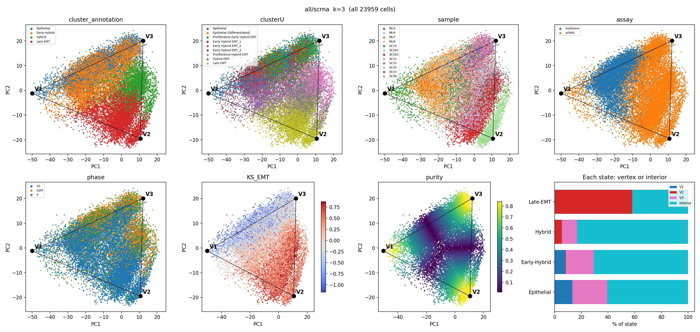

# Mouse SCC archetype analysis: full walkthrough

Written 2026-10-11, after the first complete (non-MAGIC) run of the pipeline.
It goes from the most basic idea to the deepest caveat. Read it top to bottom once;
afterwards use the section headings to jump around.

Contents
1. The question in one paragraph
2. The dataset
3. Core concepts (what each term means)
4. Decisions we made, and why
5. The pipeline: scripts, what they produce, in what order
6. Results, step by step
7. Caveats, from simple to deep
8. What is still open
9. File index

---

## 1. The question in one paragraph

Your thesis method (from the breast work) says: if cells must trade off between several
jobs ("tasks"), then in gene-expression space they fill a **simplex**: a triangle for 3
tasks, a tetrahedron for 4, and so on. The corners (**archetypes**) are the cells that
specialise in one task; cells inside are mixtures. Pérez-González et al. (2026) describe
mouse skin squamous cell carcinoma (SCC) cells moving through EMT: Epithelial, then
Early-Hybrid, Hybrid and Late-EMT. **We asked: do these cells form a simplex, and if so,
which EMT states sit at the corners and which sit inside?**

---

## 2. The dataset

| Item | Value |
|---|---|
| Source | GEO GSE288137, the authors' Seurat object |
| Cells | 23,959 (all labelled) |
| Tumours | 12. Four "MU" tumours (multiome) and eight "SC" tumours (scRNA) |
| Technologies | scRNA-seq (14,059 cells) and multiome (9,900 cells) |
| Labels from the paper | `cluster_annotation` (4 states), `clusterU` (9 finer clusters), `phase` (G1/S/G2M) |
| Genes after filtering | 14,502 (detected in ≥1% of cells; mitochondrial and ribosomal genes removed) |
| Values | log(1 + counts per 10,000) per cell |

**Two technologies, and why that matters.** scRNA-seq reads RNA from whole cells.
Multiome reads RNA from **nuclei only**. Nuclear RNA is richer in unspliced transcripts
of long genes and poorer in mitochondrial RNA. So the same cell type looks somewhat
different in the two technologies. This turns out to matter a lot (section 6).

**Tumour and state are tangled.** The MU tumours are mostly epithelial/early-hybrid;
SC2b1, SC2b3, SC35 and SC43 are 89–98% hybrid/late. So "which tumour" and "which state"
are partly the same question. Only SC15, SC32 and SC46 contain plenty of all four states.

---

## 3. Core concepts

### 3.1 PCA (principal component analysis)
Each cell is a point with 14,502 coordinates (one per gene). PCA finds the directions
along which cells differ most. PC1 is the direction of largest spread, PC2 the next
(at right angles to PC1), and so on. We keep the first few PCs and ignore the rest,
which turns "14,502 numbers per cell" into "a few numbers per cell".
"% variance" of a PC = how much of the total cell-to-cell difference it captures.

### 3.2 Simplex and archetypes
A simplex is the simplest shape with k corners: k=3 → triangle (lives in 2 dimensions),
k=4 → tetrahedron (3 dimensions). **A k-corner simplex needs only k−1 PCs.** So the k=3
fit uses only PC1 and PC2. The corners are the archetypes.

### 3.3 PCHA (the fitting algorithm)
PCHA finds k corners such that every cell is approximated as a mix of the corners, and
each corner is itself a mix of real cells (so corners stay inside the data cloud).
It starts from random positions, so we run it 15 times and keep the largest triangle.
This is the same engine (`src/archetypes.py`) as your breast work.

### 3.4 Barycentric weights, purity, specialists
Every cell gets k weights that add up to 1, e.g. (0.8, 0.1, 0.1) = "80% corner 1".
- **Purity** = largest weight − second largest.
- **Specialist**: purity ≥ 0.35 (the Pal rule). It belongs to its largest corner.
- **Interior** (generalist): purity < 0.35. A mix of corners.
- **Inside**: all weights ≥ 0. Cells outside the triangle get negative weights; we clip
  those to 0 and rescale before computing purity.

### 3.5 t-ratio
t-ratio = area (or volume) of the fitted simplex ÷ area of the data's outline (convex
hull). If the data really is a triangle, the fitted triangle fills the outline and t is
close to 1. A round or square blob gives a smaller t (a triangle inside a square covers
at most half of it).

### 3.6 Permutation test (is the shape real?)
We **shuffle** each PC separately across cells. This keeps how spread out each PC is but
destroys any shape (corners, edges). Then we refit and record the t-ratio.
Repeat 200 times. **p = fraction of shuffles that fit a triangle at least as well as the
real data** (plus a +1 correction, so the smallest possible p with 200 shuffles is
1/201 ≈ 0.005). p < 0.01 = the real data is more triangle-like than shuffled data.

### 3.7 ESV and the elbow
ESV (explained sample variance) = how much of the variance in the first 10 PCs the
simplex explains. It always rises as you add corners. The **elbow** is where the rise
flattens: more corners stop helping. It is a rule of thumb, not a test.

### 3.8 "Share of a PC explained by a factor" (eta²)
For PC1 and "tumour": compute each tumour's average PC1 value; eta² = how much of PC1's
total spread is just "which tumour the cell came from". 0 = unrelated, 1 = PC1 is purely
tumour identity.
**Within-state version**: first subtract each EMT state's average, then ask how much of
what is left is tumour. This separates "tumours differ because they contain different
states" from "tumours differ even within the same state" (the second is batch/identity).

### 3.9 Distance-bin enrichment
For each corner: sort cells by distance to it, take the closest 10%, and test which
labels are over-represented there (hypergeometric test, corrected for many tests).
"3× enriched" = the label is 3 times more common near that corner than overall.

---

## 4. Decisions we made, and why

| Decision | What we chose | Why |
|---|---|---|
| Imputation | **None** (no MAGIC) for this run | Get the honest raw shape first; MAGIC can make data look more shape-like. MAGIC is the next run. |
| Gene sets | **All 14,502 genes** (main) and **176 KS EMT genes** (comparison) | All genes = standard archetype practice. KS genes = your breast panel, but 42 of 218 genes are missing in mouse, so it is not identical to the breast panel. |
| Which cells fit the shape | **Tumour-balanced: ≤800 random cells per tumour** | A few big tumours supply most late-EMT cells; without a cap they would decide the corners. All 23,959 cells are placed in the shape afterwards. |
| Gene scaling | Centred, **not scaled** | Scaling gives noisy rare genes the same pull as strong genes (Hausser does not scale). |
| Batch correction | **None** in the main fit | We want to *see* batch effects, then test them (scRNA-only fit, leave-one-tumour-out). |
| PCA method | Exact PCA, fast method ("gram") | Same answer as full SVD (checked on this data: correlation 1.0000000) but 7× faster. Randomized PCA also matched on PCs 1–10. |
| k range | 3 to 7 | As in your breast scripts. |
| Choosing k | **Smallest k with p < 0.01, not beyond the ESV elbow** | Written in `results/PREREGISTERED_PREDICTIONS.md` before any fit, so we could not pick k after seeing results. |
| Shuffles | 200 per k, 5 PCHA starts each | Enough to reach p < 0.01; 1000 would take ~5× longer. |
| Specialist cut | purity ≥ 0.35 | Same as the Pal work, so results are comparable. |
| scRNA-only fit | Added after seeing results (not pre-registered) | One corner of the all-cells fit was made by multiome cells (section 6.3). |

---

## 5. The pipeline

All scripts are in `Mouse_SCC/codes/`, run from `Project_1/`. Outputs go to
`Mouse_SCC/results/<geneset>_<tag>/`, e.g. `all_main`, `all_scrna`, `ks_main`.

```
counts.mtx ──01──► expr_log_filtered.h5ad
                          │
                          ├─02──► pca.npz, PC diagnostics, scree.png, pc1_pc2_by_label.png
                          │          └─02b─► pc_drivers_within_state.csv
                          │
                          ├─03 (run_fits.sh)──► archetypes_k3..7.npy, null_k*.npy,
                          │                     fit_summary.csv, esv_curve.csv, fit_and_null.png
                          │
                          ├─04 (one k)──► describe_k3/: summary.md, cells_in_simplex.csv.gz,
                          │               simplex_PC1_PC2.png, marker genes, enrichment
                          │
                          └─05 (one k)──► robustness/: k3_loto.csv, k3_nophase.csv, k3_seed.csv
```

| Step | Script | Input | Main outputs | Figures |
|---|---|---|---|---|
| 1 | `01_build_anndata.py` | counts, metadata | `data/processed/expr_log_filtered.h5ad` | none |
| 2 | `02_pca.py` | h5ad | `pca.npz` (PC scores of every cell), `pc_drivers.csv`, `pc_top_genes.csv`, `pca_info.json` | `scree.png`, `pc1_pc2_by_label.png` |
| 2b | `02b_tumour_within_state.py` | `pca.npz` | `pc_drivers_within_state.csv` | none |
| 3 | `03_fit_and_test.py` via `run_fits.sh` | `pca.npz` | `archetypes_k*.npy`, `null_k*.npy`, `fit_k*.json`, `fit_summary.csv`, `esv_curve.csv` | `fit_and_null.png` |
| 4 | `04_describe_simplex.py --k 3` | `pca.npz`, archetypes, h5ad | `describe_k3/summary.md` (all tables), `cells_in_simplex.csv.gz` (weights per cell), `vertex_marker_genes.csv`, `distance_bin_enrichment.csv` | `simplex_PC1_PC2.png` (+ PC1–3, PC2–3 views for k ≥ 4) |
| 5 | `05_robustness.py --k 3 --variant ...` | h5ad, main fit | `robustness/k3_<variant>.csv` | none |

Shared code (loading, gene sets, balanced cells, PCA, weights) is in `scc_common.py`, so
every step does these things the same way. `README_pipeline.md` has the commands.

### How to read the figures

- **`scree.png`**: % variance of PCs 1–50 (log scale). Dashed line = 0.1%.
- **`pc1_pc2_by_label.png`**: fit cells on PC1 vs PC2, four panels coloured by state,
  tumour, assay and phase. A first look at what the main axes separate.
- **`fit_and_null.png`**: left, the ESV curve with the elbow; right, for each k, grey dots =
  the 200 shuffled t-ratios, red diamond = the real t-ratio. Red above the grey cloud =
  significant.
- **`simplex_PC1_PC2.png`** (the main figure), 8 panels, all 23,959 cells:
  1–5: coloured by EMT state, clusterU, tumour, assay, phase.
  6: KS EMT score (blue = epithelial genes high, red = mesenchymal genes high).
  7: purity (yellow = specialist near a corner, dark = interior mixture).
  8: bar chart, for each EMT state, % of its cells at each corner or interior.
  Black dots and lines = fitted corners (V1, V2, ...) and edges.

---

## 6. Results, step by step

### 6.1 PCA: what drives the main axes?

| Version | PC1 % var | PC2 % var | PC1 is mostly... | Tumour share of PC1 *within* a state |
|---|---|---|---|---|
| A. All genes, all cells | 9.3 | 4.8 | tumour 0.76, assay 0.54, state 0.50, % mito 0.49 | **0.49** |
| B. All genes, scRNA cells | 7.1 | 7.0 | tumour 0.49, state 0.24 (PC2: state 0.67) | **0.43** |
| C. KS genes, all cells | 26.3 | 7.4 | **state 0.81**, tumour 0.62 | **0.09** |

What this means:
- **All genes:** even among cells of the same EMT state, tumour identity explains 40–65% of
  every leading PC. Each tumour has its own transcriptional "fingerprint", about as large as EMT.
- **KS genes:** PC1 is a clean EMT axis; tumour adds little beyond state.
- The 0.1% rule kept 49 PCs (A, 31.8% of variance), 56 (B) and 108 (C). The k=3 triangle
  uses only PC1–PC2, which hold **~14% of the total variance** for all genes. The shape we
  describe lives in that slice.
- Fast and exact PCA agreed on PCs 1–10 in every version (|correlation| ≥ 0.9996).

Figures: `results/*/scree.png`, `results/*/pc1_pc2_by_label.png`.

### 6.2 Is there a real shape? (permutation tests, 200 shuffles each)

| Version | k=3 | k=4 | k=5 | k=6 | k=7 | ESV elbow | Chosen k |
|---|---|---|---|---|---|---|---|
| A. All genes, all cells | **0.005** | 0.18 | 0.07 | 0.005 | 0.005 | 4 | **3** |
| B. All genes, scRNA only | **0.005** | 0.005 | 0.005 | 0.005 | 0.005 | 4 | **3** |
| C. KS genes | 0.83 | 0.80 | 0.09 | 0.01 | 0.005 | 5 | **none** |

k=3 t-ratios: A 0.528 (shuffles: median 0.468, max 0.516); B 0.529 (median 0.466,
max 0.504); C 0.481 (median 0.496, max 0.547). In C the real data is **less**
triangle-like than a typical shuffle.

Why k=6–7 are ignored: they pass in every version, including C. With thousands of cells
and many dimensions, the shuffled data loses the small correlations real data always has,
so high k "passes" almost automatically. The pre-registered rule ignores k beyond the elbow
for this reason.

Figure: `results/*/fit_and_null.png`.

### 6.3 What sits at the corners (k = 3)

**Version A: all genes, all cells** (`all_main/describe_k3/`)

| Corner | Specialists are... | Assay | Phase | Marker genes | Tumours (≥5%) |
|---|---|---|---|---|---|
| V1 | Epithelial 36% / Early-Hybrid 63% | **79% multiome** | mostly G1 | `Camk1d`, `Pcdh7`, `Maml2`, `Magi1`, `Mast4` (long genes) | 3 (MU7 45%) |
| V2 | Epithelial 34% / Early-Hybrid 62% | 90% scRNA | **33% G2M** | `Krt14`, `Krt5`, `Krt6a`, `Krt17` (basal keratins) | 4 (SC32, SC33) |
| V3 | **Late-EMT 93%** | 100% scRNA | G1 | `Col3a1`, `Col1a1`, `Dcn`, `Postn` (collagens, ECM) | 5 |

V1 is the **nuclei corner**: the same epithelial/early-hybrid cells as V2, but measured
by multiome. Long genes like `Camk1d` are typical of nuclear RNA. **So V1 is technology,
not an EMT task.** Of all cells, 73% are inside the triangle, 40% are specialists.

**Version B: all genes, scRNA only** (`all_scrna/describe_k3/`). The cleanest version.

| Corner | Specialists are... | Phase | Marker genes | Notes |
|---|---|---|---|---|
| V1 | Epithelial / Early-Hybrid | G1 | long genes (`Camk1d`, `Pcdh7`) | 985 of its 1,372 specialists are multiome cells **projected in**; of its scRNA specialists, **94% are SC15** |
| V2 | **Late-EMT 94%** | G1 | collagens | 4 tumours |
| V3 | Early-Hybrid 58% / Epithelial 30% / Hybrid 11% | **33% G2M, 25% S** | keratins + proliferation genes (`Npm1`, `Nme2`, `H2afz`) | 6 tumours; enriched 2.9× for Proliferative Early Hybrid EMT, 2.0× for Proliferative Hybrid EMT |

The nuclei-like corner (V1) appears even though no multiome cell was used to fit the
shape. A few scRNA cells (mostly from SC15) share that profile, and the multiome cells,
when placed in afterwards, land on it.

**Version C: KS genes** (`ks_main/describe_k3/`). Corners: epithelial (86%), hybrid+late
(97%), early-hybrid (96%). It looks tidy, but the permutation test says the cloud is not
more triangle-like than shuffled data, so these corners are not evidence of a simplex.

### 6.4 Where each EMT state sits (version B, k=3)

| State | at V1 (nuclei-like) | at V2 (late EMT) | at V3 (proliferative epithelial) | interior |
|---|---|---|---|---|
| Epithelial | 13% | 0% | 26% | 61% |
| Early-Hybrid | 8% | 0% | 21% | **71%** |
| Hybrid | 0% | 5% | 11% | **83%** |
| Late-EMT | 0% | **58%** | 0% | 42% |

Reading: late-EMT cells are the clearest specialists. Hybrid and early-hybrid cells are
mostly interior mixtures, consistent with "intermediate" states sitting between corners.

### 6.5 What the k=4 fits add

- **A, k=4** (p = 0.18, not significant): corners are basal epithelial, a **cycling hybrid**
  corner (64% Proliferative Hybrid EMT, 46% G2M), late EMT, and the nuclei corner.
- **B, k=4** (p = 0.005, but beyond the k=3 choice): late EMT, nuclei-like (SC15 94% of
  scRNA specialists), epithelial/early-hybrid, and **a Hybrid corner (91% Hybrid, 44% G2M)**.
  Only 31% of cells fall inside this tetrahedron, so it fits the cloud loosely.

So the **proliferative-hybrid corner you predicted does exist as a direction in the data**,
but it only separates once a fourth corner is allowed, and k=4 is not the chosen model.

### 6.6 Robustness (version B, k=3, plus A leave-one-tumour-out)

Each check redoes the whole fit (new PCA + new PCHA) and compares cell by cell.

| Check | Refits | Cells keeping their corner | Specialists keeping their corner |
|---|---|---|---|
| B: leave one scRNA tumour out | 8 | 90–99% (lowest: without SC15) | 100% |
| B: cell cycle regressed out | 1 | 84% | 100% |
| B: different random fit cells (seeds 1, 2) | 2 | 99% | 100% |
| A: leave one tumour out | 12 | 90–99% | 100% |

- **No single tumour creates a corner.** Even without SC15, the nuclei-like corner returns.
- **The proliferative corner (V3) is not just cell cycle.** After removing cell cycle,
  V3 is still Early-Hybrid 68%, with Proliferative Early Hybrid EMT its top cluster.
- "Specialists keeping their corner = 100%" is an easy bar: it only counts cells that are
  clearly at a corner in both fits. The "all cells" number (84–99%) is the more
  informative one.

### 6.7 Scorecard against the pre-registered predictions

| Prediction (written before fitting) | Result |
|---|---|
| 1. Best k = 3 | ✅ with all genes (A and B). ❌ with KS genes (no k passes before the elbow). |
| 2. Corners: epithelial, late EMT, proliferative hybrid | Partly. Late EMT ✅. Epithelial ✅ (but it is a *proliferative* epithelial/early-hybrid corner). The third corner is nuclei-like (technical), not proliferative hybrid. |
| 3. Proliferative Hybrid EMT enriched near a corner | Partly: 2.0× near V3 at k=3, but 80% of those cells are interior. Its own corner appears only at k=4. |
| 4. Early-hybrid cells more interior than epithelial/late | ✅ 71% interior vs 61% (epithelial) and 42% (late). |
| 5. A corner may be cell cycle | ❌ for a pure cell-cycle corner: V3 survives cell-cycle removal. |
| 6. A corner may be one tumour or assay | ✅ for assay: one corner is the nuclei/multiome signal. ❌ for single tumour: every corner survives leave-one-out. |

### 6.8 Specialists by Groves' closest-5% rule (version B, k=3)

Script `06_groves_specialists.py`, output `results/all_scrna/groves5_k3/`.

**The rule, checked in the paper.** Groves 2022 uses two definitions. Figure 3E legend:
"the 5% of cells closest to each archetype" are specialists, the rest generalists.
STAR Methods: weight > 0.95 on one archetype. We use the 5% rule; distance is measured in
PC1–PC2. The 5% cut-off is set on the 14,059 scRNA cells (the fitted population), so
703 specialists per corner, 15% in total. No cell was within the cut-off of two corners.

**Where does each state go?** (rows sum to 100)

| State | V1 (nuclei-like) | V2 (late EMT) | V3 (proliferative epithelial) | generalist |
|---|---|---|---|---|
| Epithelial | 19.6 | 0 | 18.8 | 61.6 |
| Early-Hybrid | 9.0 | 0 | 11.6 | 79.4 |
| Hybrid | 0.4 | 0.3 | 0.5 | **98.8** |
| Late-EMT | 1.5 | 12.3 | 0 | 86.3 |

**What is each class made of?** (columns sum to 100; last column = overall share)

| State | V1 | V2 | V3 | generalist | all scRNA cells |
|---|---|---|---|---|---|
| Epithelial | 42.0 | 0 | 40.3 | 7.7 | 10.7 |
| Early-Hybrid | 44.2 | 0 | 57.5 | 23.1 | 24.7 |
| Hybrid | 2.0 | 1.4 | 2.3 | 28.4 | 24.4 |
| Late-EMT | 11.8 | **98.6** | 0 | 40.8 | 40.2 |

Findings:
- **Hybrid cells are almost never specialists (1.2%).** They are generalists by every
  rule. The two proliferative clusters behave differently: Proliferative Early Hybrid EMT
  makes up 58% of V3's specialists, while Proliferative Hybrid EMT is 98% generalist.
- V2's specialists are almost purely late EMT (98.6%); V3's are epithelial/early-hybrid
  and dividing (80% in S or G2M).
- **The 5% tails are each dominated by one or two tumours:** V1 82% SC15, V2 92% SC2b1,
  V3 SC33 48% + SC32 42%. The most extreme cells at each corner come from one tumour,
  the TN-0135 pattern from the Pal work. The purity-gap rule, which takes more cells per
  corner, spreads V2 and V3 over several tumours; V1 stays SC15 under both rules.
- Multiome cells placed with the same cut-offs land at V1 (49–54% of their epithelial
  and early-hybrid cells, and 41% of their late-EMT cells). Late-EMT cells at an
  "epithelial" corner support V1 being the nuclei/technology signal, not an EMT task.

**The three rules give very different numbers** (% of each state called specialist):

| State | closest 5% | weight > 0.95 | gap ≥ 0.35 |
|---|---|---|---|
| Epithelial | 38.4 | 1.7 | 71.7 |
| Early-Hybrid | 20.6 | 0.4 | 61.1 |
| Hybrid | 1.2 | 0.0 | 17.6 |
| Late-EMT | 13.7 | 1.4 | 63.5 |

The weight > 0.95 rule finds almost no specialists (0.8%), because with delta = 0 the
corners sit inside the cloud and few cells reach a 0.95 weight. All three rules agree on
the order: hybrid cells are the least specialised state.

---

## 7. Caveats, from simple to deep

1. **No imputation yet.** Raw single-cell data is noisy, which tends to blur corners
   (Groves 2022). The MAGIC run may sharpen them; it may also create shape (section 4).
2. **Only one random subsample per main fit.** Checked with seeds 1 and 2 (99% agreement),
   so this is minor.
3. **The triangle lives in PC1–PC2 only (~14% of variance for all genes).** Most
   cell-to-cell variation is outside the plane we describe.
4. **27% (A) and 22% (B) of cells sit outside the triangle.** Their weights are clipped
   to the nearest edge. Every state has cells outside (B: 20–31% of each state; A: 22–37%,
   highest for Hybrid), so the triangle is a loose outline of the cloud, not a tight fit.
   This is expected with delta = 0, where corners must stay inside the data.
5. **p = 0.005 is the floor with 200 shuffles.** It says "better than all 200 shuffles",
   not "much better". For k=3 the margin is real but modest (0.53 vs a null max of ~0.50–0.52).
6. **A significant t-ratio does not prove a Pareto front.** It shows the cloud is not a
   shuffled blob. Batch structure, tumour fingerprints or uneven sampling of states can
   also produce corners.
7. **Assay confounding.** Multiome = nuclei. One corner in A is made by this. In B the
   same direction remains because some scRNA cells (mostly SC15) share the profile.
   Not yet established: is it biology (e.g. a quiescent state rich in long-gene
   transcripts) or sample quality (e.g. SC15 has more lysed cells or ambient nuclear RNA)?
8. **Tumour fingerprints.** With all genes, tumour explains ~40–65% of each leading PC
   *within* a state. The corners survive leave-one-out, but the PCs themselves are partly
   tumour identity.
9. **Sequencing depth.** In B, PC2 correlates with log library size (R² = 0.48). PC2 also
   separates states, and depth differs between states, so the two are hard to separate.
10. **KS genes vs all genes give different answers.** KS: cleanest EMT axis but no simplex.
    All genes: a simplex, but partly shaped by technology. The two are not contradictory:
    EMT may be a continuum (a line/curve), with the triangle coming from proliferation
    and technology directions that only the full transcriptome sees.
11. **The scRNA-only fit was not pre-registered.** It was added after seeing the nuclei
    corner. It is a reasonable response, but say so when reporting it.
12. **Circularity of labels.** The paper's states were defined by clustering the same
    data (in a batch-corrected space). Finding states at corners partly re-finds the
    paper's own clustering.

---

## 8. What is still open

1. **What is the nuclei-like corner?** Next checks: regress out a long-gene/nuclear score
   and refit; compare SC15's quality metrics (genes detected, % mito) with other tumours.
2. **MAGIC version** of the same pipeline (Arm C), then compare corners with this run.
3. Optional: a batch-corrected (Harmony) version, which removes tumour fingerprints but
   may also remove biology tied to tumour.
4. Optional, later: link corners to your coworker's intrinsic-dimension scores, or SCENIC
   regulon activity along edges.

---

## 9. File index

| Path | What it is |
|---|---|
| `results/PREREGISTERED_PREDICTIONS.md` | Predictions and rules, written before fitting |
| `codes/README_pipeline.md` | Commands and short rationale |
| `results/<run>/log_*.txt` | Printed output of each step |
| `results/<run>/pca_info.json` | Fit-cell count, 0.1% PC count, PCA checks |
| `results/<run>/pc_drivers.csv`, `pc_drivers_within_state.csv` | Section 6.1 tables |
| `results/<run>/fit_summary.csv` | Section 6.2 table |
| `results/<run>/describe_k3/summary.md` | All label tables for k=3 |
| `results/<run>/describe_k3/cells_in_simplex.csv.gz` | Weights, purity, corner for every cell |
| `results/<run>/describe_k3/vertex_marker_genes.csv` | Top 30 genes per corner |
| `results/<run>/robustness/k3_*.csv` | Section 6.6 tables |

Key figures:
- 
- 
- 
- 
- 
