<div class="titlepage">
<div class="tp-kicker">Educational research report</div>
<h1 class="tp-title">Archetypes of EMT in mouse skin squamous cell carcinoma</h1>
<div class="tp-sub">A first-principles guide to the <code>Mouse_SCC</code> project: biology, data, mathematics, code, results and critical evaluation of a Pareto-simplex (archetype) analysis of 23,959 tumour cells from GEO GSE288137</div>
<div class="tp-meta">
Project folder: <code>Project_1/Mouse_SCC/</code><br>
Analysis run: 10–11 October 2026 (non-MAGIC pipeline, versions A, B, C)<br>
Report written: 11 October 2026<br>
Thesis project (IISc), cancer archetype analysis
</div>
<div class="tp-note">
Status of the evidence in this report. Every number quoted comes from a file in <code>Mouse_SCC/results/</code> or <code>Mouse_SCC/data/processed/</code>, or from a report-time check recorded in <code>REPORT_VALIDATION.md</code>. Figures whose file name begins with <code>schem_</code> are teaching illustrations built on toy data, not results. Nothing in this report has been independently reproduced by a second person or a second code base.
</div>
</div>

<div class="pagebreak"></div>

## How to read this report

This report is written for a reader who is new to the biology, the statistics and the computation involved. It is long on purpose. It is organised so that each chapter rests on the ones before it:

- **Chapters 1–3** say what question was asked, teach the biology needed to understand it, and place it in the scientific literature.
- **Chapter 4** describes the data: where it came from, what each number means, and how it was transformed.
- **Chapters 5–6** teach the mathematics (vectors, PCA, convex geometry, permutation tests) and then each method exactly as it is implemented in the code.
- **Chapter 7** walks through the code, script by script, with real excerpts.
- **Chapters 8–9** present the results, first as a summary and then figure by figure.
- **Chapters 10–13** evaluate the work critically: the choices made, their alternatives, the limitations, the robustness checks, and what it all means together.
- **Chapters 14–17** give conclusions, a glossary, a plain-language version, and practice questions for defending the work.
- **Chapter 18** and the separate `REPRODUCIBILITY_GUIDE.md` explain how to reproduce everything.

Three conventions run throughout:

1. **Evidence labels.** Claims are marked, where it matters, as an *observation* (read directly from data or output), a *computational result* (produced by an algorithm), *statistical evidence* (a test result), an *interpretation* (what we think it means), or a *hypothesis* (an idea that would need new evidence).
2. **Versions A, B and C.** The pipeline was run three ways. **A** = all 14,502 genes, shape fitted on cells from all 12 tumours. **B** = all genes, shape fitted on the 8 scRNA tumours only. **C** = 176 KS EMT genes, all 12 tumours. Results folders: `results/all_main` (A), `results/all_scrna` (B), `results/ks_main` (C).
3. **Corners are named V1, V2, V3…** by the order PCHA returned them. The same name means different things in different versions. Always read "V2 of version B", never just "V2".

Each chapter ends with a **learning checkpoint**: a few questions with answers.

<div class="pagebreak"></div>

[TOC]

<div class="pagebreak"></div>


# 1. Research motivation and question

## 1.1 The question in one sentence

**Do mouse skin squamous cell carcinoma (SCC) cells, at different stages of epithelial-to-mesenchymal transition (EMT), fill a low-dimensional simplex (a triangle, tetrahedron, …) in gene-expression space, and if they do, which EMT states sit at its corners and which sit in its interior?**

This question joins two lines of work.

- **The biology.** Pérez-González et al. (2026) profiled tumour cells from a genetically engineered mouse model of skin SCC with single-cell RNA sequencing and single-cell multiome, and described four EMT states: *Epithelial*, *Early hybrid*, *Hybrid* and *Late EMT* [1]. They deposited the processed data as GEO series GSE288137.
- **The method.** Pareto task inference ("archetype analysis") is a theory and toolkit, developed by Uri Alon's group, which says that when cells must perform several jobs ("tasks") that compete for limited resources, the best-possible compromises fill a simplex whose corners are the task specialists [5, 6, 7]. The thesis project this report belongs to applies that method to cancer data; earlier chapters of the thesis applied it to breast cancer (the "Pal" triangle) [own work].

## 1.2 Why it matters

EMT is not an on/off switch. Tumour cells take intermediate ("hybrid") states, and these states differ in how they behave: in the SCC model, hybrid states are reported to be the most metastatic and late states the most locally invasive [1, 2, 3]. Two very different pictures can describe such a population:

1. **A one-dimensional continuum.** Cells slide along a single EMT axis from epithelial to mesenchymal. Intermediate cells are just "partway along".
2. **A multi-task trade-off.** Cells balance several competing jobs (for example dividing, invading, remodelling matrix). The specialists for each job sit at corners; intermediate cells are mixtures of several jobs.

These pictures predict different geometry. A continuum is a line or curve. A trade-off between three tasks is a triangle. Archetype analysis is a way to ask which geometry the data has, to test it against a null model, and to read off what the corners are.

## 1.3 What exactly was asked in this project

The plan evolved during the work, and the final scope is narrower than the first handoff document (`Mouse_SCC/HANDOFF_EMT_ARCHETYPE.md`). That document framed the goal around a coworker's intrinsic-dimension result. **The user redirected the project** to the simpler, primary question: does the user's archetype method work on this dataset, what does the simplex look like, and how do the paper's labels sit in it? The coworker's intrinsic-dimension scores were **not** used in any analysis reported here.

Concretely, the executed work asked:

| # | Sub-question | Where answered |
|---|---|---|
| Q1 | What drives the main axes of variation in these cells: EMT, tumour identity, technology, cell cycle? | §9.1–9.3 |
| Q2 | Is there a simplex that fits better than shuffled data, and how many corners? | §9.4 |
| Q3 | What are the corners: which EMT states, genes, tumours, cell-cycle phases? | §9.5–9.7 |
| Q4 | Which EMT states are specialists and which are generalists, under different definitions? | §9.8–9.9 |
| Q5 | Do the corners survive removing a tumour, removing cell cycle, or changing the random subsample? | §9.10, Ch. 12 |
| Q6 | Is a suspicious corner (V1) biology or technology? | §9.11 |

## 1.4 Pre-registered predictions

Before any PCA or fit was run, predictions were written to `results/PREREGISTERED_PREDICTIONS.md` (timestamp 2026-10-10 21:24 IST). Writing predictions down first protects against choosing an analysis because it gave a pleasing answer. The file states: k* = 3; corners epithelial, late-EMT and a proliferative/cycling hybrid state; the `clusterU` cluster "Proliferative Hybrid EMT" enriched near the third corner; early-hybrid cells mostly interior; and two named risks (a cell-cycle corner; a tumour or assay corner).

> **A correction this report makes.** The pre-registration motivates the third corner with the paper's trajectory analysis, paraphrased as "another [branch] ending in a cycling hybrid state". The paper itself says the second Slingshot branch ends "at the hybrid EMT state" and that "no cluster was dominated by cell cycle genes" [1]. The word "cycling" was not in the paper. The prediction is still a legitimate prediction, but its stated basis was a misreading inherited from the handoff document.

## 1.5 The answer in brief

> **Revision note (12 October 2026).** After this report was first written, three follow-up analyses were run (Addendum, at the end): (1) the V1 axis was regressed out and the fit redone; (2) separate triangles were fitted inside the three mixed tumours; (3) every tumour was projected into one tumour's triangle. They **change the main conclusion**: the strong k = 3 result below was driven mostly by the technical V1 axis. Without it, the predicted epithelial / proliferating-hybrid / late-EMT triangle appears but is weak (p = 0.04); inside single tumours a triangle holds in only 1 of 3; across all 12 tumours the cells share one EMT ordering with hybrid cells in between. Read the Addendum before quoting any conclusion from Chapters 1–17. One earlier argument (`Malat1` as evidence for V1) has been withdrawn.

(Details and caveats are in Chapters 8–13.)

- With all genes, a **triangle (k = 3)** fits better than all 200 shuffled datasets (p = 0.005, the smallest value 200 shuffles can give) in both version A and version B, and it is chosen by the pre-registered rule.
- Two corners are clearly interpretable: a **late-EMT corner** (collagen and matrix genes; 94% of its specialists are late-EMT cells in version B) and a **proliferative epithelial / early-hybrid corner** (basal keratins; ~54% of its specialists in S or G2M phase in version B).
- The third corner is **not an EMT state**. It carries a "long-gene" expression profile that is high in every multiome (nuclei) sample and in two scRNA tumours (SC15, SC46), regardless of EMT state. It is best described as a technical or sample-specific axis whose origin is unresolved.
- **Hybrid cells are generalists** under every specialist definition tested.
- With the 176 KS EMT genes alone (version C), **no simplex beats shuffled data** at k = 3 or 4.
- The corners are stable to leaving out any single tumour (84–99% of cells keep their corner), but the most extreme cells at each corner come mostly from one or two tumours.

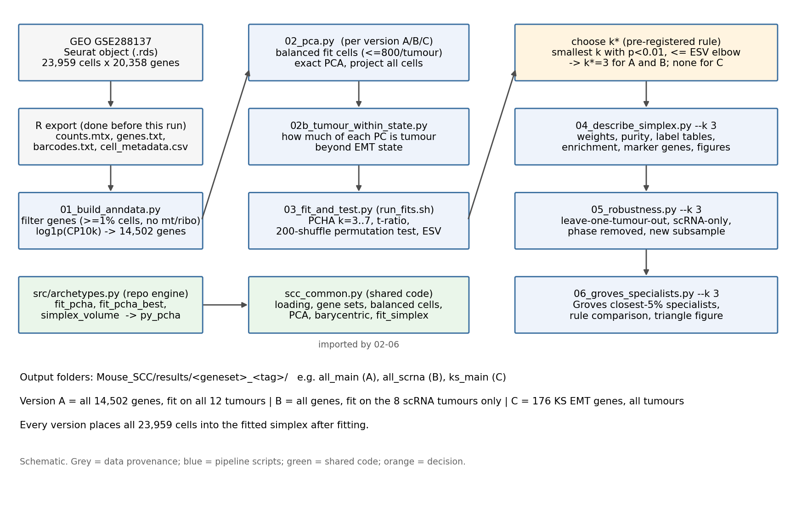
<p class="caption"><b>Figure 1. Master workflow of the Mouse_SCC pipeline (schematic).</b> Grey boxes: data provenance (done before the pipeline run). Blue: pipeline scripts in <code>Mouse_SCC/codes/</code>. Green: shared code (<code>scc_common.py</code>) and the repository's PCHA engine (<code>src/archetypes.py</code>). Orange: the decision of how many corners to keep. Each script and output is explained in Chapter 7.</p>

<div class="checkpoint">

**Learning checkpoint 1**

1. *What geometric shape would a three-task trade-off produce, and what shape would a single EMT continuum produce?* — A triangle (2-simplex) versus a line or curve.
2. *Why were predictions written down before fitting?* — So the choice of k and the interpretation could not be tuned after seeing the results.
3. *Was the coworker's intrinsic-dimension result analysed here?* — No. The project was redirected to the archetype geometry itself.

</div>

# 2. Biological foundations

This chapter teaches only the biology needed for this project, and connects each concept to the data.

## 2.1 Cells, genes and gene expression

Every cell in a mouse carries (almost) the same DNA, about 20,000 protein-coding genes. What makes a skin cell different from a liver cell, or an epithelial tumour cell different from a mesenchymal one, is **which genes are switched on, and how strongly**. A gene is "expressed" when it is copied (transcribed) into messenger RNA (mRNA), which is then translated into protein. The amount of mRNA of each gene in a cell is its **gene-expression profile**: a list of about 20,000 numbers.

*Connection to the data.* In this dataset each cell is described by counts of mRNA molecules for 20,358 genes (before filtering) and 14,502 genes (after filtering). Each cell is therefore a point in a space with 14,502 axes, one per gene. Everything in this project is geometry in that space.

## 2.2 Single-cell RNA sequencing and single-nucleus multiome

**Single-cell RNA sequencing (scRNA-seq)** measures the mRNA of thousands of individual cells at once. In the 10x Genomics Chromium method used here, each cell is captured in a tiny droplet with a bead carrying a unique **cell barcode**; every mRNA molecule copied in that droplet is tagged with that barcode and with a **unique molecular identifier (UMI)**, so molecules can be counted. The result is a **count matrix**: genes × cells, mostly zeros, because only a few thousand of a cell's mRNA molecules are captured.

**Single-cell multiome** (10x "Single Cell Multiome ATAC + Gene Expression") measures, in the same cell, both RNA and chromatin accessibility (ATAC). It must be done on **isolated nuclei**, not whole cells. The GEO record for this series confirms nuclei isolation for the multiome samples: sorted cells were lysed in a lysis buffer, washed, and "Nuclei were resuspended in nuclei buffer … and loaded on Chromium Next GEM Single Cell Multiome" chips (GSE288137 series matrix, overall design).

*Why this matters here.* RNA in a nucleus is not the same population as RNA in a whole cell. Nuclei contain newly made, partly unspliced transcripts and lack most cytoplasmic mRNA. Studies comparing matched nuclei and cells report systematic differences, including a relative excess of reads from long genes with many intronic regions in nuclear data [23]. In this project, one simplex corner turns out to track exactly such a long-gene signal (§9.11). Treat this as a known technical difference between assays, not as biology.

## 2.3 Skin squamous cell carcinoma and the LKPR mouse model

**Squamous cell carcinoma** is a cancer of keratinocytes, the flat cells that make up the outer skin (epidermis). Keratinocytes are **epithelial cells**: they sit in sheets, stick to each other through junctions (E-cadherin, `Cdh1`), and express keratins (`Krt14`, `Krt5` in the basal layer).

The tumours here come from **LKPR** mice: *Lgr5-CreER; Kras^LSL-G12D; Trp53^fl/fl; Rosa26-YFP* (GEO sample characteristics). In words:

- `Lgr5-CreER` puts an enzyme (Cre) into Lgr5-expressing hair-follicle stem cells; tamoxifen activates it.
- Cre switches on a cancer-causing mutant of `Kras` (G12D) and deletes both copies of the tumour suppressor `Trp53` (p53).
- Cre also switches on yellow fluorescent protein (YFP), so every tumour-derived cell glows and can be sorted.

Tamoxifen was given at postnatal day 28; tumours appeared after 7–9 weeks (GEO overall design). This model was characterised by Latil et al. (2017) [4] and shows **spontaneous EMT**: within one tumour, some cells stay epithelial and others become mesenchymal [1, 2].

*Connection to the data.* All cells analysed are YFP⁺, lineage-negative (CD45⁻, CD31⁻) tumour cells sorted by FACS (GEO overall design). So immune cells, blood vessels and normal skin are excluded, and differences between cells reflect tumour-cell states, tumour identity and technology.

## 2.4 Epithelial-to-mesenchymal transition (EMT)

**EMT** is a programme in which epithelial cells lose cell–cell adhesion and polarity and gain mesenchymal traits: they become motile, invasive and fibroblast-like [3, 22]. It is normal in embryonic development and wound healing, and is used by cancer cells during invasion and metastasis. It is controlled by EMT transcription factors such as `Snai1`, `Twist1`, `Zeb1`, `Zeb2` and `Prrx1` [1, 3].

Current consensus (the EMT International Association guidelines [22]) stresses that EMT is a **spectrum**: cells can sit at intermediate, "hybrid" or "partial" states, co-expressing epithelial and mesenchymal genes, and they can move back (MET). The guidelines also warn against defining EMT from one or two markers.

## 2.5 The four EMT states in this dataset

Pérez-González et al. defined the states by unsupervised clustering of the integrated single-cell data. Figure 2 summarises the marker genes they report; quotations are from their Results [1].

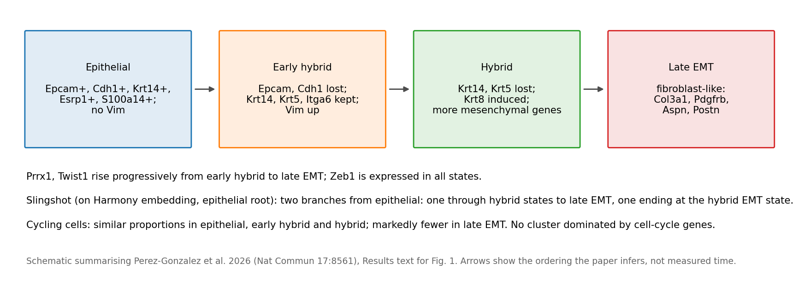
<p class="caption"><b>Figure 2. EMT states in LKPR skin SCC as described by Pérez-González et al. (2026) (schematic, from the paper's text).</b> Boxes list the marker genes reported for each state. Arrows show the ordering inferred by the authors' trajectory analysis, not measured time. The text below the boxes summarises their transcription-factor, trajectory and cell-cycle statements.</p>

| State (label in data) | Reported markers [1] | n cells here |
|---|---|---|
| Epithelial | `Epcam`⁺, `Cdh1`⁺, `Krt14`⁺, `Esrp1`⁺, `S100a14`⁺; no `Vim`; includes a small more-differentiated squamous subpopulation | 4,146 |
| Early-Hybrid | `Epcam`, `Cdh1` lost; `Krt14`, `Krt5`, `Itga6` retained; `Vim` up | 9,985 |
| Hybrid | `Krt14`, `Krt5` lost; `Krt8` induced (a simple-epithelium keratin); more mesenchymal genes | 3,608 |
| Late-EMT | fibroblast-like: `Col3a1`, `Pdgfrb`, `Aspn`, `Postn` | 6,220 |

The data also carry a finer label, `clusterU`, with nine groups (Epithelial; Epithelial (Differentiated); Proliferative Early Hybrid EMT; Early Hybrid EMT_1, _2, _3; Proliferative Hybrid EMT; Hybrid EMT; Late EMT). These names come from the deposited object. The paper's text describes two early-hybrid substates, "EMT-I" and "EMT-II" [1]; **how `Early Hybrid EMT_1/2/3` map to EMT-I/II was not verified** and should not be assumed.

## 2.6 Distinguishing four kinds of statement

This project, like most single-cell work, mixes four kinds of statement that are easy to confuse:

| Kind | Example | What establishes it |
|---|---|---|
| **Expression pattern** | "Late-EMT cells express more `Col3a1`." | Counting mRNA. Direct observation (with measurement noise). |
| **Inferred state** | "This cell is in the Hybrid state." | A clustering algorithm grouped similar cells and a person named the group. Depends on algorithm, parameters and markers. |
| **Temporal transition** | "Cells go epithelial → early hybrid → hybrid → late." | Needs time: lineage tracing, live imaging, time courses. Trajectory algorithms (Slingshot) *propose* an order from snapshot similarity; they do not observe time. |
| **Mechanism** | "Klf5 drives early EMT." | Needs intervention: knockouts, rescue. The paper did CRISPR loss-of-function experiments for this [1]. |

**Archetype analysis produces geometric statements about expression patterns.** It can say "these cells are extreme along this direction". It cannot by itself say that cells move between corners, nor that a corner's genes cause anything.

## 2.7 Cell cycle and proliferation

Dividing cells pass through phases: G1 (growth), S (DNA synthesis) and G2/M (preparation for and execution of division). Each phase has characteristic gene expression, so cell-cycle phase is a large source of variation in single-cell data. The data include a `phase` label (G1 14,966; S 4,355; G2M 4,638 cells), computed by the authors with a standard scoring method (the exact method for this column was not documented in the object and was not verified).

The paper reports that cycling cells occur "at similar proportions in epithelial, early hybrid, and hybrid EMT states, but were markedly reduced in late EMT" [1]. This matters because a "proliferative" corner could be a cell-cycle signal rather than an EMT state. Hausser et al. treat cell division as one of the universal tasks of cancer cells [7], so a proliferation corner is not necessarily an artefact; it is a different kind of corner from an EMT state.

## 2.8 Tumours as the unit of biology

Each tumour arose independently, so each has its own mutations, history and microenvironment. Cells from one tumour are not independent replicates: they share all of that. The **unit of biological replication is the tumour** (n = 12 here), not the cell (n = 23,959). Treating cells as independent is called **pseudoreplication** and produces over-confident statistics [24]. This idea returns repeatedly: a corner made of cells from one tumour is one observation, not hundreds.

<div class="checkpoint">

**Learning checkpoint 2**

1. *Why do multiome profiles differ from scRNA profiles of the same cell type?* — Multiome measures RNA from isolated nuclei, which differs from whole-cell RNA (more unspliced and long-gene transcripts, little cytoplasmic mRNA).
2. *What does a trajectory algorithm such as Slingshot establish?* — A proposed ordering of states based on similarity in a snapshot; not observed time and not mechanism.
3. *Why is n = 12, not n = 23,959, the right sample size for many questions here?* — Cells from one tumour share its history and are not independent replicates.
4. *Which keratins distinguish early-hybrid from hybrid cells?* — Early-hybrid cells keep `Krt14`/`Krt5`; hybrid cells lose them and gain `Krt8`.

</div>


# 3. Relevant scientific literature

This chapter places the project in what is already known. It is selective: only work that the project builds on or tests against.

## 3.1 EMT states in skin SCC

- **Pastushenko et al. 2018** [2] identified, in the same family of mouse skin SCC models, a series of tumour "transition states" along EMT using surface markers, and showed that they differ in invasiveness, metastatic potential and plasticity. This established the idea that EMT in these tumours is a set of discrete-but-connected states rather than one switch.
- **Pastushenko & Blanpain 2019** [3] reviewed EMT transition states and their functional differences.
- **Latil et al. 2017** [4] described the LKPR model and showed that the cell of origin primes tumours for EMT through chromatin states.
- **Pérez-González et al. 2026** [1] is the source of this dataset. Key points verified against the paper:
  - "In total, 54,081 YFP+ tumor cells passed quality controls across datasets"; unsupervised clustering identified four EMT states.
  - Methods: nine scRNA-seq datasets and four Multiome samples were integrated; cells kept if >700 genes, <20% mitochondrial and <30% ribosomal counts; ambient RNA removed with SoupX [28]; doublets removed with scDblFinder [29]; integration with scVI/scANVI [17]; tumour cells subclustered with PCA + Harmony [16] and Leiden clustering.
  - Slingshot [18] on Harmony embeddings, rooted at the epithelial cluster: two branches, one through hybrid states to late EMT, one ending at the hybrid EMT state.
  - SCENIC regulon analysis [27] and CRISPR loss-of-function experiments: `Klf5` and `Pitx1` control early EMT and are needed for metastasis; `Nfatc1` and `Creb3l1` act later.

**What the paper does not do:** it does not test whether the states form a simplex or a continuum, and it does not ask which states are "specialists". That is the gap this project addresses.

## 3.2 Pareto task inference (archetype analysis in biology)

- **Shoval et al. 2012** [5] argued that when an organism must perform several tasks and no phenotype is best at all of them, natural selection pushes phenotypes onto the **Pareto front**: the set of phenotypes that cannot be improved at one task without getting worse at another. Under simple assumptions (performance falls with distance from each task's optimum), the Pareto front is the **polytope (simplex) whose corners are the task optima** (archetypes): a line for two tasks, a triangle for three, a tetrahedron for four.
- **Hart et al. 2015** [6] turned this into a data-analysis method, **ParTI** (Pareto Task Inference): fit a simplex with archetypal analysis, test it with a **t-ratio permutation test**, and find the corners' tasks by **enrichment** of genes and features near each corner.
- **Korem et al. 2015** [10] applied the idea to single cells, showing single-cell expression can fill a simplex.
- **Hausser et al. 2019** [7] applied ParTI to thousands of tumours and found five universal cancer tasks (e.g. cell division, biomass and energy, lipogenesis, immune interaction, invasion and tissue remodelling). Tumours closer to a corner are specialists at that task.
- **Groves et al. 2022** [8] applied it to small cell lung cancer, including single-cell data. Two details matter for this project:
  - they **imputed** single-cell data with MAGIC [14] before fitting, noting that raw single-cell data is dominated by noise;
  - they defined single-cell specialists in two ways: in their Figure 3E, "the 5% of cells closest to each archetype"; in STAR Methods, cells with "a score above 0.95 for a single archetype" (verified in the paper text).
- **Blais & Jeukens 2024** [9] applied Pareto task inference to diffuse large B-cell lymphoma transcriptomes.

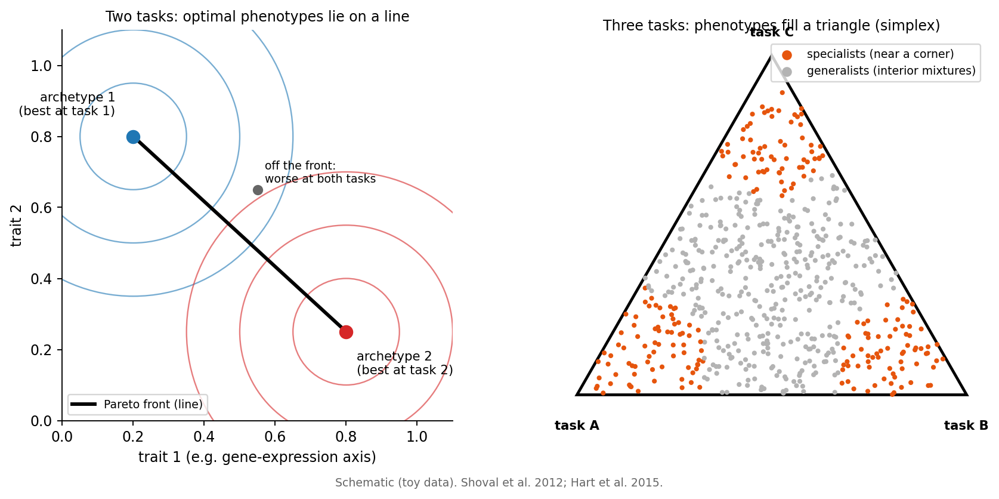
<p class="caption"><b>Figure 3. The Pareto-front idea (schematic, toy data).</b> Left: with two tasks, each task has an optimal phenotype (archetype; circles are performance contours). The best compromises lie on the straight line between the archetypes; a phenotype off the line (grey) is worse at both tasks than some phenotype on the line. Right: with three tasks, the best compromises fill a triangle. Cells near a corner are specialists (orange; here purity gap ≥ 0.35), cells inside are generalists (grey).</p>

## 3.3 Archetypal analysis as a statistical method

Separately from the biology, **archetypal analysis** is a statistical technique introduced by **Cutler & Breiman 1994** [11]: represent every data point as a convex mixture of a few "archetypes", which are themselves convex mixtures of data points. **Mørup & Hansen 2012** [12] gave the fast algorithm **PCHA** (Principal Convex Hull Analysis) used in this project through the Python package `py_pcha`.

Important distinction: archetypal analysis will *always* return k archetypes for any data, including a featureless blob. Whether those archetypes mean anything is a separate question, which is why ParTI adds a statistical test (§6.5).

## 3.4 EMT gene signatures

The **KS gene list** used in version C comes from **Tan et al. 2014** [13], who derived epithelial and mesenchymal gene signatures (from cell lines) and an EMT score using a two-sample Kolmogorov–Smirnov (KS) statistic, hence "KS". The repository file is `Breast Cancer/data/processed/ks_cellline_signature_tan2014.csv` (218 human genes: 170 epithelial and 48 mesenchymal by the file's `category` column; see §4.6 for the mouse mapping).

## 3.5 Prior work within this thesis

The thesis applied the same engine to breast cancer single-cell data (the "Pal" dataset), where a "hybrid" corner turned out to be a single patient (TN-0135). That lesson, that **a corner can be one patient or one tumour**, shaped several design choices here (tumour-balanced fitting, leave-one-tumour-out). The breast work itself is outside this report's scope and was not re-verified.

## 3.6 The research gap

Putting this together: the EMT states of LKPR SCC are well described as clusters and as a branching trajectory, but nobody has asked whether they fill a **task simplex**, which states are **specialists** versus **generalists**, or whether the geometry is driven by EMT or by other axes (proliferation, tumour identity, technology). The single-cell Pareto literature also gives a methodological warning that applies directly: single-cell geometry can be dominated by noise and batch [8].

<div class="checkpoint">

**Learning checkpoint 3**

1. *What does Pareto theory predict about the shape of optimal phenotypes for three tasks?* — A triangle whose corners are the three task optima.
2. *Why is a statistical test needed on top of archetypal analysis?* — The algorithm always returns k corners, even for data with no simplex shape.
3. *What are Groves' two specialist definitions?* — Closest 5% of cells to each archetype (Fig. 3E), and weight > 0.95 on one archetype (STAR Methods).

</div>

# 4. Dataset and data preprocessing

## 4.1 Provenance

| Step | What | Evidence |
|---|---|---|
| Download | GEO series GSE288137, files from the NCBI FTP tree on 2026-10-09 | `data/raw/DOWNLOAD_LOG.md` (sha256 checksums recorded) |
| Object | `GSE288137_SCO.rds.gz` (743 MB), a Seurat object; GEO calls it Scanpy-processed data in Seurat format. Unpacked to `GSE288137_SCO_unpacked.rds` (3.0 GB) | `DOWNLOAD_LOG.md`; file on disk |
| Unused | `GSE288137_RAW.tar` holds a breast sample and PDX files, not the mouse SCC libraries | `DOWNLOAD_LOG.md` |
| R export | Counts, gene names, barcodes, metadata and three embeddings written to plain files | files in `data/processed/` (the R commands are **not** saved in the project; see §4.8) |

The 12 mouse SCC libraries have **no per-sample count matrices on GEO**; the Seurat object is the only processed source. GEO titles the samples SC1–SC8 and MU1–MU4, with library names `sc2b1, sc2b3, sc15, sc32, sc33, sc35, sc43, sc46, mu3, mu4, mu7, mu8`. The object uses the library names (SC2b1, …, MU8), and this report does too.

## 4.2 What one row and one column mean

After export the data are a **count matrix** with 20,358 genes and 23,959 cells (`counts.mtx`, MatrixMarket format, genes × cells), plus metadata.

- **Observation (row of the analysis matrix) = one cell** (or one nucleus, for multiome), identified by its barcode.
- **Feature (column) = one gene.** The value is the number of UMIs (mRNA molecules) of that gene captured in that cell. All values are whole numbers (checked during export, per the handoff record).

## 4.3 Metadata columns (`cell_metadata.csv`)

| Column | Meaning | Values (verified) |
|---|---|---|
| `barcode` | cell identifier | 23,959 unique |
| `sample` | tumour/library | 12 tumours (Table below) |
| `assay` | technology | scRNA 14,059; multiome 9,900 |
| `cluster_annotation` | paper's EMT state | Epithelial 4,146; Early-Hybrid 9,985; Hybrid 3,608; Late-EMT 6,220 |
| `clusterU` | finer cluster | 9 groups (§2.5) |
| `phase` | cell-cycle phase | G1 14,966; S 4,355; G2M 4,638 |
| `nCount_RNA` | total UMIs per cell (sequencing depth) | median scRNA 22,873; multiome 10,014 |
| `nFeature_RNA` | genes detected per cell | median scRNA 4,684; multiome 3,326 |
| `pct_counts_mt` | % UMIs from mitochondrial genes | median scRNA 4.6%; multiome 13.4% |
| `pct_counts_ribo` | % UMIs from ribosomal-protein genes | median scRNA 18.0%; multiome 10.7% |
| `LKPR_*_andrea` (4) | authors' state signature scores | continuous; exact definition not documented in the object |

> **Correction to an earlier project note.** `WALKTHROUGH.md` (written during the run) states that nuclear RNA is "poorer in mitochondrial RNA". In this dataset the multiome cells have a **higher** median % mitochondrial counts (13.4% vs 4.6%). The general expectation does not hold here; why is unknown (possibly how mitochondrial genes were counted in the multiome processing). The report does not rely on mitochondrial fraction to identify nuclei.

## 4.4 Tumour, assay and state are tangled

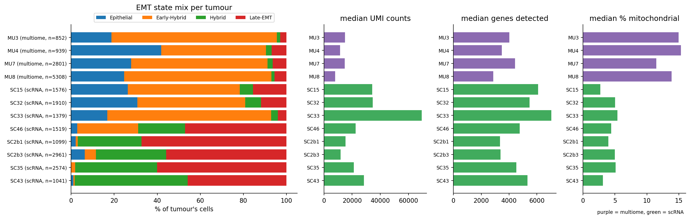
<p class="caption"><b>Figure 4. Composition and quality of each tumour (empirical; from <code>cell_metadata.csv</code>).</b> Left: percentage of each tumour's cells in each EMT state, with assay and cell count in the label. Right three panels: median UMI counts, genes detected and % mitochondrial counts per tumour (purple = multiome, green = scRNA). Generated by <code>make_report_figures.py::emp_data</code>.</p>

| Tumour | Assay | Cells | Epi | Early-Hyb | Hybrid | Late |
|---|---|---|---|---|---|---|
| MU3 | multiome | 852 | 160 | 654 | 13 | 25 |
| MU4 | multiome | 939 | 393 | 457 | 25 | 64 |
| MU7 | multiome | 2,801 | 782 | 1,774 | 65 | 180 |
| MU8 | multiome | 5,308 | 1,307 | 3,629 | 77 | 295 |
| SC15 | scRNA | 1,576 | 416 | 818 | 98 | 244 |
| SC2b1 | scRNA | 1,099 | 23 | 11 | 326 | 739 |
| SC2b3 | scRNA | 2,961 | 187 | 155 | 965 | 1,654 |
| SC32 | scRNA | 1,910 | 589 | 956 | 139 | 226 |
| SC33 | scRNA | 1,379 | 232 | 1,049 | 43 | 55 |
| SC35 | scRNA | 2,574 | 2 | 46 | 981 | 1,545 |
| SC43 | scRNA | 1,041 | 11 | 6 | 546 | 478 |
| SC46 | scRNA | 1,519 | 44 | 430 | 330 | 715 |

*Observations.* Every tumour has exactly one assay. The four multiome tumours are 90–96% epithelial/early-hybrid. Four scRNA tumours (SC2b1, SC2b3, SC35, SC43) are 88–98% hybrid/late. Four tumours (SC2b3, SC35, SC46, SC2b1) supply 75% of late-EMT cells. Sequencing depth varies 9-fold between tumours (median UMIs 7,989 in MU8 to 69,517 in SC33).

*Why it matters.* When three factors move together, an axis of variation that separates them can be called "EMT", "tumour" or "technology" with equal justice. Figure 5 shows the logic. Much of the design (tumour balancing, within-state diagnostics, scRNA-only fit, leave-one-out) exists to pull these apart as far as the design allows.

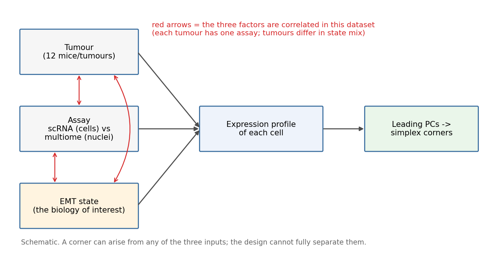
<p class="caption"><b>Figure 5. Why confounding matters (schematic).</b> Tumour, assay and EMT state all shape each cell's expression profile, and in this dataset they are correlated with one another (red arrows). The PCs and the simplex corners are computed from the profiles, so a corner can be produced by any of the three.</p>

## 4.5 Script 01: from counts to the analysis matrix

`codes/01_build_anndata.py` reads the exported files, checks them and writes `data/processed/expr_log_filtered.h5ad`. The essential lines (actual code):

```python
m = scipy.io.mmread(P + "counts.mtx").tocsr()          # genes x cells
...
assert m.shape == (len(genes), len(barcodes)), "matrix shape does not match gene/barcode lists"
assert list(meta.index) == barcodes, "metadata order does not match barcodes"
assert len(set(barcodes)) == len(barcodes), "duplicate barcodes"
adata = ad.AnnData(X=m.T.tocsr().astype(np.float32), obs=meta, var=pd.DataFrame(index=genes))
adata.layers["counts"] = adata.X.copy()
det = np.asarray((adata.X > 0).sum(0)).ravel() >= 0.01 * adata.n_obs
bad = adata.var_names.str.match(r"^(mt-|Mt-)") | adata.var_names.str.match(r"^(Rpl|Rps|Mrpl|Mrps)\d")
keep = det & ~np.asarray(bad)
adata = adata[:, keep].copy()
sc.pp.normalize_total(adata, target_sum=1e4)
sc.pp.log1p(adata)
```

Step by step:

1. **Read and transpose.** The file is genes × cells; `AnnData` wants cells × genes, so `.T`. `csr` is a compressed sparse format that stores only non-zero values (most counts are 0).
2. **Three assertions** stop the script if the matrix, gene list, barcode list and metadata are misaligned. A silent misalignment would attach the wrong labels to cells and corrupt every downstream result.
3. **Gene filter 1, detection:** keep genes detected (count > 0) in at least 1% of cells (≥ 240 cells). 14,689 genes pass (from the run log recorded in the handoff; the final count 14,502 was verified on the h5ad). *Why:* genes almost never detected add noise and no shared structure.
4. **Gene filter 2, mitochondrial and ribosomal genes removed** (187 genes among the detected ones). *Why:* their levels reflect cell stress, size and capture efficiency more than state, and they differ strongly between assays.
5. **Normalise and log-transform** (§4.7).

> **A small discrepancy in the gene filter.** The ribosomal pattern `^(Rpl|Rps|Mrpl|Mrps)\d` requires a digit immediately after the prefix, so `Rplp0`, `Rplp1`, `Rplp2` and `Rpsa` (ribosomal-protein genes) were **not** removed. They remain among the 14,502 genes (verified). The effect is probably small, but the filter does not do exactly what its comment says.

The handoff document describes an "arm A" that would keep mitochondrial/ribosomal genes, because Hausser's "biomass and energy" task is built partly from such genes [7]. **Arm A was not built.** All three versions use the filtered matrix.

## 4.6 Version C: the KS gene set in mouse

`scc_common.ks_genes_mouse` maps human symbols to mouse by capitalisation (`CDH1` → `Cdh1`):

```python
mouse = s["gene_symbol"].str[0] + s["gene_symbol"].str[1:].str.lower()
```

Of 218 genes, 195 have a matching name in the 20,358 raw genes and **176** survive the 1% filter (131 epithelial, 45 mesenchymal). Names that do not map include `FOXA1`, `S100P`, `CEACAM6` and several `C*orf*` genes. Capitalisation is a crude ortholog mapping: it works for most one-to-one orthologs but misses genes with different mouse names and cannot handle one-to-many orthologs. A proper ortholog table (e.g. from Ensembl/MGI) would be more rigorous.

## 4.7 Normalisation and log transform, with a toy example

Cells are captured with different efficiency, so raw counts are not comparable between cells. Two steps fix this.

**Counts per 10,000 (CP10k).** For cell $i$ and gene $g$ with count $c_{ig}$ and total $N_i = \sum_g c_{ig}$:

$$\tilde{x}_{ig} = \frac{c_{ig}}{N_i}\times 10^4 \qquad\text{(Eq. 1)}$$

**Log transform.** $x_{ig} = \ln(1 + \tilde{x}_{ig})$ (Eq. 2). The log compresses the huge range of expression so that a few very highly expressed genes do not dominate distances, and roughly stabilises variance. The +1 avoids $\ln 0$.

*Toy example.* Cell A has 20,000 UMIs, 40 of gene X; cell B has 5,000 UMIs, 10 of gene X. Raw counts differ 4-fold. CP10k: A = 40/20,000 × 10⁴ = 20; B = 10/5,000 × 10⁴ = 20. Same. Log: ln 21 ≈ 3.04 for both.

*Caveats.* CP10k assumes each cell's total mRNA is comparable, which is not true for nuclei vs whole cells. Library-size normalisation does not remove all depth effects: in version B, PC2 still correlates with log depth (R² = 0.48; §9.3). Alternatives include scran pooling size factors, SCTransform (regularised negative binomial residuals) and analytic Pearson residuals; each could change the leading PCs.

## 4.8 What was not verified about the data

- The R commands that exported `counts.mtx` and the metadata are **not saved** in the project. Their correctness rests on the checks in script 01 (shape and order assertions) and the handoff record that counts are integers. The exported tumour × state table matches the coworker's table exactly (handoff record; not re-checked here).
- **Why the object has 23,959 cells while the paper reports 54,081 tumour cells** is unknown. The object could be a subset (e.g. one integration subset). The paper's Methods mention "three primary skin SCCs" for multiome, while the object has four multiome samples (MU3, MU4, MU7, MU8). Also unexplained.
- The authors' QC (SoupX, scDblFinder) was not repeated, by design.

<div class="checkpoint">

**Learning checkpoint 4**

1. *Why is every tumour × assay combination a problem for interpretation?* — Each tumour has one assay, so tumour and assay effects cannot be fully separated; state mixes also differ by tumour.
2. *What does CP10k + log do, and why?* — Divides by each cell's total to remove capture differences, scales to 10,000, then log(1+x) compresses the range.
3. *Which ribosomal genes escaped the filter, and why?* — `Rplp0/1/2`, `Rpsa`: the regex requires a digit right after `Rpl`/`Rps`.
4. *How many KS genes were usable in mouse?* — 176 (131 epithelial, 45 mesenchymal).

</div>


# 5. Mathematical and statistical foundations

This chapter teaches the mathematics from scratch, with toy examples. Chapter 6 then applies each idea to the actual implementation.

## 5.1 Cells as vectors, data as a matrix

A cell with expression values for $G$ genes is a **vector** $\mathbf{x} = (x_1, x_2, \dots, x_G)$, a point in $G$-dimensional space. Stacking $n$ cells as rows gives the **data matrix** $X$ with shape $n \times G$ (cells × genes). In version A the fit matrix is $9{,}600 \times 14{,}502$.

**Distance** between two cells is the Euclidean distance $\lVert \mathbf{x} - \mathbf{y}\rVert = \sqrt{\sum_g (x_g - y_g)^2}$. Every geometric statement in this project ("near a corner", "inside the triangle") uses this distance, after PCA.

**Centring.** Subtract each gene's mean over cells: $X_c = X - \mathbf{1}\bar{\mathbf{x}}^\top$. After centring, the origin is the "average cell".

**Variance** of gene $g$: $\frac{1}{n-1}\sum_i (x_{ig}-\bar{x}_g)^2$. **Total variance** = sum over genes = $\frac{1}{n-1}\lVert X_c\rVert_F^2$, where $\lVert\cdot\rVert_F$ (Frobenius norm) is the square root of the sum of all squared entries.

## 5.2 Principal component analysis (PCA)

**Problem.** 14,502 dimensions are too many to see, and most directions carry mostly noise. We want a few directions that capture most of the cell-to-cell differences.

**Idea.** Find the unit direction $\mathbf{v}_1$ along which the cells' projections have the largest variance (PC1); then the direction $\mathbf{v}_2$, perpendicular to $\mathbf{v}_1$, with the next largest variance (PC2); and so on (Figure 6).

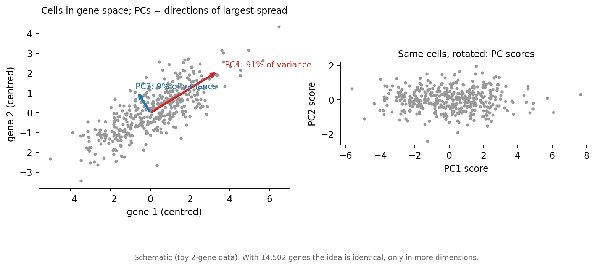
<p class="caption"><b>Figure 6. PCA on toy two-gene data (schematic).</b> Left: cells in gene space with the two principal directions (arrows; length ∝ standard deviation). Right: the same cells expressed in PC coordinates, which is just a rotation. With 14,502 genes the operation is the same, in more dimensions.</p>

**Formulation (singular value decomposition, SVD).** Any centred matrix can be written

$$X_c = U\,\Sigma\,V^\top \qquad\text{(Eq. 3)}$$

- $V$ ($G \times r$): columns are the **loadings** (directions) $\mathbf{v}_j$. Each is a weighting of genes.
- $\Sigma$: diagonal, singular values $s_1 \ge s_2 \ge \dots \ge 0$.
- $U\Sigma$ ($n \times r$): the **scores**, i.e. each cell's coordinate along each PC.
- Variance of PC $j$: $\lambda_j = s_j^2/(n-1)$. **Explained variance ratio** $= s_j^2 / \sum_k s_k^2 = s_j^2/\lVert X_c\rVert_F^2$.

**Projecting new cells.** A cell $\mathbf{x}$ that was not used to fit the PCA gets scores $(\mathbf{x}-\bar{\mathbf{x}})V$, using the fit cells' mean $\bar{\mathbf{x}}$. This is how all 23,959 cells are placed even though only ~9,600 cells define the PCs.

**The "gram" shortcut (used in this project).** The matrix $G = X_c X_c^\top$ ($n\times n$, cells × cells) has eigenvectors $U$ and eigenvalues $s_j^2$, because $X_cX_c^\top = U\Sigma^2U^\top$. So the top PCs can be obtained from the top eigenvectors of $G$, then $V^\top = \Sigma^{-1}U^\top X_c$. With $n = 9{,}600 < G = 14{,}502$, computing only the top 200 eigenpairs of $G$ is much faster than a full SVD and gives the same PCs.

**Assumptions and limits.** PCA finds *linear* directions of *maximum variance*. Large variance is not the same as biological importance: a batch effect with big variance will be PC1. PCA is sensitive to scaling: unscaled data let highly variable genes dominate.

**Sign.** A PC direction and its negative are equally valid; the code fixes the sign so the largest-magnitude loading is positive, so reruns give the same orientation.

## 5.3 Convex combinations, convex hulls and simplices

A **convex combination** of points $\mathbf{a}_1,\dots,\mathbf{a}_k$ is $\sum_j w_j \mathbf{a}_j$ with all $w_j \ge 0$ and $\sum_j w_j = 1$. It always lies "between" the points.

The **convex hull** of a data cloud is the smallest convex shape containing all points: the shape a rubber band would make around them. Its volume (area in 2-D) is computed in this project by the Qhull library [31] via `scipy.spatial.ConvexHull`.

A **simplex** with $k$ vertices is the set of all convex combinations of $k$ points in $k-1$ dimensions: $k=2$ a segment, $k=3$ a triangle, $k=4$ a tetrahedron. It needs exactly $k-1$ dimensions, which is why **a k-corner fit uses only the first k−1 PCs**.

**Volume of a simplex** with vertices $\mathbf{a}_1,\dots,\mathbf{a}_k$ in $k-1$ dimensions:

$$\text{vol} = \frac{1}{(k-1)!}\,\Big|\det\big[\mathbf{a}_1-\mathbf{a}_k,\ \dots,\ \mathbf{a}_{k-1}-\mathbf{a}_k\big]\Big| \qquad\text{(Eq. 4)}$$

For a triangle this is the familiar ½ |base × height|. This is exactly `simplex_volume` in `src/archetypes.py`.

## 5.4 Barycentric coordinates

Given a simplex with corners $\mathbf{a}_1..\mathbf{a}_k$ in $k-1$ dimensions, **any** point $\mathbf{p}$ in that space can be written uniquely as

$$\mathbf{p} = \sum_{j=1}^k w_j \mathbf{a}_j,\qquad \sum_j w_j = 1 \qquad\text{(Eq. 5)}$$

The $w_j$ are the point's **barycentric coordinates** (weights). Inside the simplex all $w_j \ge 0$; outside, at least one is negative. Writing Eq. 5 as a square linear system:

$$\begin{bmatrix} \mathbf{a}_1 & \cdots & \mathbf{a}_k \\ 1 & \cdots & 1 \end{bmatrix}\mathbf{w} = \begin{bmatrix}\mathbf{p}\\ 1\end{bmatrix} \qquad\text{(Eq. 6)}$$

which `scc_common.barycentric` solves with `np.linalg.solve`.

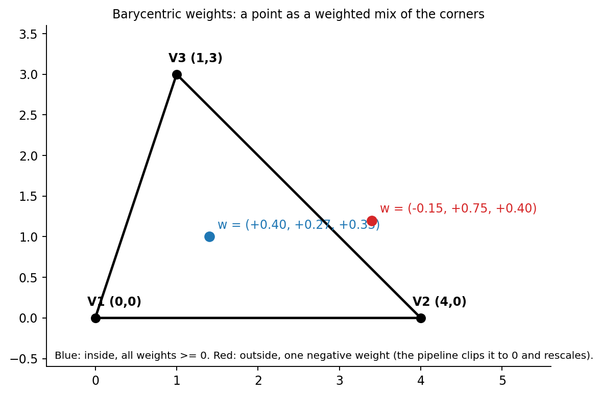
<p class="caption"><b>Figure 7. Barycentric weights (schematic, exact numbers).</b> Triangle V1 = (0,0), V2 = (4,0), V3 = (1,3). The blue point (1.4, 1.0) has weights (0.40, 0.27, 0.33): check 0.40·(0,0) + 0.27·(4,0) + 0.33·(1,3) ≈ (1.4, 1.0). The red point (3.4, 1.2) lies outside and has weights (−0.15, 0.75, 0.40).</p>

*Worked check for the blue point.* With $w = (0.4, 0.2667, 0.3333)$: $x = 0.2667\cdot 4 + 0.3333\cdot 1 = 1.4$; $y = 0.3333\cdot 3 = 1.0$; weights sum to 1. ✓

**Interpretation in this project.** A cell with weights (0.8, 0.1, 0.1) is "80% corner 1". Biologically, Pareto theory reads this as the cell performing mostly task 1. That reading is an interpretation, not something the arithmetic proves.

## 5.5 Specialists, generalists and purity

The pipeline turns weights into categories:

1. **Clip and renormalise:** negative weights set to 0, then divide by the sum (`composition`). Toy red point: (−0.15, 0.75, 0.40) → (0, 0.65, 0.35).
2. **Purity** = largest weight − second largest. Red point: 0.65 − 0.35 = 0.30.
3. **Specialist** if purity ≥ 0.35 (the thesis's "gap" rule); otherwise **interior/generalist**. The red point is a generalist under this rule; the blue point (0.40 − 0.33 = 0.07) is too.

Two other rules are used (Groves [8]): **closest 5%** of cells to each corner (by Euclidean distance) and **weight > 0.95**. They answer slightly different questions (§6.10) and give very different numbers.

## 5.6 Explained variance of a model

If a model approximates data $X$ by $\hat{X}$, the **sum of squared errors** is $\text{SSE}=\lVert X-\hat{X}\rVert_F^2$ and the **total sum of squares** $\text{SST}=\lVert X\rVert_F^2$ (for centred $X$). **Explained variance** $= (\text{SST}-\text{SSE})/\text{SST}$. In archetype analysis this is called **ESV** (explained sample variance). It always grows with more corners, so it cannot by itself choose $k$.

## 5.7 Share of variance explained by a grouping (η²)

For a numeric variable $y$ (e.g. PC1 scores) and a grouping (e.g. tumour) with groups $g$, sizes $n_g$ and means $\bar y_g$:

$$\eta^2 = \frac{\sum_g n_g(\bar y_g - \bar y)^2}{\sum_i (y_i-\bar y)^2} \qquad\text{(Eq. 7)}$$

$\eta^2$ = fraction of $y$'s variance that is "just which group the cell is in". It is the $R^2$ of a one-way ANOVA. For a numeric covariate (log depth, % mito) the code uses the squared Pearson correlation $r^2$ instead.

**Within-state version.** First replace $y$ by residuals $y_i - \bar y_{\text{state}(i)}$, then compute $\eta^2$ for tumour. This asks: once EMT state is accounted for, how much of what remains is tumour identity?

## 5.8 Permutation tests

**Problem.** We computed a statistic (the t-ratio) on real data and want to know whether it is unusually large compared with data that have "no structure".

**Recipe.**

1. Define a **null model**: a way to generate datasets with the property we want to rule out. Here: shuffle each PC column independently across cells. This keeps each PC's distribution (spread, skew) but destroys the joint structure (corners, edges).
2. Compute the statistic on many null datasets (here 200).
3. **p-value** = fraction of null statistics at least as extreme as the observed one, with a +1 correction [19]:

$$p = \frac{1 + \#\{\text{null} \ge \text{observed}\}}{1 + N_{\text{null}}} \qquad\text{(Eq. 8)}$$

With 200 shuffles the smallest possible p is 1/201 ≈ 0.005. The +1 counts the observed data as one possible draw from the null, which keeps the test valid and prevents p = 0.

**What a small p means.** Only that the real data are more extreme than the specific null. It does not say the alternative you have in mind (a Pareto front) is true; any structure that the null destroys (batch clusters, tumour fingerprints, correlation between PCs' tails) can produce a small p.

## 5.9 Enrichment tests: hypergeometric and false discovery rate

**Question.** Among the 10% of cells closest to a corner, are late-EMT cells over-represented?

With $N$ cells in total, $K$ of them late-EMT, and a bin of $n$ cells containing $k$ late-EMT cells, under random sampling without replacement $k$ follows a **hypergeometric distribution**. The p-value is $P(X \ge k)$. **Fold enrichment** = $(k/n)/(K/N)$.

Testing many labels × corners × bins inflates false positives, so p-values are converted to **Benjamini–Hochberg q-values** [20], which control the expected fraction of false discoveries among the significant results (FDR). The code calls a result significant if q < 0.1.

## 5.10 Matching corners between two fits (assignment problem)

Two fits (e.g. with and without a tumour) produce corners in different PC spaces with arbitrary labels. To compare them, the code builds a $k\times k$ table of how many cells are nearest to corner $i$ in fit 1 and corner $j$ in fit 2, then finds the one-to-one matching with the largest total count using the **Hungarian algorithm** [30] (`scipy.optimize.linear_sum_assignment`). Agreement = matched cells / all cells.

<div class="checkpoint">

**Learning checkpoint 5**

1. *Why does a triangle fit need only PC1 and PC2?* — A simplex with k corners spans k−1 dimensions.
2. *A cell has weights (0.5, 0.45, 0.05). Purity? Specialist by the gap rule?* — 0.05; no (generalist).
3. *With 200 shuffles and none beating the data, what is p?* — 1/201 ≈ 0.005.
4. *What does η² = 0.76 for tumour on PC1 mean?* — 76% of PC1's variance is explained by which tumour a cell came from.

</div>


# 6. Detailed method explanations

Each method below follows the same template: problem → intuition → formulation → parameters → inputs/outputs → assumptions → why used here → alternatives → how to read the output → limitations. Everything is checked against the code that ran.

## 6.1 Tumour-balanced selection of fit cells

**Problem.** Tumours differ a lot in size (852 to 5,308 cells) and state mix. If the shape is fitted on all cells, MU8 (5,308 cells) and SC2b3 (2,961) pull the corners towards themselves.

**Method** (`scc_common.balanced_fit_cells`): for each tumour, draw at most `MAX_PER_TUMOUR = 800` cells at random (`seed = 0`); keep all cells of smaller tumours (none here; the smallest, MU3, has 852). Version A: 12 × 800 = **9,600** fit cells. Version B (`only_assay="scRNA"`): 8 × 800 = **6,400**.

**After fitting,** all 23,959 cells are projected into the same PCs and simplex, so every cell receives weights.

**Assumptions.** That each tumour deserves equal weight in defining the axes. This is a choice, not a fact: it gives a tumour with 1,000 cells the same influence as one with 5,000.

**Alternatives.** Fit on all cells (larger tumours dominate); balance by state instead of tumour (would over-weight rare states and still be confounded); balance by tumour × state (many cells unavailable for small groups).

**Limitations.** Balancing by tumour does not remove the tumour–state confounding: late-EMT cells still come from few tumours. One random draw; checked with two other seeds (§9.10: 99% agreement).

## 6.2 PCA, as implemented

**Code** (`scc_common.fit_pca`, method "gram"; shown in §7.3). Steps:

1. `Xfit_dense` = fit cells × genes, log-CP10k values, as float64.
2. Centre each gene on the fit cells' mean. **No scaling** (genes keep their natural variance).
3. If the smaller dimension is > 200: eigen-decompose $G = X_cX_c^\top$ for its top 200 eigenpairs (`scipy.linalg.eigh(..., subset_by_index=...)`), then compute loadings $V^\top = \Sigma^{-1}U^\top X_c$. Otherwise, a full SVD. (Version C has 176 genes, so it used the full SVD.)
4. Explained variance ratio = $s_j^2/\lVert X_c\rVert_F^2$ (exact total).
5. Sign rule; keep 50 PCs.
6. `project()` computes scores for all 23,959 cells from the sparse matrix without densifying it: $XV^\top - \bar{\mathbf{x}}V^\top$.

**Validation performed during the run.** For version A, the gram method was compared with the full SVD on the same 9,600 × 14,502 matrix: maximum difference in explained-variance ratios 6.9 × 10⁻¹⁶; score correlations ≥ 0.9999999999999993 for all 50 PCs; maximum absolute score difference (PCs 1–10) 6.6 × 10⁻¹³. It was also compared with sklearn's randomized PCA (|r| ≥ 0.9996 on PCs 1–10 in all versions; `pca_info.json`). The projection was checked to reproduce the fit cells' SVD scores (an `assert` in `02_pca.py`).

> **Implementation note.** Version A's saved `pca.npz` was produced with the full-SVD method (it ran before the gram method was added). Versions B and C used the current code. Because the two methods agree to rounding error, this does not affect results.

**The 0.1% PC-count rule.** `02_pca.py` reports how many PCs each add ≥ 0.1% of variance (Groves's single-cell rule [8]): 49 PCs (A, 31.8% of total variance), 56 (B, 36.3%), 108 (C, 97.1%). **This number is reported but not used by any later step.** The fit uses k−1 PCs; the ESV curve uses a fixed 10 PCs. The docstring of `02_pca.py` says the rule is "used for the ESV curve"; that is inaccurate (a documentation discrepancy).

**Alternatives.** Highly-variable-gene selection before PCA (the paper did this); scaling genes to unit variance; batch-corrected embeddings (Harmony, scANVI); non-linear embeddings (UMAP is for visualisation, not geometry). Each would change which directions lead.

## 6.3 Archetypal analysis by PCHA

**Problem.** Find $k$ corners such that every cell is well approximated as a mixture of the corners, and the corners are themselves realistic (mixtures of real cells).

**Formulation** (Mørup & Hansen [12]; implemented in `py_pcha.PCHA`). With data $X$ arranged as dimensions × cells ($d \times n$):

$$\min_{C,S}\ \lVert X - X C S\rVert_F^2 \quad\text{s.t.}\quad C \ge 0,\ \mathbf{1}^\top C = \mathbf{1}^\top;\quad S\ge 0,\ \mathbf{1}^\top S = \mathbf{1}^\top \qquad\text{(Eq. 9)}$$

- $C$ ($n\times k$): each column says how each archetype is built from cells. Columns are non-negative and sum to 1, so **each archetype $XC_{:,j}$ is a convex combination of real cells** and therefore lies inside the data's convex hull.
- $S$ ($k\times n$): each column gives one cell's mixture of archetypes (non-negative, sums to 1).
- $XC$ ($d\times k$): the archetypes (corners).
- $\delta$ (`delta`): relaxes $\mathbf{1}^\top C$ to lie in $[1-\delta, 1+\delta]$, allowing corners slightly outside the hull. **This project uses δ = 0**, so corners must be inside the hull.

**Algorithm** (read from `py_pcha/PCHA.py`): initialise the archetypes with **FurthestSum** (start from a random cell, repeatedly add the cell farthest from those chosen) and $S$ randomly; then alternate **projected gradient** updates of $S$ (10 inner steps) and $C$ (10 inner steps), with adaptive step sizes, projecting back onto the simplex constraints after each step. Stop when the relative change in SSE is < 10⁻⁶, after 500 iterations, or when explained variance reaches 0.9999. Return `XC, S, C, SSE, varexpl` with `varexpl = (SST − SSE)/SST`, where `SST` is the sum of squares of the input (the PC scores, which are centred).

**Multiple starts** (`src/archetypes.fit_pcha_best`): the problem is non-convex, so different starts can give different answers. The engine runs PCHA `n_init` times on **the first k−1 PCs only** and keeps the **largest-volume** simplex (ParTI's convention). Real fits: `n_init = 15`; shuffled fits: 5.

```python
def fit_pcha_best(pc_scores, k, n_init=50, delta=0.0, conv_crit=1e-6, maxiter=500):
    """Match ParTI: fit PCHA n_init times on the first (k-1) PCs, keep max volume."""
    scores = np.asarray(pc_scores, dtype=float)[:, : int(k) - 1]
    ...
    for _ in range(int(n_init)):
        archetypes, weights, varexpl = fit_pcha(scores, k, delta=delta, ...)
        vol = simplex_volume(archetypes)
        if np.isfinite(vol) and vol > best_vol: ...
```

**Report-time check of the 15-versus-5 asymmetry.** If more starts systematically found bigger triangles, the real data (15 starts) would get an unfair advantage over the shuffles (5 starts), making p too small. For k = 3, re-fitting the real data six times with only 5 starts gave **exactly the same t-ratio** (0.52897 for B, 0.52842 for A, to 5 decimals) every time. So at k = 3 the asymmetry has no effect. It was not checked for k ≥ 4.

**Toy illustration.** Figure 8 (left) shows PCHA, run with the project's own engine, on toy points drawn inside a triangle with noise. The fitted corners (orange) sit inside the cloud, slightly inside the true corners (dotted), as δ = 0 requires.

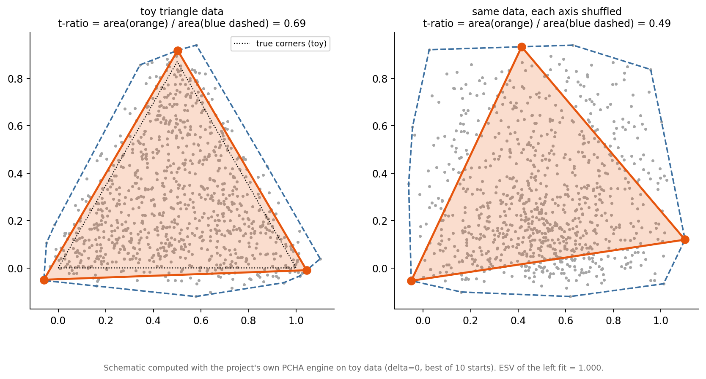
<p class="caption"><b>Figure 8. PCHA and the t-ratio on toy data (schematic, computed with the project's engine).</b> Left: 900 toy points generated inside a triangle plus noise. Orange: best-of-10 PCHA triangle (δ = 0); blue dashed: convex hull; dotted: true generating corners. t-ratio = orange area / blue area = 0.69. Right: the same points with each axis shuffled independently. The shape is destroyed and t falls to 0.49. This contrast is the logic of the permutation test.</p>

**Assumptions.** That the data's geometry in the first k−1 PCs is approximately a simplex; that corners lie within the data (δ = 0); Euclidean distance in unscaled log-expression PC space is meaningful.

**Why used.** It is the thesis's engine (comparability with the breast work) and ParTI's standard method.

**Alternatives.** δ > 0 (Hausser and ParTI often allow corners slightly outside the data, which gives tighter fits and larger t-ratios); other archetypal analysis algorithms (e.g. the original alternating least squares of Cutler & Breiman [11]); non-negative matrix factorisation (parts-based, not geometric); AAnet (neural archetypal analysis); clustering (discrete groups, no mixtures).

**Limitations.** (i) Always returns k corners, structure or not. (ii) With δ = 0 and noisy data, corners sit inside the cloud, so many cells fall outside the simplex (§9.5). (iii) Only k−1 PCs are used, so everything beyond them is ignored. (iv) Corners are pulled by outlying cells.

## 6.4 The t-ratio

$$t = \frac{\text{vol(fitted simplex)}}{\text{vol(convex hull of the data in the same } k-1 \text{ PCs)}} \qquad\text{(Eq. 10)}$$

computed as `simplex_volume(arcs) / ConvexHull(scores[:, :k-1]).volume`. With δ = 0 the simplex is inside the hull, so $0 < t \le 1$. If the data really fill a triangle, the best triangle covers most of the hull and $t$ is near 1. A square cloud allows at most $t = 0.5$ for a triangle; a disc allows about 0.41.

**How to read it.** Only relative to a null. Absolute values fall fast with k (a tetrahedron fills less of a 3-D blob than a triangle fills a 2-D blob), so t-ratios cannot be compared across k or across datasets.

**Limitations.** The hull is defined by the most extreme cells, so a few outliers inflate the denominator (and lower t). Hull volume also grows with the number of cells, so t depends on n; the null must use the same n (it does).

## 6.5 The permutation test, as implemented

```python
for i in range(start, args.n_perm):
    sh = C._shuffle_columns(scores[:, : k - 1], rng)          # shuffle each PC separately
    np.random.seed(C.SEED + 10_000 * k + i)
    arcs, *_ = C.fit_pcha_best(sh, k, n_init=C.N_INIT_NULL, delta=0.0)
    null.append(t_ratio(sh, arcs))
...
p = (1 + np.sum(nl >= obs_t)) / (1 + len(nl))
```

(`codes/03_fit_and_test.py`.) Inputs: the fit cells' first k−1 PC scores. 200 shuffles per k, seeded so reruns are identical, saved after every shuffle (`null_k{k}.npy`) so a stopped run resumes. Output: `fit_k{k}.json` with observed t, null median, 95th percentile, maximum and p. All 3 × 5 × 200 = 3,000 null fits succeeded (no failures; verified from the arrays). The p-values in `fit_summary.csv` were recomputed from the saved null arrays at report time and match exactly.

**Assumptions of this null.** Shuffling PCs independently produces data with the same marginal distributions but no dependence between PCs. PCs are uncorrelated by construction, but **uncorrelated is not independent**: real data have dependence in their tails (e.g. cells extreme on PC1 are rarely extreme on PC2), which is exactly what makes a cloud triangular, but also what clusters and batch structure produce. So the test rejects "independent PCs", not "no Pareto front".

**Alternatives.** More shuffles (Groves used 1,000 [8]); nulls that keep tumour structure (shuffle within tumour); bootstrap stability of corner positions (Groves used 200 bootstraps at 75% of cells [8]); comparison of k by cross-validated ESV.

## 6.6 Choosing k: ESV curve and elbow

`03_fit_and_test.py --esv` fits k = 2..10 in the **first 10 PCs** (5 starts each, best ESV kept) and finds the elbow with ParTI's DimensionFinder idea: the k farthest from the straight line joining the first and last points of the curve.

```python
d = np.abs(np.cross(p1 - p0, np.column_stack([k, y]) - p0)) / np.linalg.norm(p1 - p0)
return int(k[np.argmax(d)])
```

Results: elbow at k = 4 (A), 4 (B), 5 (C) (`log_03_esv.txt`).

**Pre-registered decision rule:** k* = the smallest k with permutation p < 0.01 that is at or before the ESV elbow. A: p < 0.01 at k = 3 → **k* = 3**. B: **k* = 3**. C: no k ≤ 5 has p < 0.01 → **no k***.

**Limitations.** The elbow is a heuristic and depends on the k range and on the number of PCs used (10 here, a fixed choice). The rule protects against choosing k after the fact, but not against an arbitrary rule.

## 6.7 Placing cells, purity and the gap rule

`04_describe_simplex.py` computes, for every cell, barycentric weights in the first k−1 PCs (Eq. 6), the inside flag (all weights ≥ −10⁻⁶), clipped composition, purity and nearest corner, and calls a cell a **specialist** if purity ≥ 0.35, else **interior**. The 0.35 cut is a thesis convention from the breast work, not from a published source (this is stated in the repository's own notes).

**Two kinds of weight.** PCHA itself also returns weights ($S$ in Eq. 9), which are non-negative by construction. The pipeline does not use them; it recomputes exact geometric barycentric weights, which can be negative for cells outside the simplex, and then clips. The two agree for cells inside the simplex.

## 6.8 Distance-bin enrichment (ParTI style)

`src/enrichment.distance_bins` sorts all cells by distance to each corner and splits them into 10 equal-count bins. `hypergeometric_enrichment` tests every label (state, clusterU, phase, tumour, assay) in every bin for over-representation (§5.9), with BH correction across all tests. The script reports bin-0 labels with fold ≥ 1.5 and q < 0.1. This follows the ParTI and Groves enrichment logic [6, 8].

**Caution.** With ~2,400 cells per bin, tiny effects are "significant"; read fold enrichment, not q.

## 6.9 Marker genes per corner and the KS EMT score

- **Markers:** for each corner, mean log-expression in its closest bin minus the mean in all other cells, all 14,502 genes; top 30 saved (`vertex_marker_genes.csv`). This is a descriptive ranking with no statistical test (ParTI uses Mann–Whitney tests).
- **KS EMT score** (per cell): mean z-score of the mouse KS mesenchymal genes minus mean z-score of the epithelial genes, z computed over all cells. Positive = more mesenchymal.

## 6.10 Specialist rules compared

| Rule | Definition | Source | Counts as specialist |
|---|---|---|---|
| Gap ≥ 0.35 | largest − second weight ≥ 0.35 | thesis convention | cells clearly closer to one corner than to any other |
| Closest 5% | the 5% of reference cells nearest each corner (Euclidean, k−1 PCs) | Groves Fig. 3E [8] | a fixed 5% per corner, so 15% at k = 3, regardless of shape |
| Weight > 0.95 | one weight > 0.95 | Groves STAR Methods [8] | only cells almost on a corner |

`06_groves_specialists.py` sets the 5% cut-off distances on the **reference cells** (the cells the shape was fitted on; for version B, the 14,059 scRNA cells), then applies the same cut-offs to the other cells. No cell fell within the cut-off of two corners.

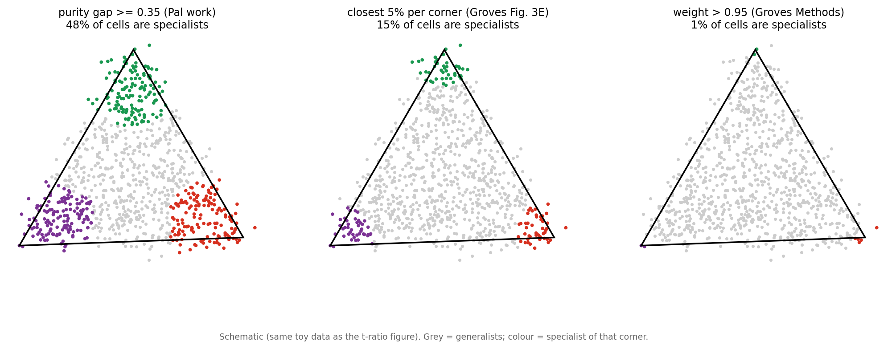
<p class="caption"><b>Figure 9. Three specialist rules on the same toy data (schematic).</b> The gap rule labels most cells near any corner; the closest-5% rule labels a fixed fraction per corner; the weight > 0.95 rule labels only cells almost on a corner. The same data can therefore give very different "specialist fractions".</p>

**Why the rules disagree so much here.** With δ = 0, corners sit inside the cloud and most cells near a corner have weights well below 0.95, so the 0.95 rule finds almost nobody (0.8% of scRNA cells). The 5% rule's radius depends on how dense the cloud is near each corner: around a sparse corner (V1 in version B) the 5% circle becomes very large (§9.8).

## 6.11 Robustness refits

`05_robustness.py` redoes the **whole** fit (new fit cells, new PCA via gram, new 15-start PCHA) under four variants, places all 23,959 cells, matches the new corners to the main fit with the Hungarian method (§5.10), and records:

- `agreement_pct`: % of all 23,959 cells with the same (matched) nearest corner;
- `agreement_specialists_pct`: the same, restricted to cells that are gap-rule specialists in **both** fits;
- each corner's top state, cluster and tumour among its specialists;
- for leave-one-out, where the held-out tumour's cells land.

Variants: **loto** (leave each tumour out; 12 for A, 8 for B), **nophase** (subtract per-phase gene means before PCA, a simple cell-cycle regression), **seed** (seeds 1 and 2 for the subsample), **scrna** (A only; not run as a variant because version B covers it).

**Caveats.** Agreement is computed over all 23,959 cells, including cells that were not fit cells (and for B, the projected multiome cells). The specialist agreement was 100% in every refit, which is an easy bar: it only counts cells clearly at a corner in both fits. The unused helper `match_vertices` in `scc_common.py` matches by coordinates; it was superseded by cell-based matching and is dead code.

## 6.12 Cell-cycle regression (the "nophase" variant)

For each phase $p$, compute the fit cells' mean expression $\boldsymbol{\mu}_p$ and the overall mean $\boldsymbol{\mu}$; subtract $\boldsymbol{\mu}_{p(i)} - \boldsymbol{\mu}$ from each cell (fit and projected cells alike) before PCA. This removes the average expression difference between phases. It does not remove within-phase cell-cycle variation and depends on the accuracy of the `phase` labels. A score-based regression (regressing out S and G2M scores) is the common alternative.

<div class="checkpoint">

**Learning checkpoint 6**

1. *What do the matrices C and S mean in PCHA?* — C builds archetypes from cells (convex weights); S expresses each cell as a convex mix of archetypes.
2. *Why does δ = 0 make many cells fall outside the simplex?* — The corners must be convex combinations of cells, so they sit inside the cloud and the outermost cells lie beyond them.
3. *What does the permutation test reject?* — That the first k−1 PCs are independent; not specifically "no Pareto front".
4. *Why does the closest-5% rule give exactly 15% specialists at k = 3?* — By construction: 5% per corner, no overlaps.

</div>


# 7. Complete pipeline and code walkthrough

## 7.1 Execution order and pipeline table

Figure 1 (Chapter 1) is the master diagram. The table lists every script that produced a reported result, in the order it ran.

| Order | Script (in `Mouse_SCC/codes/`) | Command (from `Project_1/`) | Main inputs | Main outputs | Runtime (this Mac) |
|---|---|---|---|---|---|
| 0 | (R, not saved) | — | `GSE288137_SCO_unpacked.rds` | `data/processed/counts.mtx`, `genes.txt`, `barcodes.txt`, `cell_metadata.csv`, `emb_*.csv` | — |
| 1 | `01_build_anndata.py` | `.venv/bin/python Mouse_SCC/codes/01_build_anndata.py` | files above | `expr_log_filtered.h5ad` | ~5 min |
| 2 | `02_pca.py` | `... 02_pca.py --geneset all` (A); `--geneset all --assay scRNA` (B); `--geneset ks` (C) | h5ad | `results/<run>/pca.npz`, `pca_info.json`, `pc_drivers.csv`, `pc_top_genes.csv`, `scree.png`, `pc1_pc2_by_label.png` | 2–13 min |
| 2b | `02b_tumour_within_state.py` | `... --geneset all --tag main` etc. | `pca.npz`, metadata | `pc_drivers_within_state.csv` | seconds |
| 3 | `run_fits.sh` → `03_fit_and_test.py` | `bash Mouse_SCC/codes/run_fits.sh all main 200` | `pca.npz` | `archetypes_k*.npy`, `null_k*.npy`, `fit_k*.json`, `esv_curve.csv`, `fit_summary.csv`, `fit_and_null.png` | ~2–3 h per version (parallel) |
| 4 | `04_describe_simplex.py` | `... --geneset all --tag scrna --k 3` | `pca.npz`, archetypes, h5ad | `describe_k3/summary.md`, `cells_in_simplex.csv.gz`, `vertex_marker_genes.csv`, `distance_bin_enrichment.csv`, `simplex_PC*_PC*.png` | ~2 min |
| 5 | `05_robustness.py` | `... --geneset all --tag scrna --k 3 --variant loto` (+ `nophase`, `seed`; `--tag main --variant loto`) | h5ad, main fit | `robustness/k3_<variant>.csv` | ~1–2 min per refit |
| 6 | `06_groves_specialists.py` | `... --geneset all --tag scrna --k 3` | `pca.npz`, archetypes, metadata | `groves5_k3/cells_groves5.csv.gz`, `summary.md`, `triangle_groves5.png` | seconds |

Runs actually executed: step 2 for A, B, C; step 3 for A, B, C; step 4 for A (k = 3, 4), B (k = 3, 4), C (k = 3); step 5 for B (loto, nophase, seed) and A (loto); step 6 for B. Logs are in each results folder (`log_*.txt`).

**Dependencies.** Python 3.9 in `Project_1/.venv` with numpy 1.26.4, scipy 1.13.1, scikit-learn 1.6.1, pandas 2.3.3, matplotlib 3.9.4, anndata 0.10.9, scanpy 1.10.3, `py_pcha` 0.1.3; the repository modules `src/archetypes.py` and `src/enrichment.py`; the KS gene file under `Breast Cancer/data/processed/`.

## 7.2 Shared configuration (`scc_common.py`, top)

```python
SEED = 0
MAX_PER_TUMOUR = 800      # tumour-balanced fit set (smallest tumour has 852 cells)
N_PCS_KEEP = 50           # PCs stored per cell; the fit uses only the first k-1
K_VALUES = (3, 4, 5, 6, 7)
N_INIT = 15               # PCHA starts for the real fit (same as the Pal fits)
N_INIT_NULL = 5           # PCHA starts per shuffled dataset
PURITY_CUT = 0.35         # specialist rule from the Pal work
```

Keeping every constant in one place means all scripts use the same values; changing one value changes every step consistently. `sys.path.insert(0, str(ROOT))` lets the scripts import the repository's `src/` package, so the PCHA engine is literally the same code as in the breast analyses.

## 7.3 Script 02: PCA and diagnostics

Key flow (abridged from `02_pca.py`):

```python
a = C.load_adata()                         # log-CP10k, cells x genes, sparse
gi = C.gene_index(a, args.geneset)         # all genes, or the 176 KS genes
X = a.X[:, gi].tocsr()
fit_idx = C.balanced_fit_cells(obs, only_assay=args.assay)
Xfit = X[fit_idx].toarray().astype(np.float64)
pca = C.fit_pca(Xfit, method=args.pca_method)       # default "gram"
scores_all = C.project(X, pca, shift=shift_all)     # all 23,959 cells
err = np.abs(scores_all[fit_idx] - pca["scores_fit"]).max()
assert err < 1e-6 * max(1.0, np.abs(pca["scores_fit"]).max())
```

Then, for PCs 1–10 on the fit cells, η² for tumour, assay, state, clusterU and phase, and r² for log depth and % mito (`pc_drivers.csv`); top 15 genes at each end of PCs 1–5 (`pc_top_genes.csv`); randomized-vs-exact agreement; the scree and PC1/PC2 plots. `pca.npz` stores `scores_all` (23,959 × 50), `fit_idx`, `mean`, `components` (50 × genes), `evr` (first 200), `genes`, `barcodes`.

*Programming notes.* `X[fit_idx].toarray()` makes a dense copy only of the fit cells (9,600 × 14,502 × 8 bytes ≈ 1.1 GB). `C.project` uses `X_sparse @ V.T` so the full 23,959-cell matrix is never densified. The `assert` is a cheap correctness check: if projection and fitting disagreed, the run would stop.

The `--remove-phase` option implements §6.12; it was used only inside `05_robustness.py`.

## 7.4 Script 03: fitting and permutation testing

`run_fits.sh` launches one process per k plus one for the ESV curve, with BLAS threads set to 1 so the processes share the 8 CPU cores without oversubscription, then calls `--summarize`:

```bash
export OMP_NUM_THREADS=1 OPENBLAS_NUM_THREADS=1 VECLIB_MAXIMUM_THREADS=1 MKL_NUM_THREADS=1
$PY -u $S --geneset $GENESET --tag $TAG --esv > $OUT/log_03_esv.txt 2>&1 &
for K in 3 4 5 6 7; do
  $PY -u $S --geneset $GENESET --tag $TAG --k $K --n-perm $NPERM > $OUT/log_03_k$K.txt 2>&1 &
done
wait
$PY -u $S --geneset $GENESET --tag $TAG --summarize | tee $OUT/log_03_summary.txt
```

For each k, `C.fit_simplex(scores, k)` runs the 15-start PCHA and computes the t-ratio; the archetypes are saved as `archetypes_k{k}.npy` with shape (k, k−1) (corner coordinates in the first k−1 PCs). The shuffle loop is shown in §6.5. *Resumability:* on restart, the script reloads `null_k{k}.npy` and replays the random-number generator to the saved position, so the resumed run is identical to an uninterrupted one.

## 7.5 Script 04: describing the simplex

```python
w = C.barycentric(scores[:, : k - 1], arcs)
comp = C.composition(w)
pur, near = C.purity_and_nearest(w)
cells["inside"] = (w >= -1e-6).all(1)
cells["specialist"] = pur >= C.PURITY_CUT
cells["group"] = np.where(cells["specialist"], cells["nearest"], "interior")
```

Then: KS EMT score per cell (§6.9); label tables; the tumour check (each corner's share from its top tumour and the number of tumours supplying ≥ 5% of its specialists); mean scores per group; distance-bin enrichment; marker genes; figures. Everything printed is also written to `summary.md`.

> **Important for reading version B outputs.** `describe_k3/summary.md` for version B computes every table over **all 23,959 cells**, including the 9,900 multiome cells that were not used to fit the shape (they were projected in). Several numbers quoted during the run (and in `WALKTHROUGH.md` §6.4) therefore mix fitted and projected cells. This report recomputes version B tables on the 14,059 scRNA cells where it matters (§9.6), and flags the difference.

## 7.6 Script 05: robustness

```python
fit_idx = C.balanced_fit_cells(obs, **sel)               # e.g. exclude_tumours=["SC15"]
scores, fit = refit(X, obs, fit_idx, k, gi, remove_phase=rmphase)
near_new, spec_new = place(scores, fit["archetypes"], k)
near_new, agree = match(near_main, near_new, k)           # Hungarian on the k x k table
```

`refit` repeats PCA (gram) and the 15-start PCHA from scratch. Results are appended to the CSV after each variant, so the script resumes after an interruption. For version B (`--tag scrna`), all variants keep the scRNA-only rule for fit cells.

## 7.7 Script 06: Groves specialists

```python
ref = (meta["assay"] == "scRNA").values if args.tag == "scrna" else np.ones(len(meta), bool)
d = np.linalg.norm(pts[:, None, :] - arcs[None, :, : k - 1], axis=2)   # cells x corners
cut = np.quantile(d[ref], FRACTION, axis=0)                             # 5% per corner
close = d <= cut
cls = np.where(close.sum(1) == 0, "generalist", np.array(V)[np.argmin(d / cut, axis=1)])
```

`pts[:, None, :] - arcs[None, :, :]` uses NumPy **broadcasting** to compute every cell-to-corner difference at once (cells × corners × dimensions). `np.quantile(..., 0.05, axis=0)` gives one cut-off distance per corner. It also computes the weight > 0.95 and gap rules for comparison and draws Figure 22.

## 7.8 Report figure script

`research_report/make_report_figures.py` generates every `schem_*` and `emp_*` figure in this report from saved outputs and copies the pipeline's own figures into `figures/project/`. It writes nothing into `results/` or `codes/`. One function, `emp_v1_longgene`, computes a new descriptive score from the expression matrix (§9.11); it is a report-time verification analysis, not part of the pipeline.

<div class="checkpoint">

**Learning checkpoint 7**

1. *Which file holds the coordinates of every cell in PC space?* — `results/<run>/pca.npz`, array `scores_all`.
2. *Why does `run_fits.sh` set thread counts to 1?* — So several k run in parallel without each process trying to use every core.
3. *Why must version B tables be recomputed on scRNA cells?* — Script 04 includes projected multiome cells, which were not used to fit the shape.

</div>

# 8. Results overview

All numbers below come from the files named; Chapter 9 explains each figure.

## 8.1 Headline results

| # | Result | Kind | Source |
|---|---|---|---|
| R1 | On all genes, PC1 is explained by tumour (η² 0.76) and assay (0.54) more than by EMT state (0.50) in version A; within states, tumour still explains 33–66% of each of PCs 1–10 | computational | `all_main/pc_drivers*.csv` |
| R2 | On KS genes, PC1 (26.3% of variance) is EMT: state η² 0.81, tumour within state 0.09 | computational | `ks_main/pc_drivers*.csv` |
| R3 | k = 3 fits better than all 200 shuffles in A and B (t = 0.528 and 0.529; p = 0.005); KS genes: p = 0.83 at k = 3, 0.80 at k = 4 | statistical | `*/fit_summary.csv` |
| R4 | Pre-registered rule gives k* = 3 for A and B, none for C | decision | §6.6 |
| R5 | Version B, k = 3 corners: V2 late EMT (94% of its scRNA specialists; collagens), V3 epithelial/early-hybrid and proliferative (54% S/G2M; keratins), V1 "long-gene" profile | computational + interpretation | `all_scrna/describe_k3/` |
| R6 | V1's long-gene score is high in all multiome samples and in scRNA tumours SC15 and SC46, regardless of state | computational (report-time) | `emp_v1_longgene.png` |
| R7 | Hybrid cells are the least specialised state under all three rules (gap: 18% specialists; closest 5%: 1.2%; weight > 0.95: 0%) | computational | `all_scrna/groves5_k3/` |
| R8 | Leaving out any one tumour keeps 90–99% of cells at the same corner; cell-cycle regression 84%; new subsample 99% | robustness | `*/robustness/*.csv` |
| R9 | The most extreme 5% at each corner come mostly from one or two tumours (V1 82% SC15; V2 92% SC2b1; V3 90% SC32 + SC33) | computational | `groves5_k3/summary.md` |
| R10 | At k = 4 (not chosen), a Hybrid-dominated cycling corner separates (B: 91% Hybrid, 44% G2M among all specialists) | computational | `all_scrna/describe_k4/` |

## 8.2 Scorecard against the pre-registration (version B, k = 3, scRNA cells)

| Prediction | Verdict | Evidence |
|---|---|---|
| 1. k* = 3 | **Met** for A and B; **not met** for C | R3, R4 |
| 2. Corners epithelial, late-EMT, proliferative hybrid | **Partly met.** Late-EMT yes. The epithelial corner is a proliferative epithelial/early-hybrid corner. The third corner is a long-gene axis, not proliferative hybrid. | R5, R6 |
| 3. Proliferative Hybrid EMT enriched near a corner | **Weakly met.** 2.0-fold enrichment in V3's closest bin, but 79% of these cells are interior (gap rule) and 98% generalists (5% rule). | §9.7 |
| 4. Early-hybrid more often interior than epithelial or late | **Met, narrowly.** Interior (gap rule): early-hybrid 39%, epithelial 28%, late 37% (hybrid 82%). | §9.6 |
| 5. A corner may be cell cycle | **Not as stated.** V3 is proliferative but survives cell-cycle regression (84% agreement; V3 still early-hybrid-dominated). | §9.10 |
| 6. A corner may be a tumour or assay | **Met for a technical axis** (V1), not for a single tumour (every corner survives leave-one-out). | R6, R8 |

Remember (§1.4) that prediction 2's stated basis ("cycling hybrid branch") was a misreading of the paper.

<div class="checkpoint">

**Learning checkpoint 8**

1. *Which version gives the cleanest EMT axis, and which gives a significant simplex?* — KS genes give the cleanest EMT PC1 but no simplex; all genes give a simplex partly shaped by tumour and technology.
2. *Is "hybrid cells are generalists" robust to the specialist rule?* — Yes; all three rules rank hybrid cells least specialised.

</div>


# 9. Figure-by-figure interpretation

Each figure is traced through **Data → Code → Method → Output → Observation → Interpretation → Limitations → Next step**. "Project figure" means the pipeline produced it (copied unchanged into `figures/project/`); "report figure" means `make_report_figures.py` drew it from saved outputs.

## 9.1 How much variance do the PCs carry? (Figure 10)

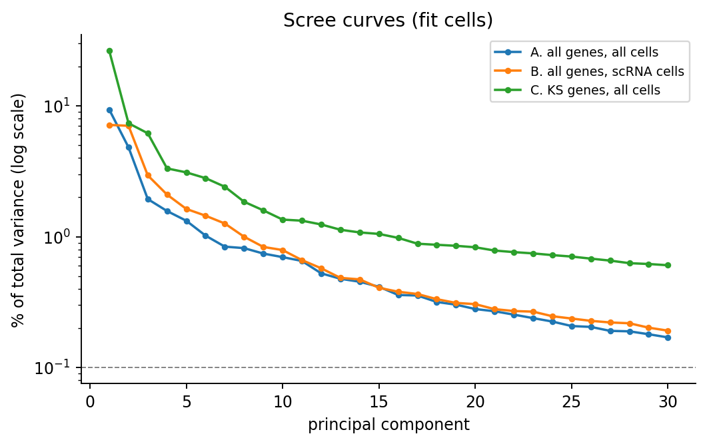
<p class="caption"><b>Figure 10. Scree curves for versions A, B and C (report figure; from <code>pca.npz</code>, array <code>evr</code>).</b> x: principal component number. y: % of total variance of the fit cells (log scale). Dashed line: 0.1%.</p>

- **Question.** How concentrated is the variation, and how many dimensions matter?
- **Data/code.** `evr` saved by `02_pca.py`: $s_j^2/\lVert X_c\rVert_F^2$ on the fit cells.
- **Observation.** A: PC1 9.3%, PC2 4.8%, then a slow decline (PC3 1.9%, PC10 0.7%). B: PC1 7.1% and PC2 7.0%, almost equal. C: PC1 26.3%, PC2 7.4%; with only 176 genes, a few PCs carry much more of the total.
- **Interpretation.** With all genes, the first two PCs (the plane in which the k = 3 triangle lives) hold only ~14% of the variance in A and B. The triangle describes a small, though the largest, slice of the variation. In B, PC1 and PC2 being nearly equal means their directions are less sharply defined: small changes in the data could rotate them.
- **Not established.** That the remaining variance is noise. Much of it is real but spread across many directions.
- **Next.** Ask what drives PC1 and PC2 (§9.2–9.3).

## 9.2 What do the first two PCs separate? (Figures 11–12)


<p class="caption"><b>Figure 11. Version A fit cells on PC1 vs PC2 (project figure, <code>results/all_main/pc1_pc2_by_label.png</code>, from <code>02_pca.py</code>).</b> The same 9,600 cells coloured, left to right, by EMT state, tumour, assay and cell-cycle phase.</p>

- **Observation (A).** PC1 runs from late-EMT and hybrid cells (left, negative) to epithelial/early-hybrid cells (right). In the assay panel the right half of the cloud is mostly multiome (blue) and the left half scRNA (orange): epithelial/early-hybrid cells are split into a multiome group (right) and an scRNA group (upper middle, around SC32/SC33). PC2 separates the scRNA epithelial/early-hybrid group (top) from late-EMT cells (bottom). G2M/S cells are concentrated at the top and upper right.
- **Top genes** (`pc_top_genes.csv`, A): PC1+ `Krt14`, `AY036118`, `Nrg1`, `Camk1d`, `Krt5`, `Pcdh7`, `Dsp`, `Mast4`; PC1− `Lgals1`, `Dcn`, `Col1a2`, `Vim`, `Col1a1`, `S100a4`. PC2+ basal keratins (`Krt14`, `Krt5`, `Krt6a`, `Krt17`); PC2− collagens (`Fn1`, `Col1a1`, `Col3a1`, `Dcn`).
- **Interpretation.** PC1 mixes EMT (keratins vs collagens) with assay (long genes `Camk1d`, `Pcdh7`, `Mast4` on the multiome side). PC2 is a cleaner EMT/proliferation axis within scRNA.

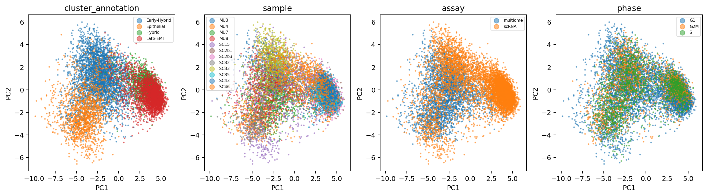
<p class="caption"><b>Figure 12. Version C (KS genes) fit cells on PC1 vs PC2 (project figure, <code>results/ks_main/pc1_pc2_by_label.png</code>).</b> Same layout as Figure 11.</p>

- **Observation (C).** PC1 orders cells epithelial → early-hybrid → hybrid → late-EMT almost monotonically; assay is mixed along it. Top genes: PC1+ `Vim`, `Lgals1`, `Col5a2`, `Sparc`, `Cald1` (mesenchymal); PC1− `Sfn`, `Dsp`, `Perp`, `Itgb4`, `Klf5` (epithelial). PC2− carries `Epcam`, `S100a14`, `Cdh1`, `Esrp1`, the paper's epithelial-state markers.
- **Interpretation.** Restricting to EMT genes gives a clean EMT axis. This is the continuum picture of §1.2.

## 9.3 What drives each PC, quantitatively? (Figure 13)

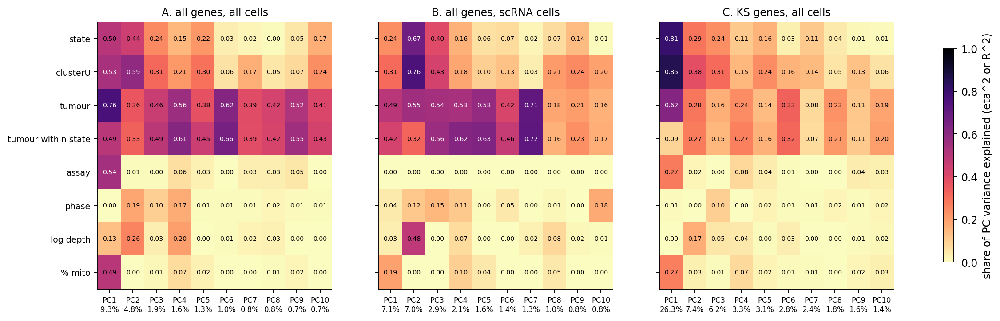
<p class="caption"><b>Figure 13. Share of each of PCs 1–10 explained by each factor (report figure, from <code>pc_drivers.csv</code> and <code>pc_drivers_within_state.csv</code>).</b> Rows: EMT state, clusterU, tumour, tumour within state, assay, phase (η²); log depth, % mito (r²). Columns: PC (with % variance). Darker = larger share. Fit cells only.</p>

- **Method.** η² (Eq. 7) and its within-state version (§5.7).
- **Observations.**
  - A, PC1: tumour 0.76, assay 0.54, state 0.50, % mito 0.49; **tumour within state 0.49**.
  - B, PC2: state 0.67, clusterU 0.76, **log depth 0.48**; PC1 tumour 0.49, state 0.24; tumour within state 0.32–0.72 for PCs 1–7.
  - C, PC1: state 0.81, clusterU 0.85, **tumour within state 0.09**, assay 0.27.
  - Phase never exceeds 0.19 on any of PCs 1–10 in any version.
- **Interpretation.** On the whole transcriptome, **each tumour has a large transcriptional fingerprint that is not explained by its EMT-state mix**. On EMT genes, PC1 is EMT. Cell cycle is a modest contributor to the leading axes. Depth correlates with B's PC2, which also separates states, so depth and state cannot be separated there (late-EMT cells may also differ in RNA content).
- **Not established.** η² measures association, not cause. A "tumour fingerprint" could be genetics, microenvironment, dissociation stress or library batch: each tumour was one library, so these are indistinguishable.
- **Next.** Fit simplices anyway, then test whether corners depend on any one tumour.

## 9.4 Is there a simplex? (Figures 14–15)

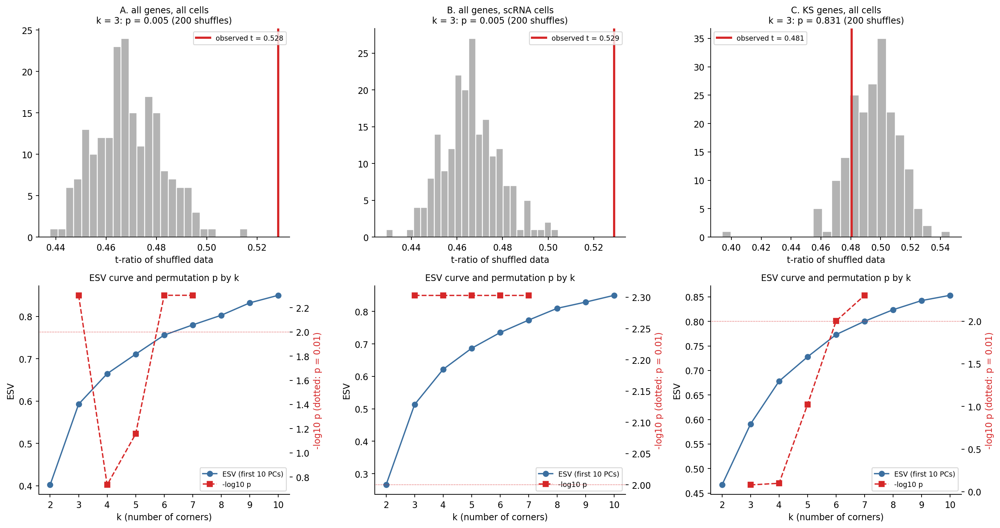
<p class="caption"><b>Figure 14. Permutation tests and ESV curves (report figure, from <code>null_k3.npy</code>, <code>fit_k*.json</code>, <code>fit_summary.csv</code>, <code>esv_curve.csv</code>).</b> Top: histograms of the 200 shuffled t-ratios at k = 3; red line = observed t. Bottom: ESV in the first 10 PCs for k = 2–10 (blue, left axis) and −log₁₀ p for k = 3–7 (red, right axis; dotted line at p = 0.01).</p>

| Version | k=3 t (null median; max) | p | k=4 p | k=5 p | k=6 p | k=7 p | elbow | k* |
|---|---|---|---|---|---|---|---|---|
| A | 0.528 (0.468; 0.516) | 0.005 | 0.184 | 0.070 | 0.005 | 0.005 | 4 | 3 |
| B | 0.529 (0.466; 0.504) | 0.005 | 0.005 | 0.005 | 0.005 | 0.005 | 4 | 3 |
| C | 0.481 (0.496; 0.547) | 0.831 | 0.796 | 0.095 | 0.010 | 0.005 | 5 | none |

- **Observation.** In A and B the observed k = 3 t-ratio is beyond every shuffle. In C it sits in the middle of the null (83% of shuffles are at least as triangular). ESV rises smoothly; the elbow is at k = 4 (A, B) and 5 (C).
- **Interpretation.** On all genes, the PC1–PC2 cloud is more triangular than independent PCs would produce. On KS genes it is not; together with Figure 12, version C looks like a continuum (an elongated cloud), not a triangle.
- **Effect size.** The margin is modest: 0.53 versus a null maximum of 0.50–0.52. A perfect triangle would be near 1; the toy triangle in Figure 8 gave 0.69.
- **Not established.** That the triangle is a Pareto front (see §6.5: the null rejects independence, not "no tasks"). That k = 6–7 mean anything: they pass in every version, including C, which suggests high-k significance is driven by generic structure.
- **Why A's k = 4 fails but B's passes.** Not investigated. In A, adding a fourth corner may mostly capture the assay split that PC3 partly carries, which a shuffle can also mimic. Treat as unexplained.

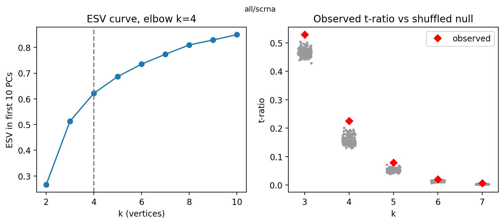
<p class="caption"><b>Figure 15. The pipeline's own summary for version B (project figure, <code>results/all_scrna/fit_and_null.png</code>, from <code>03_fit_and_test.py --summarize</code>).</b> Left: ESV curve with the elbow (dashed, k = 4). Right: for each k, grey dots = 200 shuffled t-ratios (jittered), red diamonds = observed t.</p>

This is the same information as Figure 14, drawn by the pipeline. The red diamonds are above the grey clouds at every k, but the gap is visibly largest at k = 3–4.

## 9.5 The k = 3 simplices (Figures 16–18)

All three figures have the same eight panels (`04_describe_simplex.py`). Panels 1–5: all 23,959 cells on PC1 vs PC2, coloured by EMT state, clusterU, tumour, assay and phase. Panel 6: KS EMT score (blue epithelial → red mesenchymal, clipped at the 2nd/98th percentiles). Panel 7: purity (yellow = specialist, dark = interior). Panel 8: for each state, % of its cells at each corner or interior (gap rule). Black dots and lines: fitted corners and edges. **Panel 8 and every table in these files use all cells, including projected ones.**

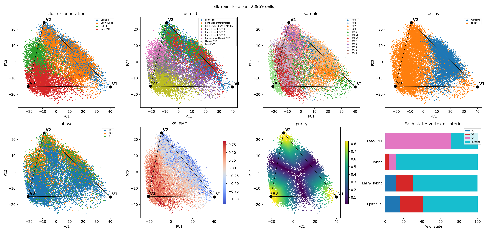
<p class="caption"><b>Figure 16. Version A, k = 3 (project figure, <code>results/all_main/describe_k3/simplex_PC1_PC2.png</code>).</b></p>

**Version A** (`all_main/describe_k3/summary.md`): 73.1% of cells inside, 40.0% specialists.

| Corner | Specialists by state | Assay | Phase | Top marker genes | Top tumour (n tumours ≥ 5%) |
|---|---|---|---|---|---|
| V1 | Epi 36%, Early-Hyb 63% | 79% multiome | G1 80% | `Camk1d`, `Maml2`, `Pcdh7`, `Frmd4b`, `Adgrl3`, `Magi1`, `Mast4` | MU7 45% (3) |
| V2 | Epi 34%, Early-Hyb 62% | 90% scRNA | G2M 33%, S 25% | `Krt14`, `Krt5`, `Krt6a`, `Krt17`, `Krtdap`, `Rbm3`, `Sfn` | SC32 36% (4) |
| V3 | Late-EMT 93% | 100% scRNA | G1 89% | `Col3a1`, `Col1a1`, `Col1a2`, `Dcn`, `Bgn`, `Postn`, `Fn1` | SC2b3 35% (5) |

*Interpretation.* V1 and V2 contain the same EMT states and differ mainly by assay and proliferation. V1's markers are long neuronal-type and signalling genes typical of nuclear RNA, so V1 is most plausibly a **technology corner**. V3 is the late-EMT corner and matches the paper's late-EMT markers (`Col3a1`, `Postn`) [1].


<p class="caption"><b>Figure 17. Version B, k = 3, the simplex chosen for focus (project figure, <code>results/all_scrna/describe_k3/simplex_PC1_PC2.png</code>).</b> The shape was fitted on 6,400 scRNA cells; multiome cells (blue in the assay panel) were projected in afterwards.</p>

**Version B**, restricted to the 14,059 scRNA cells (recomputed at report time from `cells_in_simplex.csv.gz`): 77.3% inside, 52.6% specialists.

| Corner | scRNA specialists by state | Phase (S + G2M) | Top marker genes | Notes |
|---|---|---|---|---|
| V1 | Epi 53%, Early-Hyb 44% | 34% | `Camk1d`, `Pcdh7`, `Maml2`, `Frmd4b`, `Adgrl3` | 387 scRNA specialists, 94% from SC15; plus 985 multiome specialists (projected) |
| V2 | Late-EMT 94% | 10% | `Col3a1`, `Col1a1`, `Col1a2`, `Dcn`, `Postn` | top tumour SC2b3 40%, 4 tumours ≥ 5% |
| V3 | Early-Hyb 60%, Epi 27%, Hybrid 13% | 54% | `Krt14`, `Rbm3`, `Krt5`, `Krt6a`, `Krt17`; proliferation genes `Npm1`, `Nme2`, `H2afz` | top tumour SC32 37%, 6 tumours ≥ 5% |

*Observations in the figure.* V1 sits far out on a thin spike at PC1 ≈ −50, reached by few cells (mainly SC15, green in the tumour panel). The KS EMT panel is blue near V1 and V3 and red near V2, so the EMT axis runs between V3/V1 and V2. The purity panel shows dark (interior) bands along the lines that bisect the triangle, which is how the purity gap geometrically behaves.

*Interpretation.* Two corners are biologically meaningful: **late EMT (V2)** and **proliferative epithelial/early-hybrid (V3)**. V1 is not an EMT state (§9.11). PC1's negative end includes `Ext1`, `Adgrl3`, `Malat1`, `Aopep`, `Mast4`, `Pcdh7` and `Gm42418` (`all_scrna/pc_top_genes.csv`). *Correction (12 Oct):* an earlier version of this report took `Malat1`, a nuclear-retained RNA, as support for a nuclear-RNA reading of V1. A direct check shows `Malat1` is high in every tumour (median 4.2–5.6) and correlates only weakly with the V1 score (r = 0.19 across scRNA cells), so it is **not** evidence for that reading.

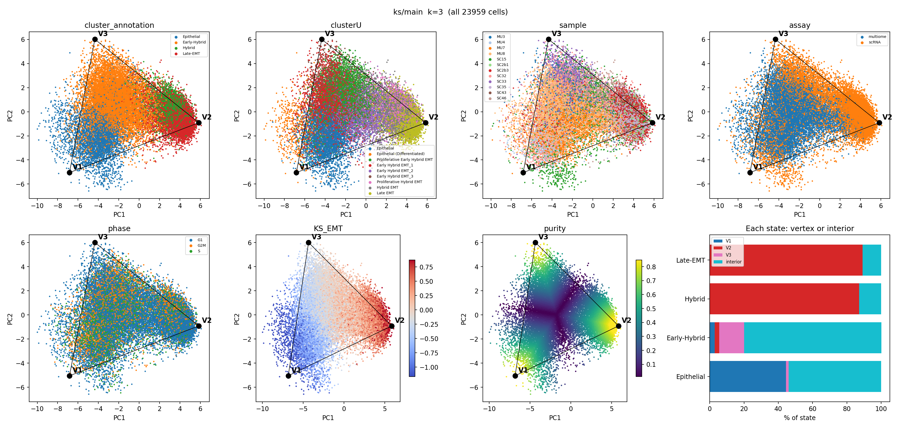
<p class="caption"><b>Figure 18. Version C (KS genes), k = 3 (project figure, <code>results/ks_main/describe_k3/simplex_PC1_PC2.png</code>). Not significant (p = 0.83).</b></p>

*Observation.* Corners: V1 epithelial (86.5% of specialists; 61% multiome), V2 hybrid + late (97%), V3 early-hybrid (96%); 82.5% of cells inside; each corner's specialists spread over 5 tumours. The KS panel shows a smooth blue-to-red gradient along PC1. *Interpretation.* The tidy-looking label separation is what a continuum cut into a triangle would also give; the permutation test says the triangle is not better than shuffled data. **This figure is the clearest illustration that clean label separation is not evidence for a simplex.**

## 9.6 Where do the EMT states sit? (Figure 19)

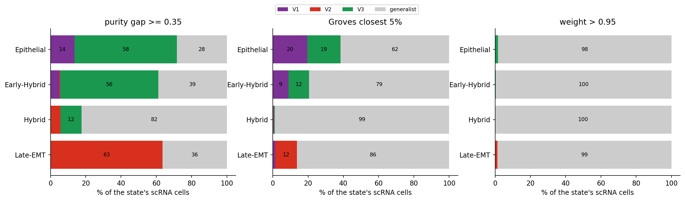
<p class="caption"><b>Figure 19. Each EMT state's scRNA cells by corner, under three specialist rules (report figure, from <code>results/all_scrna/groves5_k3/cells_groves5.csv.gz</code>; version B, k = 3; 14,059 scRNA cells).</b> Purple V1, red V2, green V3, grey generalist/interior. Numbers are % of the state.</p>

| State | Gap rule: V1 / V2 / V3 / interior | Closest 5%: V1 / V2 / V3 / generalist | weight > 0.95: specialists |
|---|---|---|---|
| Epithelial | 13.6 / 0 / 58.0 / 28.3 | 19.6 / 0 / 18.8 / 61.6 | 1.7 |
| Early-Hybrid | 5.0 / 0.5 / 55.6 / 38.9 | 9.0 / 0 / 11.6 / 79.4 | 0.4 |
| Hybrid | 0 / 5.7 / 11.9 / 82.4 | 0.4 / 0.3 / 0.5 / 98.8 | 0.0 |
| Late-EMT | 0.2 / 63.3 / 0 / 36.5 | 1.5 / 12.3 / 0 / 86.3 | 1.4 |

- **Observation.** Under every rule, Hybrid cells are the least specialised. Epithelial and early-hybrid cells specialise at V3 (proliferative) or V1; late-EMT cells at V2.
- **Correction.** `WALKTHROUGH.md` §6.4 gave version B interior fractions computed over all cells, including projected multiome cells (e.g. epithelial 61% interior). On the fitted scRNA cells the gap-rule value is 28%. The multiome cells are mostly interior (79–98% per state) because their technical profile places them between corners.
- **Interpretation.** Hybrid cells lie between the epithelial/proliferative and late-EMT corners, as mixtures. That fits the idea of hybrid EMT as an intermediate, "multi-task" state, but geometry alone cannot distinguish "a mixture of two tasks" from "a distinct state that happens to lie between them in PC1–PC2".

## 9.7 Finer clusters (no figure; `cells_in_simplex.csv.gz`, scRNA cells, gap rule)

| clusterU | V1 | V2 | V3 | interior |
|---|---|---|---|---|
| Proliferative Early Hybrid EMT | 0.2 | 0 | **83.9** | 15.9 |
| Epithelial (Differentiated) | 1.3 | 0 | 72.0 | 26.7 |
| Early Hybrid EMT_1 | 6.4 | 0 | 69.3 | 24.3 |
| Epithelial | 16.2 | 0 | 52.3 | 31.6 |
| Early Hybrid EMT_3 | 6.6 | 0 | 35.4 | 58.0 |
| Early Hybrid EMT_2 | 11.0 | 1.9 | 4.4 | **82.7** |
| Proliferative Hybrid EMT | 0.1 | 2.9 | 18.3 | **78.7** |
| Hybrid EMT | 0.2 | 22.5 | 1.5 | 75.8 |
| Late EMT | 0 | **78.2** | 0 | 21.8 |

*Interpretation.* The proliferative corner V3 is defined most strongly by **Proliferative Early Hybrid EMT** cells. **Proliferative Hybrid EMT** cells, the pre-registered test of the third corner, are mostly interior: their proliferation pulls them toward V3 and their hybrid EMT state toward V2. Early Hybrid EMT_2 is mostly interior too, consistent with (but not proof of) it being the "more advanced" early-hybrid substate; the mapping of `_1/_2/_3` to the paper's EMT-I/II was not verified (§2.5).

## 9.8 The k = 4 simplices (Figures 20–21)

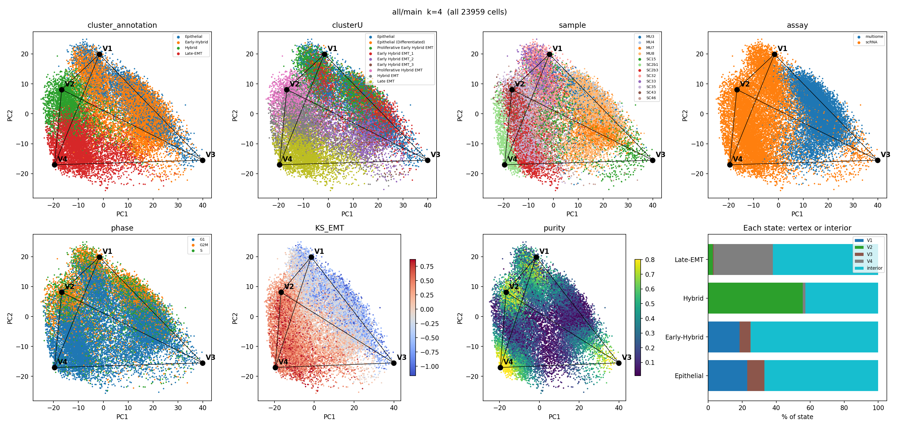
<p class="caption"><b>Figure 20. Version A, k = 4, PC1–PC2 view (project figure). Not significant (p = 0.18).</b> The tetrahedron lives in PC1–PC3; this view flattens it.</p>

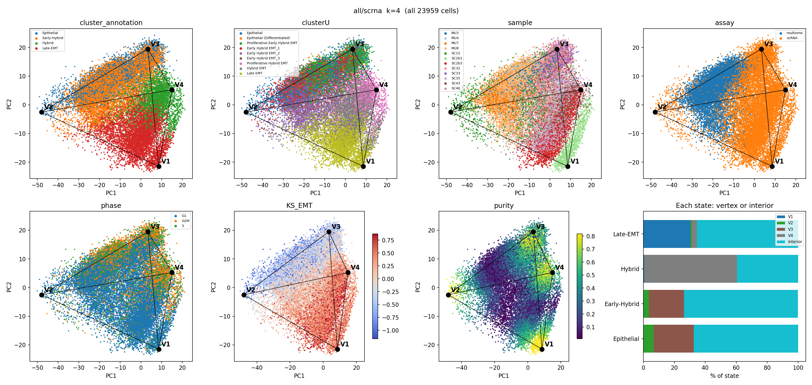
<p class="caption"><b>Figure 21. Version B, k = 4, PC1–PC2 view (project figure). p = 0.005, but k = 4 was not chosen by the pre-registered rule.</b></p>

| Version | Corners (specialists, all cells) | Inside |
|---|---|---|
| A, k=4 | V1 basal epithelial/early-hybrid (keratins; 76% scRNA); V2 Hybrid 92% (`Lgals1`, `Csrp2`, `Tm4sf1`, `Vim`; 46% G2M); V3 nuclei corner (67% multiome, long genes); V4 Late-EMT 97% (collagens) | — |
| B, k=4 | V1 Late-EMT 98%; V2 nuclei-like/SC15 (52% of its specialists SC15); V3 epithelial/early-hybrid; V4 Hybrid 91% (44% G2M) | 30.8% |

*Interpretation.* Allowing a fourth corner separates a **Hybrid, cycling** corner in both versions. This is the closest the data come to the pre-registered "proliferative hybrid" corner. In version B only 31% of cells lie inside the tetrahedron, so the k = 4 shape outlines the cloud loosely. Because k = 4 was not chosen, this is exploratory.

## 9.9 Groves specialists on the chosen triangle (Figure 22)


<p class="caption"><b>Figure 22. Version B, k = 3, with Groves closest-5% specialists (project figure, <code>results/all_scrna/groves5_k3/triangle_groves5.png</code>, from <code>06_groves_specialists.py</code>).</b> 14,059 scRNA cells on PC1 vs PC2. Grey: generalists. Dashed circles: each corner's 5% cut-off distance. Left: specialists coloured by corner (703 each). Middle: by EMT state. Right: by tumour.</p>

- **Observation.** V1's circle is huge (radius ≈ 32 PC units versus ≈ 8 for V2 and V3) because few cells are near V1. Tumour panel: V1's specialists are 82% SC15; V2's 92% SC2b1; V3's 48% SC33 and 42% SC32. Phase: V3's specialists are 80% S/G2M.
- **Interpretation.** At the extreme tips, each corner is essentially one or two tumours. This repeats the thesis's breast lesson (the TN-0135 corner). The gap rule, which uses more cells per corner, spreads V2 and V3 over 4 and 6 tumours. **The broad corner regions are multi-tumour; the tips are tumour-specific.**
- **Not established.** Whether SC2b1 is "the most late-EMT tumour" biologically, or whether its library simply sits furthest along PC2.

## 9.10 Robustness (Figure 23)

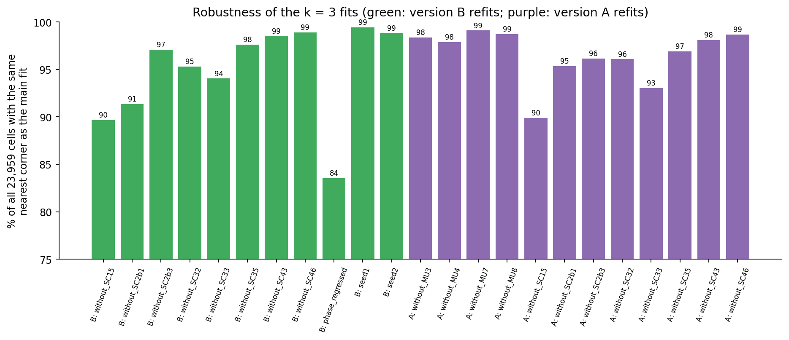
<p class="caption"><b>Figure 23. Agreement of each refit with its main k = 3 fit (report figure, from <code>results/*/robustness/k3_*.csv</code>).</b> Bar height: % of all 23,959 cells whose (matched) nearest corner is unchanged. Green: version B refits (8 leave-one-tumour-out, cell-cycle regression, 2 new subsamples). Purple: version A leave-one-tumour-out (12).</p>

- **Observation.** Leave-one-out: 89.7–98.9% (B), 89.9–99.1% (A); lowest when SC15 is removed in both. Cell-cycle regression: 83.5%. New subsamples: 98.8% and 99.4%. Specialist agreement was 100% in all 23 refits. Refit t-ratios ranged 0.486–0.546 (not re-tested against shuffles). After cell-cycle regression, V3 remained Early-Hybrid-dominated (68%, top cluster Proliferative Early Hybrid EMT 37%).
- **Interpretation.** The triangle does not depend on any single tumour or on the random subsample. SC15 has the largest influence (consistent with it supplying V1's tip). Removing cell-cycle structure moves 16% of cells but keeps the corners' identities, so V3 is **proliferative-associated but not purely a cell-cycle corner**.
- **Not established.** Robustness to leaving out *two or more* tumours, to the gene filter, to normalisation, to MAGIC, or to batch correction (not run).

## 9.11 What is corner V1? (Figure 24)

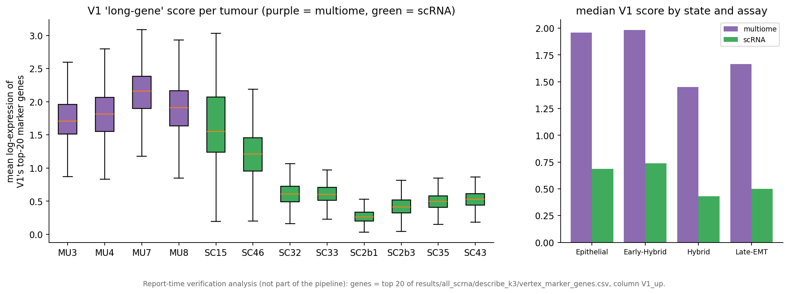
<p class="caption"><b>Figure 24. The V1 "long-gene" score (report figure; report-time verification analysis).</b> Score = each cell's mean log-expression of the top-20 V1 marker genes of version B (<code>vertex_marker_genes.csv</code>, column <code>V1_up</code>: <code>Camk1d, Pcdh7, Maml2, Frmd4b, Adgrl3, AY036118, Pard3, Magi1, Ext1, Mast4, Zswim6, Aopep, Atxn1, Ptpn13, Hivep2, Macf1, Cmss1, Efna5, Ldlrad4, Maml3</code>). Left: per tumour (box = interquartile range, line = median, whiskers to 1.5 IQR). Right: median by state and assay.</p>

| Tumour | MU3 | MU4 | MU7 | MU8 | SC15 | SC46 | SC32 | SC33 | SC2b1 | SC2b3 | SC35 | SC43 |
|---|---|---|---|---|---|---|---|---|---|---|---|---|
| Median score | 1.71 | 1.81 | 2.16 | 1.91 | **1.55** | **1.21** | 0.61 | 0.61 | 0.26 | 0.41 | 0.50 | 0.53 |

- **Observation.** All four multiome tumours score high; among scRNA tumours, SC15 and partly SC46 score high and the other six score low. Within each assay, the score varies only modestly by EMT state (multiome 1.45–1.98; scRNA 0.43–0.74).
- **Interpretation.** V1 tracks an axis that is (i) present in every nuclei sample, (ii) present in two whole-cell samples, and (iii) largely independent of EMT state. The most likely explanation is a **difference in RNA composition or read counting** (e.g. intronic reads counted for some libraries, which inflates long genes; nuclei always carry such reads), present in SC15 and SC46 for an unknown reason (e.g. different chemistry, more lysed cells, ambient nuclear RNA, or a genuine quiescent-cell biology). SC15 is not low-quality by standard metrics: median 34,225 UMIs, 6,098 genes, 2.7% mitochondrial.
- **A caution on circularity.** The marker genes were selected from the cells nearest V1, which include projected multiome cells. So "multiome cells score high" is partly built in. The informative comparisons are among scRNA tumours and across states.
- **What would settle it.** Intronic-read fraction per cell (needs the raw reads or a spliced/unspliced count matrix, not available on GEO), a gene-length analysis of V1's markers, and checking the SC15 library's chemistry. None was done.

<div class="checkpoint">

**Learning checkpoint 9**

1. *Why is Figure 18 (KS genes) a warning against reading too much into label separation?* — Labels separate neatly, yet the triangle is no better than shuffled data.
2. *What is the best evidence that V1 is not an EMT state?* — Its marker score is high in every multiome sample and in two scRNA tumours regardless of EMT state, and 89% of SC15 cells carry it in every state: a whole-sample shift, not a cell state. (`Malat1` is *not* evidence; see the correction in §9.5.)
3. *Which state is least specialised, and is that rule-dependent?* — Hybrid; no, all three rules agree.
4. *What fraction of cells kept their corner when SC15 was left out (B)?* — 89.7%.

</div>


# 10. Methodological choices and alternatives

Each decision is classified by its basis: **[P]** justified explicitly in the project (pre-registration, README, run discussion), **[L]** inherited from a published method, **[C]** inferred from the code with no written justification, **[W]** weakly justified or questionable.

| Decision | Choice made | Basis | Main alternatives | How the alternative could change results |
|---|---|---|---|---|
| Data source | Authors' Seurat object, 23,959 labelled cells | [P] only processed source on GEO | Request raw counts / full 54,081-cell atlas | More cells and tumours; independent QC; could reveal why 54,081 ≠ 23,959 |
| Gene detection filter | ≥ 1% of cells | [C] | HVG selection (paper used Seurat HVGs); stricter/looser thresholds | HVGs would emphasise high-variance genes, possibly strengthening tumour fingerprints or EMT |
| Mito/ribo genes | removed (regex missed `Rplp0/1/2`, `Rpsa`) | [P] with a [W] implementation gap | keep them ("arm A", planned, not run) | Could add a biomass/energy axis [7], or more assay signal |
| Normalisation | CP10k + log1p | [L] standard (Scanpy [15]) | scran, SCTransform, Pearson residuals | Better depth correction could weaken the depth–PC2 correlation in B |
| Imputation | none | [P] "honest raw shape first" | MAGIC (Groves [8]; thesis's Pal fits) | Sharper corners and higher t, but a less comparable null (Ch. 11) |
| Gene scaling | centred, not scaled | [L] Hausser [7] | z-score genes | Low-expressed noisy genes gain weight |
| Batch correction | none in main fit | [P] to see batch, then test it | Harmony / scANVI embeddings (paper's own space) | Would shrink tumour fingerprints and the V1 axis; may also remove tumour-linked EMT biology; scANVI is label-guided (circular) |
| Gene set | all genes (A, B) and KS (C) | [P] | HVGs; paper's state marker genes; SCENIC regulons | Changes what "axes" exist; C already shows the answer depends on it |
| Fit cells | ≤ 800 per tumour | [P] | all cells; balance by state | Big tumours would dominate corners |
| scRNA-only fit (B) | added after seeing A | [P] but **not pre-registered** | multiome-only (4 tumours, mostly epithelial); assay as covariate | — |
| PCA solver | exact (gram/SVD) | [P] validated | randomized | No change for PCs 1–10 (checked) |
| PCs used for fit | k−1 | [L] ParTI [6], engine | fit in more PCs, then project | Corners could use more information; t-ratio needs k−1 dims |
| PCHA δ | 0 | [L] thesis engine | δ > 0 (ParTI default practice) | Corners outside the cloud; higher t; more cells inside |
| Starts | 15 real / 5 null | [L] thesis breast scripts | equal starts | No effect at k = 3 (checked); unchecked for k ≥ 4 |
| Null model | shuffle each PC independently | [L] ParTI [6] | within-tumour shuffles; bootstrap stability | A within-tumour null would ask whether the triangle exists beyond tumour fingerprints |
| Shuffles | 200 | [P] compute budget | 1,000 (Groves) | Finer p; same conclusion where margins are large |
| ESV space | first 10 PCs | [C] fixed choice | the 0.1%-rule dimension (49–108 PCs) | Elbow could move |
| k rule | smallest p < 0.01 ≤ elbow | [P] pre-registered | bootstrap stability; cross-validation | Could choose k = 4, which isolates the hybrid corner |
| Specialist rule | gap ≥ 0.35 (main), closest 5%, w > 0.95 | [P] gap is a thesis convention; others [L] Groves | — | Specialist fractions change by an order of magnitude (§9.6) |
| Corner matching in refits | by cell assignments (Hungarian) | [C] | by coordinates (`match_vertices`, unused) | Cell-based is more meaningful across different PC spaces |
| Cell-cycle handling | phase-mean regression (sensitivity only) | [P] | score regression; remove cycling genes | Might move V3 further |

**Decisions that deserve the most scrutiny:** (1) no batch handling in the primary fit while tumour fingerprints are large; (2) the specific null model; (3) δ = 0 together with noisy data (many cells outside); (4) the scRNA-only focus chosen after seeing results.

<div class="checkpoint">

**Learning checkpoint 10**

1. *Which decision was made after seeing results?* — The scRNA-only fit (version B).
2. *Why could Harmony help and hurt?* — It removes tumour/batch fingerprints, but in this design it can also remove EMT differences that are tumour-linked, and the paper's scANVI used labels.

</div>

# 11. Critical evaluation and limitations

## 11.1 Separating kinds of claims

| Claim | Kind | Strength |
|---|---|---|
| "On all genes, the PC1–PC2 cloud is more triangular than independent PCs" | statistical evidence | Moderate: p at the floor of 200 shuffles; modest effect (0.53 vs null max 0.50–0.52) |
| "Late-EMT cells occupy one corner with collagen/matrix genes" | computational + observation | Strong: 94% purity, 4 tumours, survives all refits; matches paper's markers |
| "Epithelial/early-hybrid proliferating cells occupy another corner" | computational | Strong for location; "proliferation" supported by phase labels and genes |
| "V1 is a nuclear/technical axis" | interpretation | Moderate: assay pattern, long genes, whole-sample shift; not tested at read level (`Malat1` withdrawn as evidence) |
| "Hybrid cells are generalists" | computational | Robust across rules; interpretation as "multi-task" is a hypothesis |
| "Cells perform tasks at the corners (e.g. proliferation, matrix remodelling)" | hypothesis | Not tested: no functional data |
| "Cells move between corners / EMT proceeds along an edge" | not supported | Snapshot data; geometry is not time |
| "A Pareto trade-off shapes EMT" | hypothesis | The test is compatible with but does not establish it |

## 11.2 Main limitations, in order of importance

1. **Confounding of tumour, assay and state** (§4.4). Each tumour is one library with one assay. Within EMT states, tumour identity still explains 32–72% of the variance of most of PCs 1–7 (A and B). Leave-one-out shows no single tumour makes a corner, but the axes are still partly tumour identity. With n = 12 tumours, of which only a few (e.g. SC15, SC32, SC46) contain substantial numbers of most states, the design cannot fully separate them.
2. **A technical corner.** One of three corners is most plausibly technical (§9.11). A "k = 3 simplex" therefore has only two biological corners, i.e. the biological part is closer to a **line with a proliferation bend** than to a three-task triangle. Seen this way, k* = 3 may be counting the technical axis as a corner.
3. **The null model.** Shuffling PCs independently tests independence, not Pareto optimality. Tumour clusters alone can make a cloud "triangular". A within-tumour or batch-aware null was not run.
4. **Modest effect sizes.** t = 0.53 is far from a filled triangle (toy example 0.69; ideal ~1); 23–27% of cells lie outside the triangle.
5. **Specialist definitions disagree by an order of magnitude.** Any "x% are specialists" statement is rule-dependent; only rankings (hybrid least specialised) are robust.
6. **Gene-set dependence.** KS genes: no simplex. All genes: simplex. The triangle depends on non-EMT genes (proliferation, technical). This is informative, not a failure, but it limits the claim to "the transcriptome", not "EMT".
7. **Depth.** B's PC2 correlates with log depth (r² 0.48). Depth differs between states and tumours, so its contribution cannot be removed cleanly.
8. **Circular labels.** The paper's states come from clustering the same data (in a corrected space). Finding labelled states at corners partly re-finds that clustering.
9. **Single-fit uncertainty.** Corner positions have no confidence regions (no bootstrap). Refits show stability of assignments, not of coordinates.
10. **Data provenance gaps.** 23,959 vs 54,081 cells; 3 vs 4 multiome tumours; the R export script was not saved.

## 11.3 Alternative explanations for the main finding

The k = 3 result (two biological corners plus V1) is also compatible with:

- **A continuum plus a technical direction.** EMT is a curved line from proliferative epithelial to late EMT; the third direction is assay/library. Version C (no simplex on EMT genes) supports this.
- **Tumour mixture geometry.** Tumours with different state mixes and fingerprints make a cloud with lobes; a triangle fits lobes.
- **Proliferation × EMT.** The "proliferative" corner may reflect that cycling is common in epithelial/early-hybrid and rare in late EMT [1], so proliferation and EMT are correlated and form an L-shaped cloud.

None of these was ruled out.

## 11.4 What would strengthen the conclusions

- Batch-aware null (shuffle within tumour) and bootstrap confidence regions for corners.
- Fit restricted to the three tumours with all four states (SC15, SC32, SC46), and leave-two-out.
- Read-level test of V1 (intronic fraction; gene-length enrichment of V1 markers).
- The MAGIC version (planned) with its caveats, and a Harmony version.
- A gene-set enrichment of each corner's markers against task gene sets (Hausser's universal tasks [7]).
- Functional data linking corners to tasks (proliferation assays, invasion, matrix production) — outside this project.

<div class="checkpoint">

**Learning checkpoint 11**

1. *Why might k* = 3 overstate the number of biological tasks?* — One corner is technical, leaving two biological corners.
2. *Name one alternative explanation for a significant triangle.* — Tumour clusters (lobes) or a continuum plus a technical axis.

</div>

# 12. Robustness and validation

## 12.1 Checks performed during the run

| Check | Result | File |
|---|---|---|
| Matrix/metadata alignment | assertions passed | `01_build_anndata.py` |
| Projection reproduces fit scores | assertion passed | `02_pca.py` |
| Gram vs full SVD (A) | identical to ~10⁻¹³ | run log (§6.2) |
| Randomized vs exact PCA | \|r\| ≥ 0.9996, PCs 1–10, all versions | `pca_info.json` |
| PCHA starts succeeded | 15/15 for every real fit | `fit_k*.json` |
| Null fits succeeded | 3,000/3,000 | `null_k*.npy` |
| Leave-one-tumour-out (B 8, A 12) | 89.7–99.1% agreement | `robustness/k3_loto.csv` |
| Cell-cycle regression (B) | 83.5% | `robustness/k3_nophase.csv` |
| New subsamples (B, seeds 1–2) | 98.8%, 99.4% | `robustness/k3_seed.csv` |

## 12.2 Checks performed for this report

| Check | Result |
|---|---|
| p-values recomputed from saved null arrays | match `fit_summary.csv` exactly for all 15 (version × k) |
| 5 vs 15 PCHA starts at k = 3 | identical t-ratios (6 seeds, A and B) |
| Cell counts, tumour × state table | match metadata |
| Gene filter result | 14,502 genes; `Rplp0/1/2`, `Rpsa` remain |
| QC by assay and tumour | multiome median % mito 13.4 vs scRNA 4.6 (corrects an earlier note) |
| Version B tables on scRNA cells only | recomputed; differ from all-cell tables (§9.6) |
| V1 long-gene score per tumour | high in all multiome and in SC15, SC46 |
| Paper claims (QC, states, trajectory, cycling) | verified in the PDF text; "cycling hybrid branch" not in paper |
| Groves specialist definitions | verified in the PDF text |
| PCHA algorithm details | read from installed `py_pcha` source |

## 12.3 Not validated

- No independent reimplementation; no second analyst.
- Corner coordinates have no bootstrap uncertainty.
- k ≥ 4 start-count asymmetry; refit t-ratios not tested against nulls.
- Sensitivity to normalisation, gene filter, HVG selection, δ, number of PCs in the ESV.
- MAGIC, Harmony and "arm A" (mito/ribo kept) versions: not run.

<div class="checkpoint">

**Learning checkpoint 12**

1. *Which check showed the p-values were not inflated by unequal starts?* — Refitting the real data with 5 starts gave identical t at k = 3.
2. *What does "100% specialist agreement" not tell you?* — Anything about borderline cells; it only counts cells clearly at a corner in both fits.

</div>

# 13. Integrated scientific discussion

**What the geometry says.** On the whole transcriptome, LKPR SCC tumour cells form a cloud whose two largest axes give a triangle that is more pronounced than in shuffled data. Two corners are coherent biology: a **proliferative epithelial/early-hybrid** corner (basal keratins, S/G2M) and a **late-EMT** corner (collagens, fibroblast-like genes). The third corner is a **long-gene/nuclear-RNA** direction shared by the multiome samples and two scRNA tumours. Hybrid EMT cells, and the proliferative hybrid cluster, are interior mixtures. Restricted to EMT genes, the cloud is a continuum without a significant simplex.

**How this relates to the paper.** Pérez-González et al. describe a branching trajectory from epithelial through hybrid to late EMT, with a second branch ending at hybrid EMT, and cycling cells in epithelial, early-hybrid and hybrid states but not late EMT [1]. The geometry here is consistent with that: the late-EMT corner is non-cycling; proliferation sits on the epithelial/early-hybrid side; hybrid cells lie between. At k = 4, a cycling hybrid corner appears, which echoes the paper's statement that hybrid states can be highly proliferative [1, 3]. The archetype view adds one thing the clustering view does not: hybrid cells are **not extreme** on any axis; they are mixtures between proliferative-epithelial and late-EMT profiles.

**How this relates to Pareto theory.** Hausser et al. found that cancer tasks include cell division and invasion/tissue remodelling [7]. The two biological corners here resemble those two tasks: division (keratin-rich proliferating cells) and matrix remodelling (collagen-producing late-EMT cells). That resemblance is suggestive but **not tested** (no task gene-set enrichment, no functional data). With only two biological corners, the data are equally consistent with a one-dimensional EMT continuum that is bent by proliferation.

**How this relates to the thesis's breast results.** As in the Pal analysis, the most extreme cells at corners come from one or two tumours/patients. Leave-one-out showed that corners survive removal of any single tumour, which is stronger evidence than the breast case provided. But the tips of the corners are still tumour-specific.

**What is genuinely new here.** (i) A tested simplex for this dataset with an explicit null; (ii) quantification of tumour fingerprints beyond EMT state; (iii) the identification of a technical (nuclear) axis in the integrated data that would otherwise be read as a state; (iv) a rule-robust statement that hybrid EMT cells are generalists.

<div class="checkpoint">

**Learning checkpoint 13**

1. *Which two Hausser tasks do the biological corners resemble?* — Cell division and invasion/tissue remodelling. (A resemblance, not a test.)
2. *What does the archetype view add to the paper's clustering?* — That hybrid cells are mixtures between corners, not extremes.

</div>

# 14. Conclusions and future directions

## 14.1 Answers to the core questions

> **Superseded in part.** See the Addendum (follow-up analyses, 12 Oct 2026) for the revised conclusions; the answers below describe the state before those analyses.

- **Original question.** Do mouse SCC EMT states fill a simplex, and which states are corners?
- **Why it matters.** It distinguishes a single EMT continuum from a multi-task trade-off, which changes how hybrid states should be thought of.
- **What each stage contributed.** PCA diagnostics revealed tumour and assay structure; fits and permutation tests established a k = 3 triangle on all genes and none on EMT genes; description identified corners; Groves specialists exposed tumour-specific tips; robustness showed corners survive single-tumour removal; the V1 check identified a technical axis.
- **Most important findings.** Two biological corners (proliferative epithelial/early-hybrid; late EMT) plus a technical corner; hybrid cells as generalists; no simplex on EMT genes alone; strong tumour fingerprints.
- **What is established.** The geometry described is reproducible within this dataset and pipeline, and not driven by any single tumour or subsample.
- **What remains uncertain.** Whether the triangle reflects tasks; whether V1 is technical; how much of the axes is tumour identity; results under MAGIC or batch correction.
- **Scientific contribution.** A careful, pre-registered archetype analysis showing that, in this dataset, the "simplex" is part biology and part technology, with a clear warning for integrated scRNA/multiome data.

## 14.2 Next steps, in priority order

1. **Settle V1**: gene-length/intronic analysis; regress out the V1 score and refit; check SC15/SC46 library chemistry.
2. **Batch-aware null and bootstrap** corner uncertainty.
3. **MAGIC version** with the same pipeline (planned) and a **Harmony version**.
4. **Three-tumour fit** (SC15, SC32, SC46) where all states coexist.
5. **Task annotation** of corners with gene-set enrichment (Hausser tasks, hallmark sets) and SCENIC regulons (`auc_mtx` in the object; not yet exported).
6. Report version B tables on scRNA cells by default (a small change to `04_describe_simplex.py`).

## 14.3 What to keep and what to change if starting again

**Keep:** pre-registration; tumour balancing; exact PCA with validation; the shared module; resumable permutation runs; leave-one-tumour-out as a primary check; multiple specialist rules side by side.

**Change:** fix the ribosomal regex; save the R export script; make script 04 report reference cells separately from projected cells; add a within-tumour null; compute bootstrap corner uncertainty; decide the scRNA-only analysis in advance (assay was a known confounder); describe the ESV dimension choice in the code docstrings.

<div class="checkpoint">

**Learning checkpoint 14**

1. *What is the single most important open question?* — Whether corner V1 is technical (nuclear RNA) or biological.
2. *Which planned version may sharpen corners but needs caution?* — MAGIC: it smooths data and makes shuffled nulls less comparable.

</div>


# 15. Glossary and concept map

## 15.1 Concept map

```
                     QUESTION: do EMT states fill a task simplex?
                                     |
        +----------------------------+-----------------------------+
        |                            |                             |
     BIOLOGY                        DATA                         METHOD
  EMT spectrum              23,959 tumour cells           Pareto task inference
  (Epi > EarlyHyb >         12 tumours, 2 assays          (Shoval, Hart, Hausser,
   Hybrid > Late)           log-CP10k, 14,502 genes        Groves)
        |                            |                             |
        |                  confounding: tumour = assay    PCA -> k-1 PCs -> PCHA
        |                  = state mix                     -> t-ratio vs shuffles
        |                            |                     -> k* (pre-registered)
        +-------------+--------------+-------------+---------------+
                      |                            |
               GEOMETRY RESULT               DIAGNOSTICS
         k*=3 (all genes); none (KS)     tumour fingerprints; depth;
         V2 late EMT | V3 prolif epi     V1 long-gene/nuclear axis
         V1 technical | hybrid interior  leave-one-out stable
                      |
               INTERPRETATION (tentative)
         2 biological corners ~ division vs matrix remodelling;
         hybrid = generalist mixture; tips are tumour-specific
```

## 15.2 Glossary

| Term | Meaning in this project |
|---|---|
| **Archetype / corner / vertex** | A corner of the fitted simplex; in Pareto theory, the phenotype optimal for one task. Named V1, V2, … per fit. |
| **Archetypal analysis** | Statistical method representing data as convex mixtures of archetypes that are convex mixtures of data [11]. |
| **Assay** | Measurement technology: scRNA (whole cells) or multiome (nuclei, RNA + ATAC). |
| **Barycentric weights** | Coordinates of a point as a weighted mix of the corners; sum to 1; negative outside. |
| **CP10k** | Counts per 10,000: library-size normalisation. |
| **Confounding** | Two factors varying together so their effects cannot be separated. |
| **Convex hull** | Smallest convex shape containing all points. |
| **δ (delta)** | PCHA parameter allowing corners outside the hull; 0 here. |
| **EMT** | Epithelial-to-mesenchymal transition. |
| **ESV** | Explained sample variance: fraction of variance reproduced by the simplex model. |
| **η² (eta squared)** | Fraction of a variable's variance explained by a grouping. |
| **FDR / q-value** | False discovery rate control for many tests (Benjamini–Hochberg). |
| **Fit cells** | Cells used to define PCA and corners (9,600 in A; 6,400 in B). |
| **Generalist / interior** | A cell not called a specialist; a mixture of corners. |
| **Gram method** | Exact PCA via eigenvectors of the cells × cells matrix. |
| **Hungarian algorithm** | Optimal one-to-one matching, used to align corners between fits. |
| **LKPR** | Lgr5-CreER; Kras^G12D; Trp53^fl/fl; Rosa26-YFP mouse model. |
| **MAGIC** | Diffusion-based imputation of single-cell data [14]; planned, not run. |
| **Multiome** | 10x assay measuring RNA and chromatin accessibility in the same nucleus. |
| **Null model** | Way of generating data without the structure of interest; here independently shuffled PCs. |
| **Pareto front** | Set of phenotypes that cannot improve at one task without losing at another. |
| **PCA / PC / loading / score** | Principal component analysis; a direction; its gene weights; a cell's coordinate. |
| **PCHA** | Principal Convex Hull Analysis, the fitting algorithm [12]. |
| **Permutation p-value** | (1 + #null ≥ observed)/(1 + #null). |
| **Pre-registration** | Writing predictions and decision rules before analysis. |
| **Projected (guest) cells** | Cells placed into a fit they did not help define. |
| **Pseudoreplication** | Treating non-independent observations (cells of one tumour) as independent. |
| **Purity** | Largest minus second-largest weight. |
| **Reference cells** | Population on which the 5% cut-offs are set (scRNA cells for B). |
| **Simplex** | Convex hull of k points in k−1 dimensions. |
| **Specialist** | Cell near a corner; by gap ≥ 0.35, closest 5%, or weight > 0.95. |
| **t-ratio** | Simplex volume / data hull volume. |
| **Tumour fingerprint** | Expression differences between tumours not explained by EMT state. |
| **UMI** | Unique molecular identifier; counts molecules. |
| **Version A / B / C** | All genes all tumours / all genes scRNA tumours / KS genes all tumours. |

# 16. Plain-language explanation of the whole project

Imagine every tumour cell as a dot on a map. Where a dot sits depends on which of its genes are on and how strongly. Cells that are alike sit close together.

The scientists who made this dataset had already sorted the cells into four groups along a path called EMT. At one end, cells are "epithelial": they stick together in sheets like normal skin. At the other end they are "late EMT": loose, fibroblast-like cells that make collagen. In between are "early hybrid" and "hybrid" cells that mix features of both.

There is a theory that when cells must juggle several jobs that compete, for example dividing quickly versus remodelling the tissue around them, the best possible cells form a triangle on the map. The corners are the cells that do one job best. Cells in the middle compromise.

We asked whether these tumour cells form such a triangle. We squeezed the 14,502-gene map down to its two most informative directions, drew the best triangle around the cells, and checked whether the real cells fit a triangle better than scrambled cells do. They did, a little.

Then we looked at what sits at each corner. One corner held the collagen-making late-EMT cells. One held dividing epithelial-like cells. The third corner, surprisingly, was not an EMT state at all. It held cells whose RNA looks like RNA from cell nuclei. That is a signature of how some samples were measured, not of what the cells are doing. Hybrid cells sat in the middle: they are mixtures, not specialists.

When we used only the genes known to track EMT, there was no triangle at all, just a smooth path from epithelial to mesenchymal. So the triangle needs extra ingredients beyond EMT: cell division, and a measurement artefact.

We checked that no single tumour was responsible by removing tumours one at a time; the triangle stayed. But the most extreme cells at each corner came mostly from one or two tumours, so "corner" cells partly reflect individual tumours.

The honest summary: in these tumours, EMT looks more like a path than a three-way trade-off; proliferation adds a bend; and one apparent corner is technical. Hybrid cells are in-between cells.

# 17. Questions and answers for a supervisor or research discussion

**Q1. Why should I believe there is a triangle at all?**
On all genes, the observed t-ratio (0.53) exceeded all 200 shuffled datasets in two versions (p = 0.005), and the triangle's cell assignments were 90–99% stable to leaving out any tumour. But the effect is modest, and the null only rules out independent PCs, so I describe it as "more triangular than structureless data", not as proof of a Pareto front.

**Q2. Isn't the third corner just batch?**
Probably technical, yes. Its marker score is high in all four multiome (nuclei) samples and in two scRNA tumours, almost independent of EMT state, and it shifts whole samples rather than one state. I have not proven it at the read level; I would test intronic fractions and gene length next.

**Q3. Why did you fit on scRNA cells only?**
After the all-cell fit showed a multiome corner, fitting on one assay removes that source of variation from the axes. It was not pre-registered, I say so, and it gives the same three corner types as the pre-registered fit.

**Q4. Why not batch-correct with Harmony or use the paper's scANVI space?**
To see batch effects rather than hide them. scANVI was trained with labels, which would make finding labelled states at corners circular. A Harmony version is a planned comparison.

**Q5. Why not use MAGIC like Groves?**
To get the raw shape and a fair null first. MAGIC smooths cells towards neighbours and makes the shuffled null less comparable. It is the next planned run.

**Q6. How did you choose k?**
By a rule written before fitting: the smallest k with permutation p < 0.01 at or before the ESV elbow. That gave k = 3 for A and B and none for C.

**Q7. Why are k = 6 and 7 significant everywhere, even for KS genes?**
High-dimensional real data almost always have some dependence between PCs that shuffling destroys; at high k this is enough to beat the null. That is why the rule ignores k beyond the elbow.

**Q8. What does "specialist" mean, and why three definitions?**
Gap ≥ 0.35 (thesis convention), Groves's closest 5% (Fig. 3E) and weight > 0.95 (Groves Methods). They differ by an order of magnitude in counts, so I only rely on conclusions that hold under all three (hybrid cells least specialised).

**Q9. Are the corners just tumours?**
No single tumour makes a corner (leave-one-out), but the most extreme 5% at each corner is 82–92% one tumour (or two for V3). Broad corner regions are multi-tumour; tips are tumour-specific.

**Q10. Does this show cells transition between corners?**
No. These are snapshots. Geometry shows where cells are, not where they go.

**Q11. How do your results relate to the paper's trajectory?**
Consistent: late EMT is a non-cycling extreme, proliferation is on the epithelial/early-hybrid side, hybrids lie between. At k = 4 a cycling hybrid corner appears, echoing the paper's hybrid branch. Note that the paper does not call that branch "cycling"; that was our earlier misreading.

**Q12. What is the weakest part of the analysis?**
The confounding of tumour, assay and state, together with a null model that does not account for tumour structure.

**Q13. How reproducible is it?**
Deterministic given the seeds; all outputs are saved; p-values were recomputed from the saved nulls and matched. The R export step was not saved as a script.

**Q14. What would change your conclusions?**
A batch-aware null that the triangle fails; V1 shown to be biological (e.g. a quiescent state confirmed in tissue); or a MAGIC/Harmony analysis giving different corners.

# 18. Technical appendices and reproducibility

## 18.1 Environment

`Project_1/.venv`, Python 3.9 (macOS, Apple M2, 16 GB RAM): numpy 1.26.4, scipy 1.13.1, scikit-learn 1.6.1, pandas 2.3.3, matplotlib 3.9.4, anndata 0.10.9, scanpy 1.10.3, py-pcha 0.1.3, statsmodels 0.14.6 (not used by the pipeline). `pypdf` 6.20 was installed into the venv during the run, only to read PDFs. The report build used `markdown` and `pymdown-extensions`, installed into a temporary folder outside the project, plus Google Chrome (headless) and MathJax 3.2.2 from a CDN.

## 18.2 Parameters

| Parameter | Value | Where |
|---|---|---|
| Gene detection | ≥ 1% of cells | `01_build_anndata.py` |
| Normalisation | CP10k, log1p | `01_build_anndata.py` |
| Fit cells per tumour | ≤ 800, seed 0 | `scc_common.py` |
| PCs stored | 50 (evr: 200) | `scc_common.py`, `02_pca.py` |
| k | 3–7 | `scc_common.py` |
| PCHA | δ = 0; 15 starts (real), 5 (null); conv 10⁻⁶; maxiter 500 | `scc_common.py`, `src/archetypes.py` |
| Shuffles | 200 per k | `run_fits.sh` |
| ESV | k = 2–10 in first 10 PCs, best of 5 | `03_fit_and_test.py` |
| Specialist | gap ≥ 0.35; closest 5%; w > 0.95 | `scc_common.py`, `06_groves_specialists.py` |
| Enrichment | 10 distance bins; BH q < 0.1; fold ≥ 1.5 reported | `04_describe_simplex.py` |

## 18.3 Reproducing

See `REPRODUCIBILITY_GUIDE.md` for exact commands, expected runtimes and expected key numbers.

## 18.4 Discrepancies found

| # | Discrepancy | Effect |
|---|---|---|
| D1 | Pre-registration's "cycling hybrid branch" is not in the paper | Prediction basis misattributed |
| D2 | Ribosomal regex misses `Rplp0/1/2`, `Rpsa` | 4 ribosomal genes kept; they load on B's PC1 |
| D3 | `02_pca.py` docstring says the 0.1% rule is used for ESV; ESV uses 10 PCs | Documentation only |
| D4 | `WALKTHROUGH.md` says nuclei have less mitochondrial RNA; here multiome has more | Corrected in report |
| D5 | Version B tables in script 04 include projected multiome cells | Recomputed for scRNA cells |
| D6 | "Multiome cells pile onto V1" holds only for the closest-5% rule | Restated |
| D7 | 23,959 cells vs paper's 54,081; 4 multiome samples vs 3 in paper Methods | Unexplained |
| D8 | Version A `pca.npz` from full SVD, others from gram | No effect (verified equal) |
| D9 | `match_vertices` in `scc_common.py` is unused | Dead code |
| D10 | First version of this report cited `Malat1` as evidence that V1 is nuclear RNA; `Malat1` does not track V1 (r = 0.19) | Withdrawn (§9.5, §9.11, §11.1, Q2) |
| D11 | First version concluded a k = 3 triangle with two biological corners; follow-ups (Addendum) show the strong p-value came from the V1 axis | Conclusions revised (Addendum, §1.5 note) |

## 18.5 Output file index

| Path (under `Mouse_SCC/results/`) | Content |
|---|---|
| `PREREGISTERED_PREDICTIONS.md` | predictions, 2026-10-10 21:24 |
| `<run>/pca.npz`, `pca_info.json` | PCA of each version |
| `<run>/pc_drivers.csv`, `pc_drivers_within_state.csv`, `pc_top_genes.csv` | PC diagnostics |
| `<run>/archetypes_k*.npy`, `null_k*.npy`, `fit_k*.json`, `fit_summary.csv`, `esv_curve.csv` | fits and tests |
| `<run>/describe_k*/` | label tables, per-cell weights, markers, enrichment, figures |
| `<run>/robustness/k3_*.csv` | refits |
| `all_scrna/groves5_k3/` | Groves specialists |
| `<run>/log_*.txt` | printed output of every step |

# Addendum: follow-up analyses (12 October 2026)

This chapter was added after the report was first written. It reports three follow-ups that the first version proposed (Ch. 11.4, 14.2), and it **revises the main conclusion**. Scripts: `codes/07_regress_v1.py`, `codes/08_within_tumour.py`, `codes/09_cross_projection.py`. All three use version B's settings (all genes; scRNA fit cells where a pooled fit is made). They were designed after seeing the first results, so they are **exploratory**, not pre-registered.

## A.1 Follow-up 1: remove the V1 axis and refit

**Why.** Corner V1 tracked a whole-sample shift (§9.11). If it is technical, it should be removed before asking whether the EMT states form a triangle.

**Method** (`07_regress_v1.py`). Score per cell $s_i$ = mean log-expression of V1's top-20 marker genes (version B, k = 3). On the 6,400 version-B fit cells, for each gene $g$ the slope $\beta_g = \mathrm{cov}(x_g, s)/\mathrm{var}(s)$. Every cell then gets

$$x'_{ig} = x_{ig} - \beta_g\,(s_i - \bar s) \qquad\text{(Eq. 11)}$$

which removes the part of each gene that moves linearly with the score. PCA, PCHA (k = 3–7) and 200-shuffle tests were then rerun exactly as in version B (`results/all_scrna_noV1/`).

**Effect on the axes.** The V1 score explained 75% of PC1 before and 0% after. The new PC1 is keratins vs collagens (EMT state η² = 0.60, up from 0.24); PC2 is keratins vs `Csrp2`, `Lgals1`, `Tm4sf1` (hybrid genes). The new PC1 correlates with log depth (r² = 0.51), and tumour identity still explains 31–72% of PCs 1–6 within states.

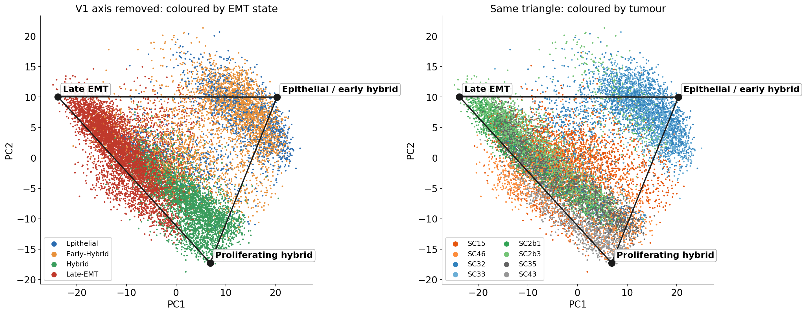
<p class="caption"><b>Figure 25. The k = 3 triangle after removing the V1 axis (scRNA cells; from <code>results/all_scrna_noV1/</code>; drawn by <code>make_slide_figures.py</code>).</b> Left: coloured by EMT state. Right: the same triangle coloured by tumour. Corners: late EMT, proliferating hybrid, epithelial / early hybrid.</p>

**Corners (scRNA cells, gap rule).**

| Corner | Specialists by state | Dividing (S + G2M) | Top genes | Top tumour |
|---|---|---|---|---|
| Late EMT | Late-EMT 94% | 12% | `Col3a1`, `Col1a1`, `Postn`, `Dcn` | SC2b3 47% (4 tumours ≥ 5%) |
| Proliferating hybrid | Hybrid 89% (Proliferative Hybrid EMT 63%) | 77% | `Lgals1`, `Csrp2`, `Tm4sf1`, `Vim`, `S100a4` | SC35 30% (4) |
| Epithelial / early hybrid | Early-hybrid 66%, epithelial 34% | 42% | `Krt14`, `Krt5`, `Krt6a`, `Krt17` | SC32 47% (3) |

**Is the hybrid corner just a cell-cycle corner?** No. Dividing epithelial cells go to the epithelial corner (71%), not the hybrid one (1%); dividing late-EMT cells reach it 10% of the time. Within hybrid cells, dividing ones reach it more often (70% vs 34%). The corner is specifically *proliferating hybrid* cells. Multiome cells, projected in, now sit 89% in the interior.

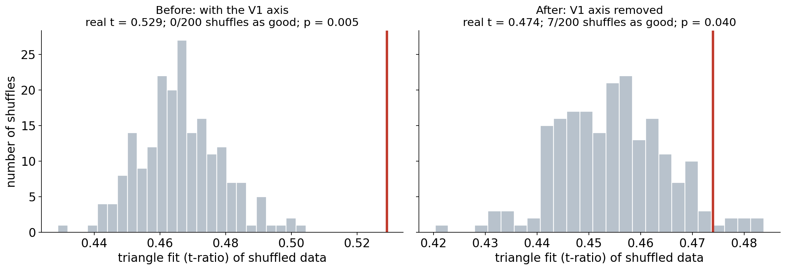
<p class="caption"><b>Figure 26. The k = 3 permutation test before and after removing V1 (from <code>null_k3.npy</code> and <code>fit_k3.json</code> in <code>all_scrna</code> and <code>all_scrna_noV1</code>).</b> Grey: t-ratios of 200 shuffled datasets. Red line: real t-ratio.</p>

| k | Real t | Shuffled median / 95th pct / max | p |
|---|---|---|---|
| 3 | 0.474 | 0.455 / 0.471 / 0.484 | **0.040** |
| 4 | 0.160 | 0.180 / 0.201 / 0.207 | 0.98 |
| 5 | 0.047 | 0.055 / 0.063 / 0.079 | 0.995 |
| 6 | 0.016 | 0.014 / 0.017 / 0.021 | 0.18 |
| 7 | 0.006 | 0.003 / 0.004 / 0.005 | 0.005 |

ESV elbow at k = 5. p-values recomputed from the saved shuffles; they match.

**Reading.** The predicted epithelial / proliferating-hybrid / late-EMT triangle appears once the technical axis is gone, but the evidence that the cloud *is* a triangle is now weak: p = 0.04 (7 of 200 shuffles as good), which passes Groves' p < 0.05 but fails the pre-registered p < 0.01. Under the pre-registered rule there is no k*. **Most of the original strong result (p = 0.005) came from the V1 lobe.**

**Limits.** The score was built from the same data. Within SC15 it is higher in epithelial cells (2.14) than hybrid cells (1.00), so the regression may remove some real signal. Linear regression cannot remove a non-linear technical effect.

## A.2 Follow-up 2: a separate triangle inside each mixed tumour

**Why.** In the pooled triangle, late-EMT cells of mesenchymal tumours reached the late corner (SC2b1 73%, SC2b3 68%) but those of mixed tumours mostly did not (3–13%). Is the triangle a within-tumour structure or a product of pooling different tumours?

**Method** (`08_within_tumour.py`). For SC15 (1,576 cells), SC32 (1,910) and SC46 (1,519), the three tumours with substantial numbers of most states: V1-corrected expression (Eq. 11), the tumour's own PCA, PCHA k = 3 and 4, 200 shuffles. Corners are compared across tumours by **gene signature**: for each corner, mean expression in the 10% of the tumour's cells nearest it minus the rest (14,502 genes), correlated (Pearson r) with the signatures of the pooled corners from A.1.

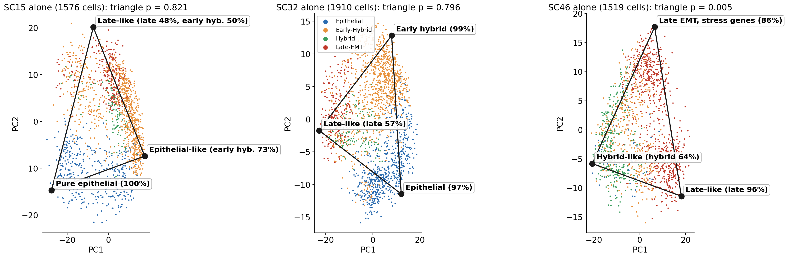
<p class="caption"><b>Figure 27. Triangles fitted inside single tumours (from <code>results/within_tumour/</code>).</b> Each panel: one tumour's cells on its own PC1–PC2, coloured by EMT state, with its k = 3 triangle. Labels: what each corner's genes match, and its state mix.</p>

| Tumour | k=3 p | k=4 p | Late-like corner (r with pooled late) | Third corner |
|---|---|---|---|---|
| SC15 | 0.82 | 0.63 | yes, r = 0.71 | pure epithelial group (r ≈ 0 with all pooled corners) |
| SC32 | 0.80 | 0.015 | yes, r = 0.69 | epithelial (97%) vs early hybrid (99%) split |
| SC46 | **0.005** | 0.59 | yes, r = 0.66 | **hybrid-like**, r = 0.70 (hybrid 64%, 87% dividing) |

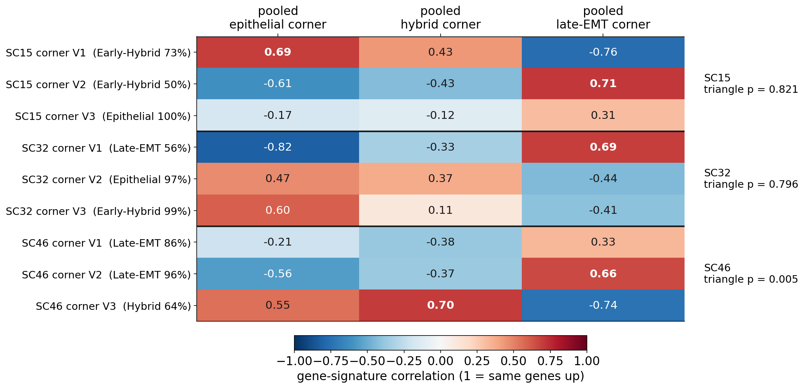
<p class="caption"><b>Figure 28. Gene-signature correlations between within-tumour corners (rows) and the pooled corners (columns) (from <code>corner_signature_correlation.csv</code>).</b> 1 = the same genes are up near both corners.</p>

**Reading.** A late-EMT-like corner with the same genes is found in every tumour. A significant triangle holds in only one of three (SC46), the only one with a hybrid-like corner. SC46 has 44 epithelial cells, so its triangle cannot contain an epithelial corner; it is late / late-stress / hybrid. The k = 4 result for SC32 (p = 0.015) was not examined further.

## A.3 Follow-up 3: every tumour placed into one tumour's triangle

**Method** (`09_cross_projection.py`). Host = SC32 (largest mixed tumour). Its k = 3 within-tumour fit was frozen; all 23,959 cells (V1-corrected) were centred on SC32's gene means and projected on SC32's PCs, **without** per-tumour rescaling, so each tumour keeps its fingerprint.

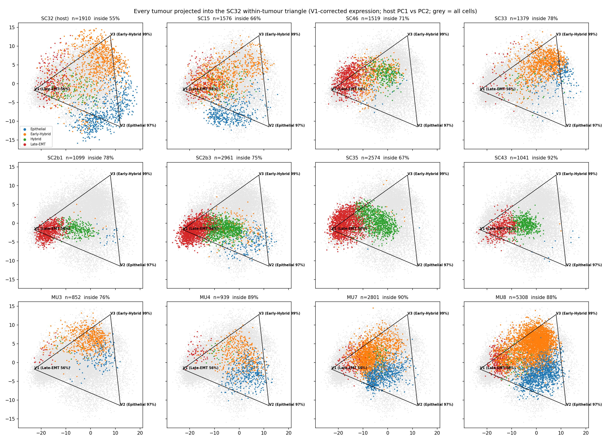
<p class="caption"><b>Figure 29. Every tumour in SC32's triangle (from <code>results/cross_projection_SC32/guests_in_host.png</code>).</b> One panel per tumour; grey = all cells; colour = EMT state; corners labelled by SC32's own corner composition.</p>

| Cells (all guests) | At SC32's late corner | At its epithelial corner | At its early-hybrid corner | Interior |
|---|---|---|---|---|
| Late-EMT, per tumour | **67–98%** (multiome 73–92%) | 0% | 0% | 2–33% |
| Hybrid (scRNA guests) | 13% | 0% | 0% | **87%** |
| Early hybrid | 15% | 1% | 25% | 59% |
| Epithelial | 0.5% | 19% | 3% | 77% |

**Reading.** The same ordering (late → hybrid → early hybrid → epithelial) appears in all 12 tumours and both assays. Late-EMT cells of mixed tumours point the same way as those of mesenchymal tumours; they are simply less extreme, which is why they missed the tip of the pooled triangle. Hybrid cells lie between the ends in every tumour. SC32's own triangle is not significant (p = 0.80), so this tests shared *directions*, not a shared simplex.

## A.4 Revised scorecard and conclusions

| Pre-registered prediction | Original verdict | Revised verdict |
|---|---|---|
| k* = 3 | Met (A, B) | **Not robust**: after removing V1, p = 0.04 (fails p < 0.01); within tumours, 1 of 3 |
| Corners epithelial, late, proliferative hybrid | Partly | **Met in the corrected pooled fit**, but weakly supported as a shape |
| Proliferative Hybrid EMT near a corner | Weakly | **Met** (63% of the hybrid corner's specialists), pooled data only |
| Early hybrid more interior | Met narrowly | Unchanged |
| A corner may be cell cycle | Not as stated | Unchanged: the hybrid corner is not a generic cycling corner |
| A corner may be tumour or assay | Met (V1) | Confirmed; V1 removed |

**Revised conclusion.** In LKPR skin SCC, tumour cells share **one EMT ordering** (epithelial → early hybrid → hybrid → late EMT) across all 12 tumours and both assays, with a conserved late-EMT gene programme. **Hybrid cells are intermediates** between the ends. A **three-corner Pareto triangle is not robustly supported**: it appears only weakly in pooled, technically corrected data and inside one of three tumours. The data are more consistent with an EMT continuum plus tumour-specific side directions (e.g. a proliferating hybrid direction in SC46) than with a three-task trade-off.

**What remains open.** (1) A direct line (k = 2) versus triangle (k = 3) comparison, which the pipeline does not yet do. (2) The origin of V1 (gene length, raw reads). (3) Whether SC46's hybrid corner generalises (more tumours with many hybrid cells). (4) MAGIC and Harmony versions.

<div class="checkpoint">

**Learning checkpoint A**

1. *Why did the k = 3 p-value rise from 0.005 to 0.04 after removing V1?* — The SC15 lobe along the technical axis made the cloud strongly triangular; without it the remaining shape is only slightly more triangular than shuffled data.
2. *What does cross-projection test that leave-one-tumour-out does not?* — Whether other tumours' cells follow the same directions as one tumour's own geometry; leave-one-out only shows no single tumour creates a corner.
3. *Why is the hybrid corner not just "dividing cells"?* — Dividing epithelial cells do not go there (1%); it is specific to (proliferating) hybrid cells.

</div>

# References

1. Pérez-González A, Windels G, Bévant K, Lengrand J, Lemaire S, Moers V, Scozzaro S, Debroux U, Dubois C, Vanuytven S, Blanpain C. Single cell multiomics unravel the transcription networks controlling the different EMT tumor states. *Nat Commun* **17**, 8561 (2026). doi:10.1038/s41467-026-75521-8. Data: GEO GSE288137.
2. Pastushenko I, et al. Identification of the tumour transition states occurring during EMT. *Nature* **556**, 463–468 (2018).
3. Pastushenko I, Blanpain C. EMT transition states during tumor progression and metastasis. *Trends Cell Biol* **29**, 212–226 (2019).
4. Latil M, et al. Cell-type-specific chromatin states differentially prime squamous cell carcinoma tumor-initiating cells for epithelial to mesenchymal transition. *Cell Stem Cell* **20**, 191–204 (2017).
5. Shoval O, Sheftel H, Shinar G, Hart Y, Ramote O, Mayo A, Dekel E, Kavanagh K, Alon U. Evolutionary trade-offs, Pareto optimality, and the geometry of phenotype space. *Science* **336**, 1157–1160 (2012).
6. Hart Y, Sheftel H, Hausser J, Szekely P, Ben-Moshe NB, Korem Y, Tendler A, Mayo AE, Alon U. Inferring biological tasks using Pareto analysis of high-dimensional data. *Nat Methods* **12**, 233–235 (2015).
7. Hausser J, Szekely P, Bar N, Zimmer A, Sheftel H, Caldas C, Alon U. Tumor diversity and the trade-off between universal cancer tasks. *Nat Commun* **10**, 5423 (2019).
8. Groves SM, Ildefonso GV, McAtee CO, et al. Archetype tasks link intratumoral heterogeneity to plasticity and cancer hallmarks in small cell lung cancer. *Cell Syst* **13**, 690–710 (2022). doi:10.1016/j.cels.2022.07.006.
9. Blais J, Jeukens J. Pareto task inference analysis reveals cellular trade-offs in diffuse large B-cell lymphoma transcriptomic data. *Front Syst Biol* **4**, 1346076 (2024).
10. Korem Y, Szekely P, Hart Y, Sheftel H, Hausser J, Mayo A, Rothenberg ME, Kalisky T, Alon U. Geometry of the gene expression space of individual cells. *PLoS Comput Biol* **11**, e1004224 (2015).
11. Cutler A, Breiman L. Archetypal analysis. *Technometrics* **36**, 338–347 (1994).
12. Mørup M, Hansen LK. Archetypal analysis for machine learning and data mining. *Neurocomputing* **80**, 54–63 (2012).
13. Tan TZ, Miow QH, Miki Y, et al. Epithelial-mesenchymal transition spectrum quantification and its efficacy in deciphering survival and drug responses of cancer patients. *EMBO Mol Med* **6**, 1279–1293 (2014).
14. van Dijk D, Sharma R, Nainys J, et al. Recovering gene interactions from single-cell data using data diffusion. *Cell* **174**, 716–729 (2018).
15. Wolf FA, Angerer P, Theis FJ. SCANPY: large-scale single-cell gene expression data analysis. *Genome Biol* **19**, 15 (2018).
16. Korsunsky I, et al. Fast, sensitive and accurate integration of single-cell data with Harmony. *Nat Methods* **16**, 1289–1296 (2019).
17. Xu C, Lopez R, Mehlman E, Regier J, Jordan MI, Yosef N. Probabilistic harmonization and annotation of single-cell transcriptomics data with deep generative models. *Mol Syst Biol* **17**, e9620 (2021).
18. Street K, et al. Slingshot: cell lineage and pseudotime inference for single-cell transcriptomics. *BMC Genomics* **19**, 477 (2018).
19. Phipson B, Smyth GK. Permutation P-values should never be zero: calculating exact P-values when permutations are randomly drawn. *Stat Appl Genet Mol Biol* **9**, Article 39 (2010).
20. Benjamini Y, Hochberg Y. Controlling the false discovery rate: a practical and powerful approach to multiple testing. *J R Stat Soc B* **57**, 289–300 (1995).
21. Jolliffe IT, Cadima J. Principal component analysis: a review and recent developments. *Phil Trans R Soc A* **374**, 20150202 (2016).
22. Yang J, et al. Guidelines and definitions for research on epithelial–mesenchymal transition. *Nat Rev Mol Cell Biol* **21**, 341–352 (2020).
23. Bakken TE, et al. Single-nucleus and single-cell transcriptomes compared in matched cortical cell types. *PLoS One* **13**, e0209648 (2018).
24. Squair JW, et al. Confronting false discoveries in single-cell differential expression. *Nat Commun* **12**, 5692 (2021).
25. Luecken MD, Theis FJ. Current best practices in single-cell RNA-seq analysis: a tutorial. *Mol Syst Biol* **15**, e8746 (2019).
26. Nieto MA, Huang RY, Jackson RA, Thiery JP. EMT: 2016. *Cell* **166**, 21–45 (2016).
27. Aibar S, et al. SCENIC: single-cell regulatory network inference and clustering. *Nat Methods* **14**, 1083–1086 (2017).
28. Young MD, Behjati S. SoupX removes ambient RNA contamination from droplet-based single-cell RNA sequencing data. *GigaScience* **9**, giaa151 (2020).
29. Germain PL, Lun A, Garcia Meixide C, Macnair W, Robinson MD. Doublet identification in single-cell sequencing data using scDblFinder. *F1000Research* **10**, 979 (2021).
30. Kuhn HW. The Hungarian method for the assignment problem. *Naval Res Logist Q* **2**, 83–97 (1955).
31. Barber CB, Dobkin DP, Huhdanpaa H. The Quickhull algorithm for convex hulls. *ACM Trans Math Softw* **22**, 469–483 (1996).

*Citation verification.* References 1, 7, 8 and 9 were checked against the PDFs in `Project_1/papers/`; references 2, 3, 4, 16, 17, 18, 27, 28 and 29 against the reference list of [1]. The others are standard references cited from the author's knowledge and were not re-checked online in this session; volume and page numbers should be confirmed before formal submission. Reference 26: the extracted reference list of [1] reads "Cell 126", but the correct volume is 166.
