# Do EMT states fill a Pareto simplex? Archetype analysis of five single-cell datasets

**Thesis report, version 2, 17 October 2026** (version 1 of 16 October plus the cleaning audit of Section 9; changed statements are marked). Covers: mouse skin SCC (GSE288137), Cook cell lines (GSE147405), mouse PDAC (GSE173958), 4T1 clones (GSE303505, Pattabiraman lab) and MCF10A / HuMEC pseudospace (GSE114687). The breast-cancer chapter is a separate branch and is not part of this report.

---

## 0. Summary

The report asks two questions of five single-cell EMT datasets, using archetype analysis (Pareto task inference in the style of Groves et al. 2022):

1. **Can archetype analysis show task trade-offs, that is, corners ("tasks") in gene-expression space?**
2. **Where do hybrid cells lie: as specialists at a corner, or as generalists in the interior?**

**Answer to question 1.** Not in the way the Pareto idea predicts, with one partial exception. In four datasets (SCC, Cook, PDAC, 4T1), the EMT marker genes (the Tan 2014 "KS" genes) never form a simplex that is more than sample identity, and the corners that do appear are *programmes*: proliferation, TGF-β or matrix response, hypoxia or stress, and sample or technical axes. In the fifth dataset (GSE114687: MCF10A and HuMEC grown so that EMT progresses with distance from the colony edge), after cleaning, a triangle is found inside nearly every sample (18 of 24 fits), including on KS genes in three samples, and it survives a sequencing-depth control (regression: 8 of 8 fits; depth matching: 7 of 8). Its three corners recur in both cell lines and both treatment arms: a **cycling** corner, a **differentiated-epithelial** corner and an **EMT / matrix** corner, and they line up with colony position (cycling and EMT corners mostly outer colony, differentiated corner mostly inner). So a trade-off between proliferation, differentiation and EMT exists in a clean induced-EMT system, but not as "epithelial versus mesenchymal versus hybrid" corners, and not in tumours.

**Answer to question 2.** Hybrid cells are mostly **generalists**. In SCC 98.8% of Hybrid-state cells are generalists by the closest-5% rule; in 4T1 83 to 86%; in PDAC 70 to 86% of other-library cells fall in the interior of a host triangle; in GSE114687 an early- or late-hybrid state is the most generalist state in 7 of 8 fits by the purity-gap rule and 8 of 8 by the closest-5% rule. In no dataset do hybrid cells own a corner. The exceptions to "hybrids are the most generalist" are small (for example HuMEC Mock, where epithelial cells are slightly more generalist than early-hybrid cells).

**What is not shown.** None of this shows that EMT *is* or *is not* a Pareto trade-off in tumours: most datasets have one sample per condition, labels are partly derived from the same score they are compared with, the fits depend on a cleaning step that changes results in opposite directions across datasets, and the one dataset that shows structure has no replicates.

**Cleaning audit (added 17 October).** The cleaning step was audited and 104 fits rerun (Section 9). One error was found: the technical-gene filter used mouse gene symbols and removed nothing in the two human datasets (Cook, GSE114687); fixing it changes no pass or fail (GSE114687 still 18 of 24). The 4T1 conclusion holds at contamination cutoffs of 0.2 to 0.5. PDAC cleaned fits on the EMT genes alone give no triangle (0 of 9 at k = 3). In GSE114687 the all-genes triangle in MCF10A holds at 5,000, 10,000 and 15,000 UMI, HuMEC is cutoff-sensitive, and the EMT-genes-only triangle needs at least 10,000 UMI. A Hallmark check of corner names now exists for all five datasets and agrees with the names.

---

## 1. Background and questions

### 1.1 The idea
Pareto task inference (Shoval et al. 2012; Hart et al. 2015; Hausser et al. 2019; Groves et al. 2022) says that if a cell must perform several tasks and cannot be best at all of them, then in gene-expression space cells fill a simple shape: a **line** for two tasks, a **triangle** for three, a **tetrahedron** for four, and so on (a k-corner **simplex**). The corners ("archetypes") are cells that specialise in one task. Cells inside the shape are mixtures. In this thesis the tasks of interest are the states of the epithelial-to-mesenchymal transition (EMT): epithelial, early hybrid, hybrid, late EMT.

The competing picture is that EMT is a **continuum**: a single path from epithelial to mesenchymal, which would give a line or curve and no corners.

### 1.2 The two questions
1. Does archetype analysis show **task corners** in EMT data?
2. Where do **hybrid E/M cells** sit: at a corner (specialists) or in the interior (generalists)?

### 1.3 Key concepts (plain language)
- **PCA.** Each cell is a point with thousands of coordinates (one per gene). PCA finds the directions along which cells differ most (PC1, PC2, ...). A k-corner simplex needs only k − 1 PCs, so a triangle uses PC1 and PC2.
- **PCHA (the fitting algorithm).** Finds k corners so that every cell is approximately a mixture of the corners, and each corner is itself a mixture of real cells (delta = 0), so corners stay inside the cloud. It starts from random positions, so it is run 15 times and the largest simplex is kept.
- **t-ratio.** Area (or volume) of the fitted simplex divided by the area of the data's convex hull. A true triangle gives a t-ratio near 1; a round blob gives less.
- **Permutation test.** Each PC is shuffled separately across cells, which keeps each axis's spread but destroys any shape. The simplex is refitted and its t-ratio recorded, 200 times. **p = (1 + number of shuffles at least as good as the data) / (1 + 200).** The smallest possible p is therefore 0.005. A small p says the data are more simplex-like than shuffled data; it does not by itself prove a Pareto front, because batch structure can also do this.
- **ESV and elbow.** Explained sample variance is how much of the variance in the first 10 PCs the simplex explains. It always rises with k. The elbow is where the rise flattens (a rule of thumb, not a test).
- **Choosing k.** The rule fixed from the start: the smallest k with p < 0.01 at or before the ESV elbow. Larger k often pass automatically because shuffled data lose the small correlations real data have, so k beyond the elbow is ignored.
- **Barycentric weights, purity, specialist.** Every cell gets k weights summing to 1. *Purity* = largest weight − second largest. A cell is a **specialist** of its largest corner if purity ≥ 0.35 (the "gap rule", from the Pal breast work); otherwise it is a **generalist** (interior). Two further rules are used for comparison: the **closest-5% rule** (Groves 2022, Fig. 3E: the 5% of cells nearest each corner are specialists, the rest generalists) and **weight > 0.95** (Groves 2022 methods; finds almost no specialists because corners sit inside the cloud).
- **Hallmark check.** An independent check of corner names: the 10% of cells nearest each corner are scored on MSigDB Hallmark gene sets (E2F targets, G2-M checkpoint, EMT, TGF-β, hypoxia, and others).
- **Path versus triangle test.** A smooth EMT path can mimic a triangle. The test builds a null from a cubic path along an EMT coordinate plus permuted residuals, refits a triangle and asks whether the real triangle fits better than the path-null.
- **Depth.** Sequencing depth (UMI per cell). Dividing cells have more RNA, so depth and cell cycle can go together.

---

## 2. Shared methods and code flow

All five analyses use one pipeline, adapted per dataset (scripts live in each dataset folder under `codes/`). The PCHA engine is `src/archetypes.py`, shared with the breast-cancer chapter, so numbers are computed the same way.

### 2.1 Pipeline

| Step | Script (per dataset) | What it does |
|---|---|---|
| 1 | `01_build_anndata.py` | Read counts, QC, keep genes detected in ≥ 1% of cells, drop mitochondrial and ribosomal genes, normalise to counts per 10,000, log1p. Score S and G2M phase. |
| 1b-1e | `01b`, `01c`, `01d`, `01e` | Dataset-specific: tumour-cell selection (PDAC), derived EMT labels (PDAC, 4T1, GSE114687), cleaned copy (4T1), depth-matched copy (GSE114687). |
| 2 | `02_pca.py` | Pick balanced fit cells (a cap per sample), exact PCA (genes centred, **not scaled**), project all cells, diagnostics: how much of each PC each label explains (η²), PC-count rule. |
| 3 | `03_fit_and_test.py` via `run_fits.sh` | ESV curve; PCHA for k = 3 to 7; 200-shuffle permutation test per k; summary table. |
| 4 | `04_describe_simplex.py` | Weights for every cell, label-by-corner tables (EMT state, cluster, sample, phase), marker genes per corner, distance-bin enrichment, figures. |
| 5 | `05_robustness.py` | Full refit leaving out each sample, a different random subsample, cell cycle removed; corner agreement with the main fit. |
| 6 | `06_groves_specialists.py` | Closest-5% specialist rule, with the gap rule and weight > 0.95 for comparison. |
| 8 | `08_within_unit.py` (and `08_within_tumour.py`) | Fit and test a simplex *inside one sample* (PCA done on that sample only), with options `--clean`, `--decontam`, `--regress-depth`, `--out-suffix`. |
| 8b | `08b_describe_corners.py` | Describe corners of the within-sample fits: cycling %, depth, EMT score, state mix, top genes. |
| 8c | `08c_path_vs_triangle.py` | Path versus triangle test. |
| 9 | `09_cross_projection.py`, `09_hallmark_corners.py` | Project every sample into one sample's frozen triangle; Hallmark scoring of corners. |
| 10 | `10_describe_labels.py` | Specialist / generalist tables per EMT state inside a within-sample fit. |
| 13 | `13_mail_figures.py` | Slide figures. |

### 2.2 Decisions common to all datasets

| Decision | Choice | Reason |
|---|---|---|
| Imputation | none (no MAGIC) | See the raw shape first; imputation can create or sharpen shape. |
| Batch correction | none in the main fit | Batch effects are measured and tested, not removed. |
| Gene scaling | centre only | Scaling gives rare, noisy genes the same pull as strong ones. |
| Fit cells | balanced: at most N per sample (SCC 800 per tumour, Cook 550 per line, PDAC 1,000 per library, 4T1 790 per clone, GSE114687 1,500 per sample) | Large samples would otherwise decide the corners. All other cells are projected afterwards. |
| Gene sets | all genes, and the Tan 2014 KS EMT genes | All genes is standard; KS genes measure EMT directly. Mouse symbols by capitalisation; 42 of 218 genes are absent in mouse. |
| PCA | exact ("gram" method), checked against a randomised PCA | Same PCs, faster. |
| k | 3 to 7; smallest k with p < 0.01 at or before the elbow | Fixed rule so k is not chosen after seeing results. |
| Specialist | gap ≥ 0.35 (main); closest 5% (comparison) | Pal work; Groves 2022. |
| Cleaning (added later) | ≥ 10,000 UMI per cell; technical genes dropped (**in the mouse datasets only; in the human datasets Cook and GSE114687 the filter matched no gene until the 17 October audit, Section 9**); 4T1 also drops cells with immune or stromal marker genes | Low-depth and contaminated cells carried spurious corners in several datasets. The 10,000 threshold is borrowed from Cook and PDAC. |

**Predictions written before fitting** exist for SCC and 4T1. From GSE114687 onward no predictions file was written, and choices added after looking are reported as such.

### 2.3 What changed after looking (reported for honesty)
- SCC: the scRNA-only fit was added after seeing the technical corner; removing the technical axis by regression was tried and **withdrawn as an artefact** (it also removed EMT signal); an earlier argument that the technical corner showed nuclear RNA (`Malat1`) was withdrawn.
- Cook, PDAC, 4T1, GSE114687: cleaned within-sample fits (≥ 10,000 UMI).
- 4T1: contamination filter (panel score cut 0.3, set by eye), path test, Groves rule, Hallmark check not run.
- GSE114687: depth control (Section 7.8), path test with the EMT score as the path.
- **Audit, 17 October (Section 9).** After the report was first written, the cleaning code was audited, the technical-gene filter fixed for human symbols, UMI and contamination cutoffs made options, and 104 fits rerun; none of the earlier emailed numbers changed. A Hallmark check was added for SCC and 4T1.

---

## 3. Dataset 1: Mouse skin squamous cell carcinoma (GSE288137)

### 3.1 The dataset
- **Source.** The authors' Seurat object for Pérez-González et al., Nat Commun 2026, a mouse skin SCC (LKPR) model in which cells move through EMT.
- **Cells and samples.** 23,959 tumour cells, all labelled, from **12 tumours**: four multiome tumours (MU3, MU4, MU7, MU8; 9,900 cells) and eight scRNA tumours (SC15, SC32, SC33, SC46, SC2b1, SC2b3, SC35, SC43; 14,059 cells).
- **Labels from the paper.** `cluster_annotation` = four EMT states (Epithelial 4,146; Early-Hybrid 9,985; Hybrid 3,608; Late-EMT 6,220), `clusterU` = nine finer clusters, `phase` = G1 / S / G2M.
- **Matrix used.** log(1 + counts per 10,000); 14,502 genes after keeping genes in ≥ 1% of cells and dropping mitochondrial and ribosomal genes.
- **Two technologies.** scRNA-seq reads whole cells; multiome reads nuclei only, which are richer in unspliced transcripts of long genes and poorer in mitochondrial RNA. The same cell type therefore looks different in the two.
- **Design limit.** Tumour, assay and EMT state are tangled. The multiome tumours are 90 to 96% epithelial or early hybrid; SC2b1, SC2b3, SC35 and SC43 are 88 to 98% hybrid or late; only SC15, SC32 and SC46 contain many cells of several states. Four tumours supply 75% of the late-EMT cells.


**Figure S1 explained.** Left: for each tumour, the percentage of cells in each EMT state. The four multiome tumours (MU3 to MU8) are mostly epithelial (blue) and early hybrid (orange); SC2b1, SC2b3, SC35 and SC43 are mostly hybrid (green) and late EMT (red). Right three panels: median UMI per cell, genes detected and mitochondrial percentage. Multiome samples (purple) have much higher mitochondrial fractions (11 to 15%) and fewer UMIs than scRNA samples (green); depth varies about nine-fold across tumours. This figure is why "tumour" and "EMT state" cannot be separated by eye.

### 3.2 Methods specific to this dataset
- **Fit cells.** At most 800 random cells per tumour (9,600 cells for the all-cell fit), seed 0; all 23,959 cells are projected afterwards.
- **Three versions of the fit.** A: all genes, all cells. B: all genes, scRNA cells only (added after seeing the technical corner in A). C: the 176 KS genes (mouse symbols), all cells.
- **PCA findings.** All genes: PC1 9.3% and PC2 4.8% of variance in A (PC1 is explained mainly by tumour 0.76 and assay 0.54); in B 7.1% and 7.0%. KS genes: PC1 26.3%, explained by EMT state (0.81) with little tumour effect within state (0.09). The triangle for all genes lives in PC1 and PC2, which hold about 14% of the total variance.
- **Predictions fixed before fitting** (file `results/PREREGISTERED_PREDICTIONS.md`): k = 3; corners epithelial, late EMT and a proliferating hybrid state; early-hybrid cells mostly interior; a corner might be one tumour, one assay, or cell cycle.

### 3.3 Code flow
`01_build_anndata.py` → `02_pca.py --geneset all|ks` (tags main, scrna, scrna6) → `02b_tumour_within_state.py` → `run_fits.sh GENESET TAG 200` (`03_fit_and_test.py`) → `04_describe_simplex.py --k 3` → `05_robustness.py --variant loto|nophase|seed` → `06_groves_specialists.py` → `07_regress_v1.py` (flawed, see 3.5) → `08_within_tumour.py --raw` → `09_cross_projection.py --raw` → `hallmark_check/hallmark_corners.py` (PDAC and Cook) and, added 17 October, `docs/cleaning_audit/hallmark_scc_4t1.py` (SCC and 4T1). Outputs in `Mouse_SCC/results/<geneset>_<tag>/`.

### 3.4 Figures and results, one by one

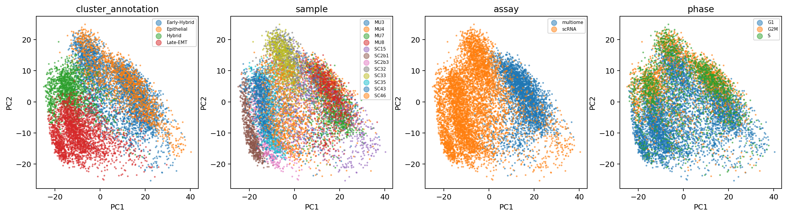

**Figure S2 explained (version A, first look).** The same PC1 and PC2 coloured four ways: EMT state, tumour, assay, phase. Late-EMT cells (red) sit lower left, epithelial and early-hybrid cells upper right. But the assay panel shows multiome cells (blue) occupying the right side and scRNA cells (orange) the left: PC1 partly separates the *technology*. The tumour panel shows individual tumours (for example SC2b1, brown, bottom left; SC33, olive, top) forming their own clouds. So even before any simplex is fitted, the leading axes mix EMT with technology and tumour identity.

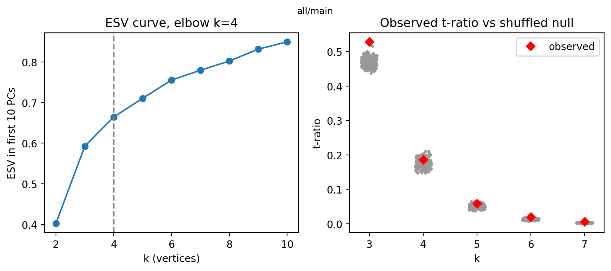

**Figure S3 explained.** Left: ESV against k; the elbow is at k = 4. Right: for each k, the grey dots are the t-ratios of 200 shuffled datasets and the red diamond is the real data. At k = 3 the real t-ratio (0.528) sits above the whole grey cloud (null median 0.468, max 0.516), so p = 0.005. At k = 4 to 7 the diamond falls inside the cloud (p = 0.18, 0.07) or just above it (k = 6, 7). k = 3 is chosen by the pre-registered rule.

| Version | k=3 | k=4 | k=5 | k=6 | k=7 | Elbow | Chosen k |
|---|---|---|---|---|---|---|---|
| A. All genes, all cells | **0.005** | 0.18 | 0.07 | 0.005 | 0.005 | 4 | 3 |
| B. All genes, scRNA only | **0.005** | 0.005 | 0.005 | 0.005 | 0.005 | 4 | 3 |
| C. KS genes | 0.83 | 0.80 | 0.09 | 0.01 | 0.005 | 5 | none |

In C the real t-ratio at k = 3 (0.481) is *below* the shuffled median (0.496): the EMT genes order the cells cleanly but the cloud is less triangular than a shuffled cloud. k = 6 and 7 pass everywhere, including C, which is why k beyond the elbow is ignored.


**Figure S4 explained.** Eight panels on all 23,959 cells with the fitted triangle (black corners V1 to V3): coloured by EMT state, finer cluster, tumour, assay, phase; the EMT score (blue epithelial, red mesenchymal); purity (yellow = near a corner); and a bar chart of where each state falls. Corner V1 is 79% multiome cells. The late-EMT corner V3 is 93% late EMT (collagens Col3a1, Col1a1, Dcn, Postn). V2 is epithelial and early hybrid with basal keratins (Krt14, Krt5, Krt6a, Krt17) and 33% G2M cells. 73% of cells lie inside the triangle and 40% are specialists.

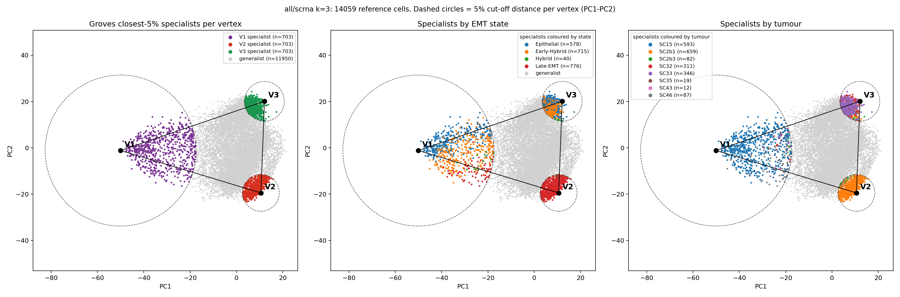

**Figure S5 explained (version B, scRNA only).** Left: the 5% of cells nearest each corner (703 per corner, dashed circle = the cut-off distance) in colour, generalists in grey. Middle: the same specialists coloured by EMT state. Right: coloured by tumour. The three corners: **V2 late EMT (94%)**, **V3 proliferating epithelial / early hybrid** (58% early hybrid, 30% epithelial, 33% G2M and 25% S cells, keratins plus Npm1, Nme2, H2afz) and **V1, the odd corner**: long-gene markers (Camk1d, Pcdh7, Maml2), 985 of its 1,372 specialists are multiome cells that were projected in, and 94% of its scRNA specialists are tumour SC15. The tips are tumour-specific: V1 82% SC15, V2 92% SC2b1, V3 SC33 48% and SC32 42%.


**Figure S6 explained.** Left: each cell's mean expression of V1's top 20 marker genes, per tumour. Every multiome tumour (purple) scores high (medians 1.7 to 2.2); two scRNA tumours, SC15 (1.55) and SC46 (1.21), also score high; the other scRNA tumours are low (0.26 to 0.61). Right: by state and assay, the score tracks the assay, not the EMT state. So V1 is a technical or sample-level axis. Its origin (gene length versus nuclear RNA versus sample quality) is unresolved.


**Figure S7 explained (answers question 2 for SCC).** For each EMT state of the scRNA cells, the share at each corner (coloured) or generalist (grey), under the purity-gap rule (left), the closest-5% rule (middle) and weight > 0.95 (right).
- **Hybrid cells are generalists under every rule:** 82% generalist by the gap rule, 99% by the closest-5% rule (only about 1% specialists), 100% by weight > 0.95.
- **Late EMT is the clearest specialist state:** 63% at V2 by the gap rule, 12% by the closest-5% rule.
- Epithelial and early-hybrid cells lie mostly at V3 (the proliferating corner) or V1 by the gap rule.
- The three rules give very different numbers (weight > 0.95 finds almost no specialists because delta = 0 puts corners inside the cloud), but they agree on the order: hybrid cells are the least specialised state.


**Figure S8 explained.** Each bar is a full refit (new PCA and PCHA) and shows the percentage of all 23,959 cells whose nearest corner is unchanged. Leaving out any one tumour: 90 to 99% (lowest without SC15); cell cycle regressed out: 84%; two other random subsamples: 99%. No single tumour creates a corner. (This figure shows the *first* triangles, before the technical-axis problem was understood; see 3.5.)

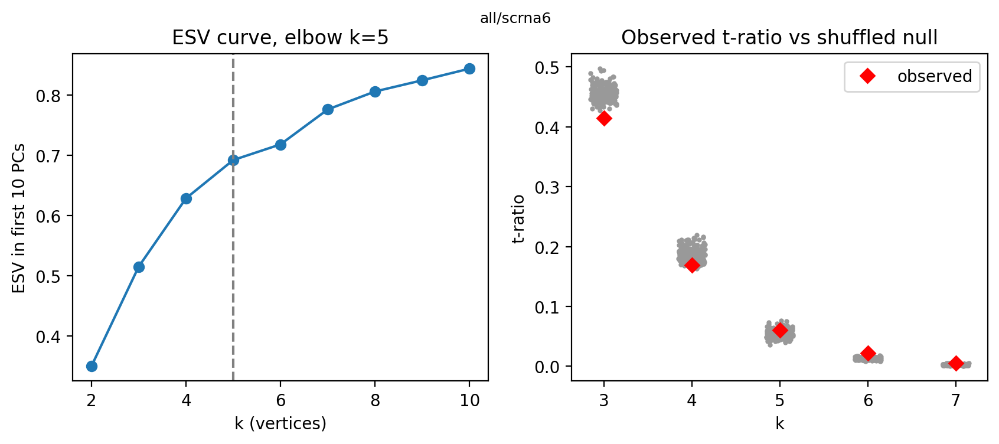

**Figure S9 explained.** After the V1 problem, the pooled fit was redone on six scRNA tumours without the technical axis (SC2b1, SC2b3, SC32, SC33, SC35, SC43) and without any correction. The real t-ratio (red) sits *inside or below* the shuffled cloud at every k: k = 3 p = 1.00, k = 4 p = 0.98, k = 5 p = 0.21. The corners look clean (late EMT 99%, an epithelial/early corner, a hybrid corner 99%) but the cloud is not triangular.

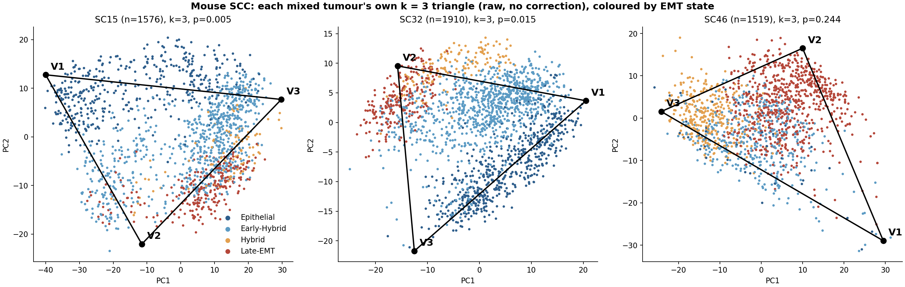

**Figure S10 explained.** The three tumours with many cells of several states (SC15, SC32, SC46) fitted separately, with no correction, cells coloured by EMT state. A triangle beats shuffled data in SC15 (p = 0.005, t = 0.512) and SC32 (p = 0.015, t = 0.498) but not SC46 (p = 0.244; k = 4: p = 0.08). The corners: SC15 V1 epithelial (97.8%, Trp63, Frmd4b), V2 matrix (Col5a2, Fn1, Col1a1), V3 early hybrid (77%); SC32 V1 cycling epithelial (80% cycling, Krt14, Hmgb2), V2 mesenchymal (Spp1, Vim, Fn1), V3 epithelial; SC46 V2 late EMT (99%, collagens), V3 cycling hybrid. A late-like corner with similar genes appears in every tumour (signature correlation with the pooled late-EMT corner 0.48 to 0.62), but a proliferating or epithelial corner is tumour-specific.

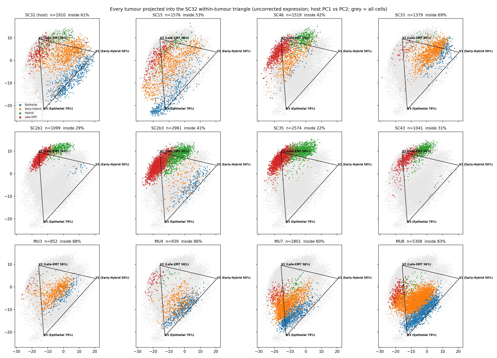

**Figure S11 explained.** Every other tumour projected into SC32's frozen triangle (uncorrected). Late-EMT cells of every scRNA tumour reach SC32's late corner (71 to 100%); pooled over all scRNA guests, late EMT is 95% at that corner, hybrid cells 45% at that corner and 55% interior, early hybrid 78% interior, epithelial 27% at V1 and 35% at V3. The multiome tumours place most of their cells in the interior. The EMT order is shared across tumours, and the intermediate states sit between the ends.

### 3.5 Results of the SCC analysis, in the order they happened

| Step | Result | Status |
|---|---|---|
| A: all genes, all cells | k = 3, p = 0.005; one corner 79% multiome | valid but technical corner |
| B: scRNA only | k = 3, p = 0.005; corner V1 remains (SC15, SC46) | valid; V1 technical or sample-level |
| C: KS genes | no simplex (p = 0.83) | valid |
| Regress V1 out | k = 3, p = 0.04 | **artefact, withdrawn** (it also removed EMT signal: Krt14 slope 1.04, Col1a1 slope −1.06) |
| Six clean scRNA tumours, no correction | k = 3, p = 1.00 | current |
| Within-tumour, raw | SC15 0.005, SC32 0.015, SC46 0.244 | current |
| Cross-projection into SC32, raw | shared EMT order | current |

**Hallmark check of corner names (added 17 October, Section 9.6.5).** On the pooled all-genes fits, the proliferating corner is top on E2F targets and G2-M (E2F +0.42, +0.47, +0.58) and the late-EMT corner top on EMT (+0.36 to +0.43), as named; the corner called technical has no Hallmark set above +0.25, consistent with a non-biological axis.

### 3.6 SCC, in one paragraph
All-genes fits give a triangle (p = 0.005) whose three corners are late EMT, proliferating epithelial/early hybrid, and a technical axis. EMT marker genes give no triangle. Without the technical axis the pooled triangle disappears (p = 1.00 on six clean tumours). Inside two of three mixed tumours a triangle holds, with mesenchymal, epithelial and cycling corners. Across tumours the EMT order is shared. **Question 1:** no EMT task corners that survive removing the technical axis; the corners are late-EMT matrix programme, proliferation and technology. **Question 2:** hybrid cells are generalists (98.8% by the closest-5% rule).

---

## 4. Dataset 2: Cook, TGF-β time course in four human cell lines (GSE147405)

### 4.1 The dataset
- **System.** Four human cancer cell lines (A549 lung, DU145 prostate, MCF7 breast, OVCA420 ovarian) treated with TGF-β1 and sampled over time by scRNA-seq.
- **Design.** *Forward arm:* 0 d (untreated), 8 h, 1 d, 3 d, 7 d. *Removal arms:* 8 h, 1 d and 3 d after TGF-β was removed (`_rm`). The authors' own pseudotime is in the metadata.
- **What the unit is.** One cell line = one "sample". Time after TGF-β plays the role of EMT progression and is **ground truth that does not depend on the EMT score used here**. This is why Cook is the cleanest test of whether time-ordered EMT forms corners.
- **Matrix.** 11,250 genes shared by all four lines, in ≥ 1% of cells, mito and ribosomal genes dropped; CP10k + log1p. KS genes: 163 human symbols (no case conversion).
- **Design limits.** Each line is a single identity, so pooled fits mostly pick up cell-line differences; late time points are scarce (MCF7 7 d has 22 cells); the removal arm is small.

### 4.2 Methods specific to this dataset
- **Pooled fit:** forward-arm cells only, at most 550 per line (2,200 cells; the smallest line has 558). Removal-arm cells are projected as guests.
- **Per-line fits** (Step 7): forward arm, cleaned (≥ 10,000 UMI, mito fraction ≤ 0.07), with a time-balanced version (≤ 300 cells per time point). Cells kept: A549 2,646, DU145 1,839, MCF7 1,378, OVCA420 355. *Correction (17 October):* the script's docstring said technical genes were dropped, but the code never did; fits were rerun with MALAT1, NEAT1 and haemoglobin genes dropped (`--drop-human-tech`) and no result changed (Section 9.6.1).
- **Path versus triangle test** (Step 8): the path coordinate is the authors' pseudotime.
- **Corner programmes** (Step 12): the 10% of cells nearest each per-line corner are scored for KS epithelial, KS mesenchymal, proliferation, hypoxia and TGF-β response gene sets.

### 4.3 Code flow
`01_build_anndata.py` → `02_pca.py --lines all|A549|...` → `03_fit_and_test.py` (`run_fits.sh`, `run_all_queue.sh`) → `04_figures.py` → `06_groves_specialists.py` → `07_within_line_clean.py` (`run_within_line.sh`) → `08_path_vs_triangle.py` → `09_describe_labels.py` → `10_pooled_tetrahedron.py` → `11_per_line_triangles.py` → `12_corner_programmes.py`; Hallmark check in `Mouse_SCC/hallmark_check/`.

### 4.4 Figures and results, one by one

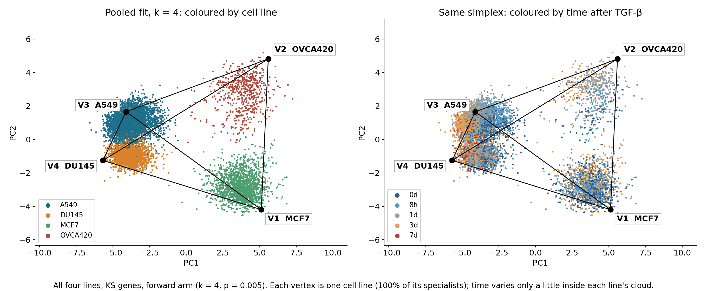

**Figure C1 explained.** The pooled simplex for all four lines (KS genes, k = 4, p = 0.005), coloured by cell line (left) and by time (right). Each vertex is one cell line (V1 MCF7, V2 OVCA420, V3 A549, V4 DU145; 100% of the specialists at each vertex are from one line), and time varies only a little inside each line's cloud. The pooled test is significant at **every** k from 3 to 7 for both gene sets (p = 0.005; elbow k = 4), but it is a simplex of **cell identity**, not of EMT.

| Pooled fit | k=3 | k=4 | k=5 | k=6 | k=7 | Elbow |
|---|---|---|---|---|---|---|
| All genes | 0.005 | 0.005 | 0.005 | 0.005 | 0.005 | 4 |
| KS genes | 0.005 | 0.005 | 0.005 | 0.005 | 0.005 | 4 |

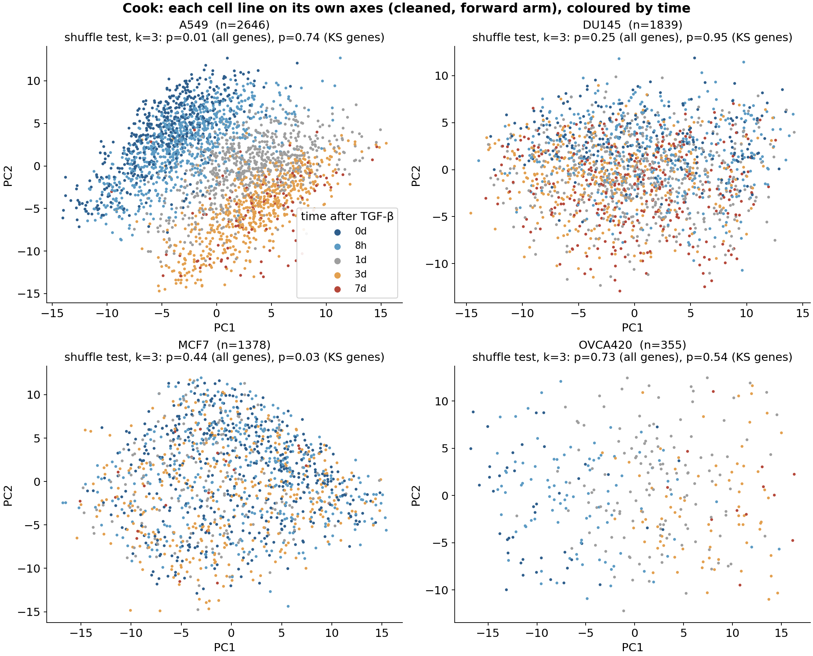

**Figure C2 explained.** After cleaning, each line fitted separately (forward arm), coloured by time after TGF-β. **A549 shows a clear gradient**: 0 d and 8 h (dark blue) in the upper left, 1 d (grey) in the middle, 3 d (orange) and 7 d (red) lower right. DU145, MCF7 and OVCA420 show **no visible time order**; the time points are mixed. The titles give the shuffle-test p for k = 3 (all genes, KS genes).

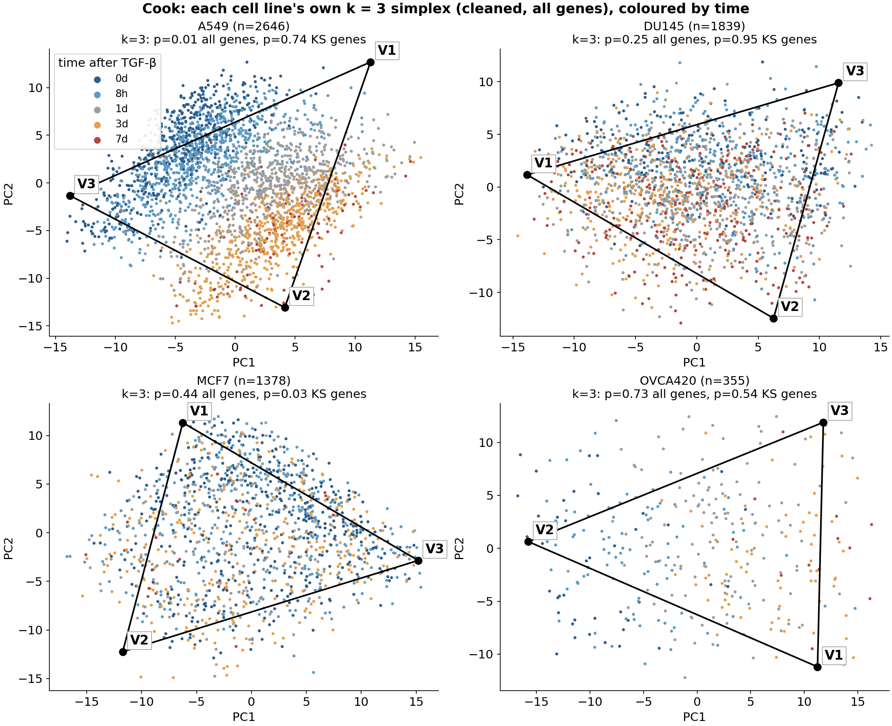

**Figure C3 explained.** The fitted k = 3 triangle drawn in each line whether or not it is significant. A549 (p = 0.010, all genes) is the only line with a clear shape on all genes; MCF7 (p = 0.03) passes only on KS genes. In DU145 and OVCA420 the triangles enclose an unstructured cloud.

| Line | Cells | Uncleaned k=3 all / KS | Cleaned k=3 all / KS | Cleaned k=4 all / KS | Time-balanced k=3 all / KS |
|---|---|---|---|---|---|
| A549 | 2,646 | 0.711 / 0.886 | **0.010** / 0.741 | 1.00 / 0.716 | 0.224 / 0.726 |
| DU145 | 1,839 | 0.100 / 0.975 | 0.249 / 0.950 | 0.338 / 1.00 | 0.095 / 0.980 |
| MCF7 | 1,378 | 0.443 / 0.015 | 0.443 / **0.030** | 0.930 / 0.194 | 0.413 / 0.244 |
| OVCA420 | 355 | 0.940 / 0.418 | 0.726 / 0.537 | 1.00 / 0.448 | 0.726 / 0.537 |

Cleaning created the A549 result (0.711 → 0.010) and it disappears when time points are balanced (0.224). Two passes in eight fits at k = 3, none at k = 4. *After the 17 October rerun with the human technical genes dropped, all 18 cleaned fits keep their pass or fail status (A549 0.010 → 0.010; time-balanced 0.224 → 0.269; MCF7 KS 0.030 → 0.030).*

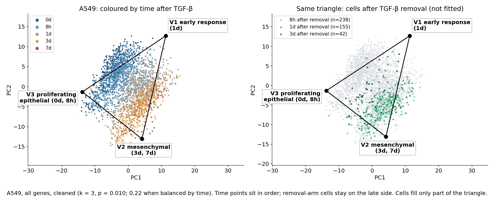

**Figure C4 explained.** Left: A549's triangle coloured by time, with corners named from their genes: **V3 proliferating epithelial (0 d, 8 h)**, **V1 early response (1 d)** and **V2 mesenchymal / TGF-β response (3 d, 7 d)**. Time points sit in order and the cells fill only part of the triangle. Right: the same triangle with the held-out removal-arm cells (green, never fitted): cells 8 h and 1 d after TGF-β removal stay on the late side near V2, so the cells do not simply go back to the epithelial corner when the signal is withdrawn.

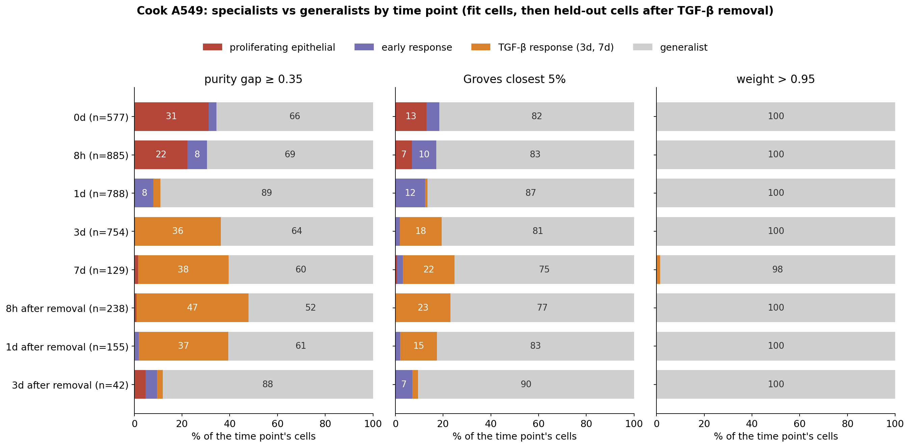

**Figure C5 explained (question 2 for Cook).** For each time point, the share of cells at each corner (colour) or generalist (grey) under the three rules. By the purity-gap rule: 0 d 31% proliferating-epithelial specialists, 66% generalist; 8 h 22% and 69%; **1 d 89% generalist** (only 8% early-response specialists); 3 d 36% TGF-β-response specialists, 64% generalist; 7 d 38% and 60%. Removal arm: 8 h after removal 47% at the TGF-β corner, 52% generalist. Under the closest-5% rule 75 to 90% of every time point is generalist; under weight > 0.95, 98 to 100%. **The intermediate time point (1 d) is the most generalist, and the endpoints (0 d and 3 d to 7 d) carry the specialists.** The early-response corner is a transient state, not a long-lived one.

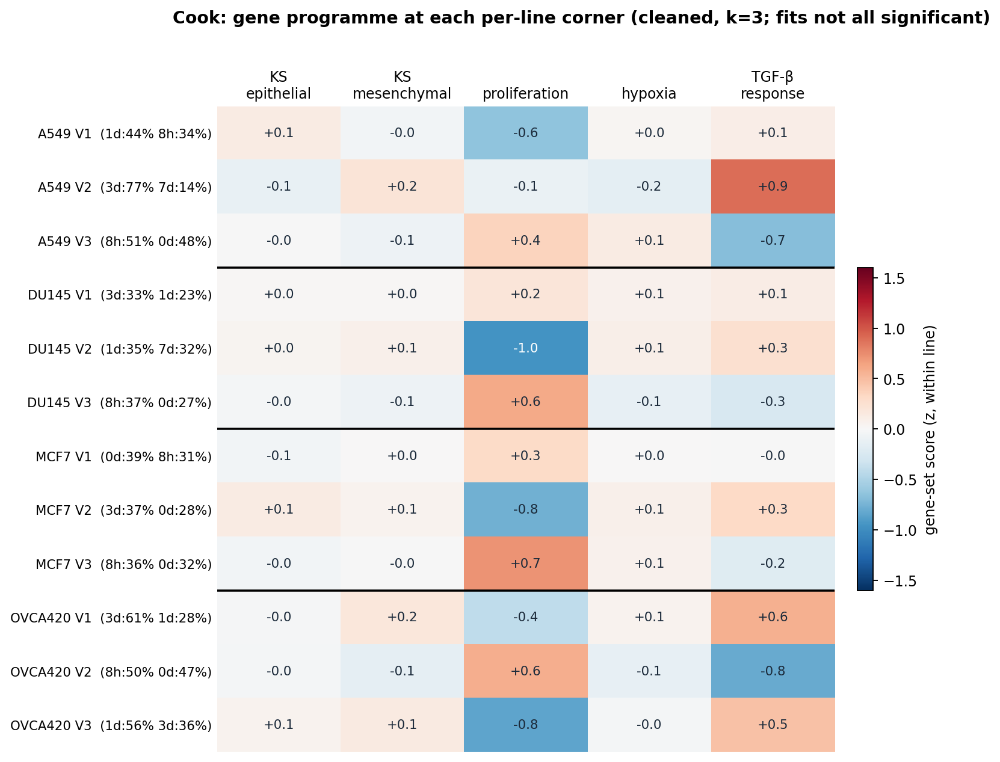

**Figure C6 explained.** For every line's triangle (also the non-significant ones), the 10% of cells nearest each corner scored on gene sets (z within line): KS epithelial, KS mesenchymal, proliferation, hypoxia, TGF-β response. Corners are **proliferation** (A549 V3 +0.36, DU145 V3 +0.60, MCF7 V3 +0.72) and **TGF-β response** (A549 V2 +0.89 with 77% of its cells from 3 d; OVCA420 V1 +0.57), with the KS epithelial and mesenchymal gene sets near zero at nearly every corner (|score| ≤ 0.2). **The corners are not the EMT genes.** MSigDB Hallmark sets agree with the corner names in 7 of 8 Cook corners (one miss: MCF7 V2, named TGF-β response, top Hallmark set Hypoxia).

**Path versus triangle (authors' pseudotime as path).**

| Line | All genes: PC1 / PC2 explained by pseudotime | p vs path | KS genes: PC1 / PC2 | p vs path |
|---|---|---|---|---|
| A549 | 0.46 / 0.46 | 0.66 | 0.58 / 0.18 | 0.67 |
| DU145 | 0.04 / 0.19 | 0.75 | 0.08 / 0.36 | 0.88 |
| MCF7 | 0.07 / 0.20 | 0.70 | 0.21 / 0.04 | **0.005** |
| OVCA420 | 0.74 / 0.01 | 0.79 | 0.73 / 0.25 | 0.98 |

In 7 of 8 fits a one-dimensional path explains the data as well as a triangle; only MCF7 on KS genes beats a path.

### 4.5 Cook, in one paragraph
Pooled over lines, a simplex appears at every k but its corners are cell lines. Inside one line only A549 (all genes) and MCF7 (KS genes) pass at k = 3, and the A549 result depends on cleaning and on time balance. The corners are proliferation and TGF-β response, not epithelial or mesenchymal gene sets, and a pseudotime path usually explains the shape. **Question 1:** no EMT task corners beyond a transient early-response and a TGF-β-response state in A549. **Question 2:** the middle time point is the most generalist (89%); endpoints carry the specialists.

---

## 5. Dataset 3: Mouse PDAC, metastasis lineage across sites (GSE173958)

### 5.1 The dataset
- **System.** Mouse pancreatic ductal adenocarcinoma cells from two mice, harvested at several body sites, plus two cultured populations. The GEO labels are used for library names: **mouse 1** (M1-PT, M1-SS, M1-Met, M1-Liver, M1-Lung, M1-CTC), **mouse 2** (M2-PT, M2-Met, M2-Liver, M2-Lung) and **cultured cells** (iv-5cell, iv-100cell). PT = primary tumour, Met = metastasis, CTC = circulating tumour cells.
- **Cells.** 80,944 droplets pass QC (≥ 1,000 and ≤ 7,000 genes, mitochondrial fraction ≤ 15%); the libraries also hold immune, endothelial, fibroblast, hepatocyte and red blood cells (M1-CTC is mostly blood). Tumour cells are selected by a documented rule: 40 k-means clusters on 30 PCs; a cluster is tumour if its epithelial marker score (Krt8, Krt18, Krt19, Epcam, Cdh1, Krt7) ≥ 0.85 and its immune, endothelial and fibroblast scores are all < 0.3. This leaves **57,770 tumour cells**, 13,370 genes.
- **EMT labels are ours, not the paper's.** GEO has none, so the KS EMT score (mouse Tan 2014 mesenchymal genes minus epithelial genes, 126 epithelial and 42 mesenchymal genes present) is binned over in-vivo tumour cells: **Epithelial** (lowest 40%), **Early-Hybrid** (40 to 75%), **Late-Hybrid** (75 to 95%), **Mesenchymal** (top 5%); cultured cells use the same cut-offs. `clusterU` = k-means (k = 5) on the first 5 KS PCs. The fits never use these labels, but a state's share at a corner is partly built in because the states come from the same genes.
- **Design limits.** Libraries are pieces of two mice, so mouse, site and library are confounded; labels are derived from the score being analysed.

### 5.2 Methods specific to this dataset
- **Fit cells.** At most 1,000 per library (8,122 cells for the in-vivo fit, from the 10 in-vivo libraries; the lung and CTC libraries have fewer than 1,000 tumour cells); cultured cells are projected as guests.
- **PCA.** All genes: PC1 5.5% of variance; KS genes PC1 19.7% (explained by EMT state 0.635; tumour 0.25).
- **Within-library fits (Step 8)** with and without cleaning (≥ 10,000 UMI; technical genes dropped: hepatocyte ambient RNA (Alb, Apoa1, Apoa2, Apoh, fibrinogen genes, Serpina1 genes, Hp, Saa1/2), haemoglobin genes, Malat1, Neat1, Gm26870, Gm42418, AY036118), 200 shuffles, k = 3 and 4, units = each library, each mouse, all in-vivo.
- **Cross-projection (Step 9)** into M1-SS's frozen triangle. **Corner programmes** (Step 8b) and the **Hallmark check** (19 PDAC corners).

### 5.3 Code flow
`01_build_anndata.py` (12 libraries) → `01b_select_tumour_cells.py` → `01c_emt_labels.py` → `02_pca.py --assay in_vivo` → `02b_tumour_within_state.py` → `run_fits.sh all|ks in_vivo 200` (`03_fit_and_test.py`) → `04_describe_simplex.py` → `05_robustness.py` → `06_groves_specialists.py` → `08_within_unit.py [--clean]` (`run_within.sh`, `run_within_clean.sh`) → `08b_describe_corners.py` → `09_cross_projection.py` → `10_describe_labels.py`.

### 5.4 Figures and results, one by one

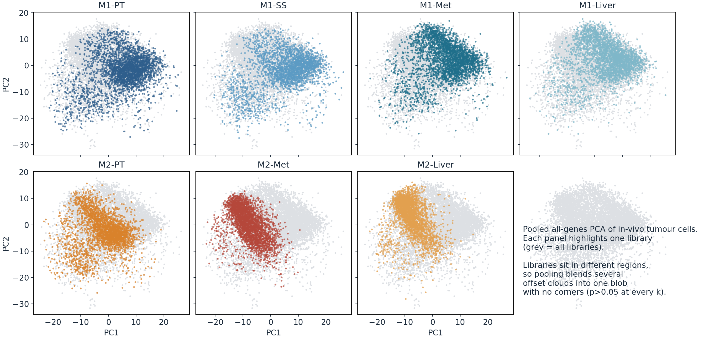

**Figure P1 explained.** The pooled in-vivo PCA with one panel per library highlighted (all other cells grey). Libraries occupy different regions: M1-PT, M1-SS, M1-Met, M1-Liver in one area; M2 libraries shifted. Pooling blends several offset clouds into one blob with **no corners**: no k reaches p < 0.01.

| Pooled in vivo | k=3 | k=4 | k=5 | k=6 | k=7 | Elbow |
|---|---|---|---|---|---|---|
| All genes | 0.99 | 0.26 | 0.08 | 0.055 | 0.09 | 5 |
| KS genes | 1.00 | 0.97 | 0.77 | 0.96 | 0.45 | 4 |

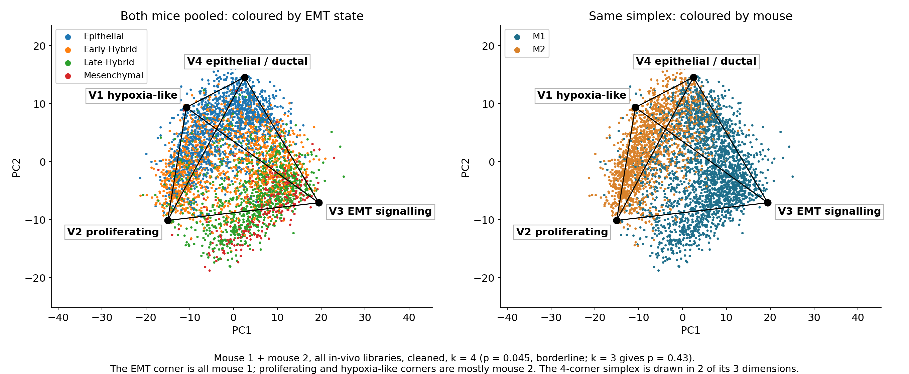

**Figure P2 explained.** Both mice pooled after cleaning: k = 4 gives only a borderline p = 0.045 (k = 3: p = 0.43). The four corners are named from their genes: **V1 hypoxia-like**, **V2 proliferating**, **V3 EMT signalling**, **V4 epithelial / ductal**. Right panel: the EMT corner is **all mouse 1**; the proliferating and hypoxia-like corners are mostly mouse 2. So the corners follow mouse and programme, not a shared EMT trade-off.

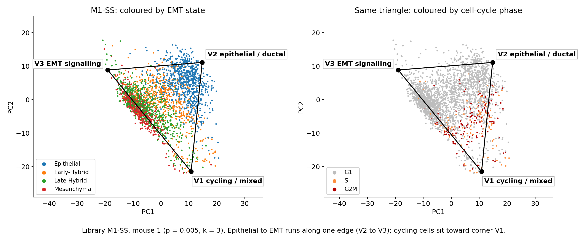

**Figure P3 explained.** One library, cleaned, k = 3, p = 0.005. Left: cells coloured by EMT state. **Epithelial (blue) to EMT (red) runs along one edge (V2 to V3)**, with early and late hybrids (orange, green) between. Right: coloured by phase; cycling cells (S, G2M) sit toward corner V1. So here the triangle's third corner is proliferation, and EMT is an edge, not a corner of its own.

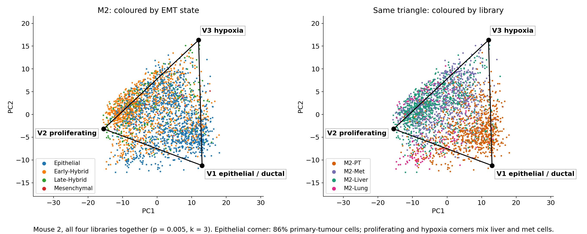

**Figure P4 explained (mouse 2, all four libraries together, k = 3, p = 0.005).** Corners: **V1 epithelial / ductal** (86% primary-tumour cells), **V2 proliferating** and **V3 hypoxia** (both mixing liver and metastasis cells). Libraries sit at different corners because tissue site shapes the programme. The mouse 1 equivalent (`pdac_mouse1_triangle.png`; all six libraries together) gives k = 3, p = 0.12 (not significant; k = 4 gives p = 0.005 but adds an unnamed fourth corner) with the epithelial-to-EMT gradient running from the top (V2 epithelial) to the lower right (V3 EMT signalling) and every corner mixing libraries.

**Within single libraries (all genes).**

| Unit | Cells (cleaned) | Uncleaned k=3 / k=4 | Cleaned k=3 / k=4 |
|---|---|---|---|
| M1-SS | 2,397 | 0.005 / 0.050 | **0.005** / 0.005 |
| M1-PT | 3,770 | 0.005 / 0.005 | **0.020** / 0.080 |
| M1-Liver | 3,521 | 0.144 / 0.005 | **0.020** / 0.005 |
| M1-Met | 4,000 | 0.358 / 0.025 | 0.517 / 0.010 |
| M2-PT | 4,000 | 1.000 / 0.005 | **0.005** / 0.005 |
| M2-Liver | 4,000 | 0.015 / 0.005 | **0.005** / 0.557 |
| M2-Met | 4,000 | 0.065 / 0.109 | **0.005** / 0.090 |
| Mouse 1 (all libraries) | 4,000 | 0.542 / 0.005 | 0.124 / 0.005 |
| Mouse 2 (all libraries) | 2,728 | 0.547 / 0.050 | **0.005** / 0.040 |

**Cleaning *revealed* triangles here:** six of seven libraries pass at k = 3 after cleaning (M1-Met does not). With KS genes only M1-PT at k = 4 passes uncleaned (p = 0.005); cleaned KS fits were not run in version 1. *Added 17 October (Section 9.6.3):* on KS genes alone, **no unit passes at k = 3 (0 of 9; all genes 7 of 9)** and 3 of 9 pass at k = 4 (M1-SS 0.005, M2 0.025, M2-Met 0.040).

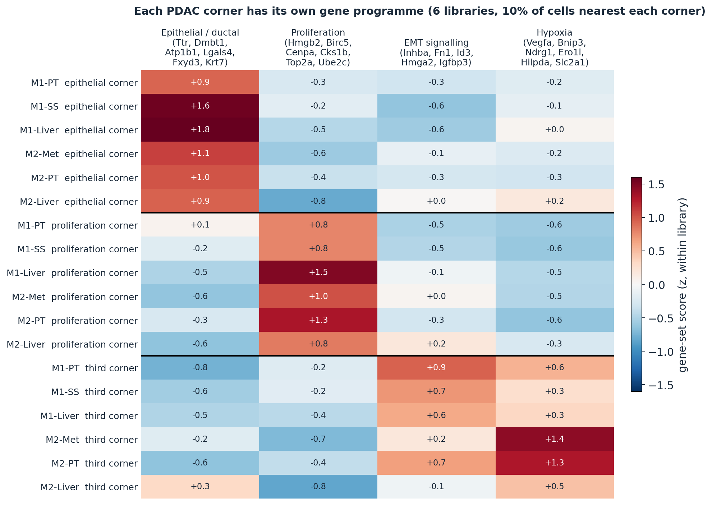

**Figure P5 explained.** For six libraries, three corners each (rows), the 10% of cells nearest the corner scored on four gene programmes (columns; z within library). **Epithelial / ductal corner:** Ttr, Dmbt1, Atp1b1, Lgals4, Fxyd3, Krt7 high (+0.9 to +1.8). **Proliferation corner:** Hmgb2, Birc5, Cenpa, Cks1b, Top2a, Ube2c high (+0.8 to +1.5), 82 to 100% of its cells in S or G2M. **Third corner:** *EMT signalling* (Inhba, Fn1, Id3, Hmga2, Igfbp3; +0.6 to +0.9) in the mouse 1 libraries, *hypoxia* (Vegfa, Bnip3, Ndrg1, Ero1l, Slc2a1; +1.3 to +1.4) in mouse 2 Met and PT. The programmes are distinct and recur across libraries, but only the third corner involves EMT, and in mouse 2 it is hypoxia, not EMT. Hallmark gene sets name the corners the same way in **19 of 19** PDAC corners.

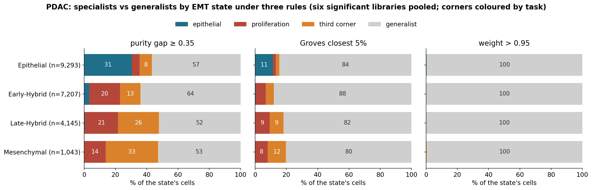

**Figure P6 explained (question 2 for PDAC).** Six significant libraries pooled, share of each state at each corner under three rules. Generalist share, purity-gap / closest-5% / weight > 0.95: **Epithelial 57 / 84 / 100%**, **Early-Hybrid 64 / 88 / 100%**, **Late-Hybrid 52 / 82 / 100%**, **Mesenchymal 53 / 80 / 100%**. Epithelial cells are specialists of the epithelial corner (31% by the gap rule); late-hybrid and mesenchymal cells split between the proliferation and third corners. The **early-hybrid state is the most generalist** under the first two rules.

**Cross-projection into M1-SS.** Placed in M1-SS's frozen triangle, 70 to 86% of the cells of the other in-vivo libraries by state are interior (epithelial 70.5%, early-hybrid 85.7%, late-hybrid 74.1%, mesenchymal 70.3%); cultured cells 97 to 98% interior. The mesenchymal-leaning corner of M1-SS holds 0 to 0.4% of mouse 2 cells. Corners are largely **not shared across mice**.

### 5.5 PDAC, in one paragraph
Pooled across libraries there is no simplex. Inside single libraries a triangle appears after cleaning in six of seven; its corners are epithelial / ductal, proliferation and EMT signalling (mouse 1) or hypoxia (mouse 2), named and confirmed by Hallmark sets. EMT runs along an edge. **Question 1:** corners exist per library but are programmes, and the EMT corner exists only in mouse 1. **Question 2:** hybrid cells are mostly generalists (early-hybrid 64% / 88%), and 70 to 86% of other-library cells fall in the interior of a host triangle.

---

## 6. Dataset 4: 4T1 clones along an EMT spectrum (GSE303505, Pattabiraman lab)

### 6.1 The dataset
- **System.** Series title: "Epithelial-mesenchymal transition is associated with altered immune composition and cytotoxic function in triple-negative breast cancer". Five single-cell-derived clones of the mouse 4T1 triple-negative breast cancer line, chosen to span an epithelial-to-mesenchymal spectrum (**E, EM1, EM2, EM3, M**), plus the parental 4T1 line, were implanted in BALB/c mice; one tumour per group was sequenced by 10x scRNA-seq.
- **Samples used.** The six "Total" tumour libraries (tumour plus stromal and immune cells). The CD45⁺ immune libraries and the 1 GB raw archive were not downloaded (12 files, about 180 MB, were).
- **Tumour cells.** The authors' own `Annotation == Tumor` label in the GEO metadata (the other labels are macrophage, T/NK, granulocyte, DC, endothelial, fibroblast) plus light QC (≥ 500 genes, mito ≤ 15%): **19,930 cells** (E 794, EM1 2,913, EM2 3,381, EM3 1,986, M 4,845, parental 6,011); 11,911 genes after filtering.
- **Design limit.** **One tumour per clone**, so clone = tumour = batch; a corner that is one clone cannot be told apart from one tumour's quirks. The CD45 libraries were not used.
- **Labels.** Clone identity; KS-derived EMT states (quartiles of the KS_EMT score); k-means clusters; phase.


**Figure T1 explained.** Box plots of the EMT score for each clone (higher = more mesenchymal). **Clone E is clearly separate** (mean −0.83). EM1, EM2 and parental 4T1 overlap (about −0.03), and EM3 and M overlap (+0.17 and +0.16). Only **37% of the EMT-score variance is between clones**. The "spectrum" is therefore one epithelial clone plus five similar ones, not five evenly spaced steps.

### 6.2 Methods specific to this dataset
- **Fit cells.** At most 790 per clone (4,740 cells); all other cells projected.
- **Cleaning (added after looking).** ≥ 10,000 UMI and, because low-depth cells carried immune and stromal genes, a contamination filter: cells with a panel score (Ptprc, Lyz2, C1qa, C1qb, Cd3e, Cd79a, Itgam, Adgre1, Col1a1, Col3a1, Dcn, Lum, Pecam1) above 0.3 removed; technical genes dropped. A first, broader panel (including S100a8/9, Cd74, H2-Aa) had to be abandoned because 4T1 tumour cells genuinely express those genes. Clone E keeps only 142 cells after the UMI rule.
- **Fits.** Pooled fits (light QC and cleaned, all genes and KS genes), robustness (leave one clone out, seeds, cell cycle removed), within-clone fits (light QC and cleaned), path test (the EMT score as the path), the Groves rule.
- **Added 17 October (Section 9):** the Hallmark check and a contamination-cutoff sweep (0.2, 0.3, 0.5). **Still not done for 4T1:** cross-projection.

### 6.3 Code flow
`01_build_anndata.py` → `01c_emt_labels.py` → `01d_clean_cells.py` → `02_pca.py` (tags main, clean; `EXPR_NAME=expr_tumour_clean.h5ad` for clean) → `02b_tumour_within_state.py` → `run_fits.sh` → `04_describe_simplex.py` → `05_robustness.py` → `06_groves_specialists.py` → `08_within_unit.py [--clean --decontam]` → `08b_describe_corners.py` → `08c_path_vs_triangle.py` → `13_mail_figures.py`.

### 6.4 Figures and results, one by one

**PCA first look.** Light-QC all genes: PC1 4.1% of variance, **71% explained by sequencing depth**, 47% by clone, 42% by mitochondrial fraction (a partly technical axis); KS genes: PC1 15.9%, clone 0.75, EMT state 0.51.


**Figure T2 explained.** Permutation p (log scale) against number of corners for four pooled fits; the dashed line is p = 0.01 and p = 0.005 is the floor. KS genes (grey) never cross it, with or without cleaning. All genes with light QC (blue) crosses at k = 4 and k = 6. All genes cleaned (red) crosses only at k = 3 (p = 0.010).

| Pooled fit (p) | k=3 | k=4 | k=5 | k=6 | k=7 | k* |
|---|---|---|---|---|---|---|
| KS, light QC | 0.93 | 0.31 | 0.17 | 0.83 | 0.18 | none |
| All genes, light QC | 0.12 | **0.005** | 0.015 | 0.005 | 0.020 | 4 |
| KS, cleaned | 0.52 | 0.03 | 0.52 | 0.36 | 0.34 | none |
| All genes, cleaned | **0.010** | 0.33 | 0.94 | 0.75 | 0.90 | 3 |

The cleaned set has 13,256 cells. The tetrahedron of the light-QC fit disappears after cleaning and a triangle appears; both p-values sit near the floor, so the all-genes shape is weak.


**Figure T3 explained.** The k = 4 fit before cleaning in PC1 and PC2 (a flat view of a 3-D shape), by clone (left) and phase (right). **V1 clone E** (57% E), **V2 mostly parental 4T1** (epithelial, partly cycling), **V3 clone M** (76% M, G1) and **V4 a cycling corner** (S + G2M 68%). Only 36% of cells fall inside the shape. Leaving out E removes V1 (agreement 65%); leaving out M replaces V3.


**Figure T4 explained.** Cleaned pooled fit (all genes, p = 0.010) coloured by clone, phase and EMT score. **V1 = cycling cells** (95% S + G2M; parental 41%, M 31%), **V2 = epithelial-leaning G1 cells** (parental 4T1 50%, EM2 26%), **V3 = clone M** (89% M, 49% mesenchymal state). Seeds agree 93 to 96%; leaving out EM1, EM2, EM3, parental or E changes little (88 to 96%); **leaving out M drops agreement to 79%** (M cells 57%) and the mesenchymal corner is replaced by an early-hybrid one. The cycling and epithelial-leaning corners survive any one clone; the mesenchymal corner is the M clone.


**Figure T5 explained (question 2 for 4T1).** Closest-5% rule. Top row: light-QC k = 4 (20% specialists); bottom: cleaned k = 3 (15%). Left: map with specialists coloured, generalists grey. Middle: where each EMT state goes. Right: which clone makes up each class. **Hybrid states are mostly generalists** (cleaned: epithelial 86%, early-hybrid 87%, late-hybrid 85%, mesenchymal 83%; light QC 72 to 85%). **V3 is the M clone** (98.8% in the light-QC fit, about 90% in the cleaned fit); other corners mix clones.


**Figure T6 explained.** Within-clone p-values (heat map, log scale; * = p < 0.05), light QC (left) and cleaned (right). Light QC passes in 5 of 24 fits (E k=3 0.010 and k=4 0.045; M k=4 0.010; parental k=4 0.010; EM1 KS k=4 0.005), with corners made of stress genes (Fos, Jun, Atf3), immune cells (Cd14, S100a8, Lyz2), stromal cells (Col1a1) and cycling cells. After cleaning and contamination removal, **1 of 20** passes (EM2, KS genes, k = 3: 0.015), about what chance gives; clone E cannot be tested (142 cells).


**Figure T7 explained.** Each clone's own k = 3 triangle (all genes), coloured by phase, drawn whether or not it is significant. The cleaned clones show one dense mass of cells with a cycling lobe on one side (orange and red); the triangle does not enclose a triangular cloud. Clone E (left top, light QC, p = 0.010) is sparse. Path test: inside a clone the EMT score explains at most 6% of the leading PCs; the pooled cleaned fit does not beat an EMT path (p = 0.32).

**Added 17 October: how much do the within-clone results depend on the 0.3 cutoff?** (Section 9.6.2) At 0.2 and 0.5 as well as 0.3, no clone passes on all genes (0 of 5 each time); on KS genes EM2 passes at all three cutoffs (0.035, 0.015, 0.050) and the parental clone passes only at 0.5 (p = 0.005, unexplained). **Hallmark check** (Section 9.6.5): the cycling corner is top on E2F and G2-M in the pooled cleaned and every within-clone fit; clone M's corner is TGF-β / hypoxia; no corner is named by an EMT set.

### 6.5 4T1, in one paragraph
KS genes give no simplex in any version; all genes give a weak shape that depends on cleaning, whose corners are cycling cells, epithelial-leaning cells and the M clone. Inside single clones the shapes fade after cleaning. **Question 1:** the corners are cycling and clone identity (M), not EMT states; five of six clones overlap on the EMT score. **Question 2:** hybrid states are mostly generalists (83 to 87%).

---

## 7. Dataset 5: MCF10A and HuMEC "pseudospace" EMT (GSE114687)

### 7.1 The dataset
- **Source.** McFaline-Figueroa et al. (Trapnell lab), "A pooled single-cell genetic screen identifies regulatory barriers in the continuum of the epithelial-to-mesenchymal transition". Human mammary epithelial cells are grown as colonies, so **EMT progresses with distance from the colony edge ("pseudospace")**. A CRISPR perturbation screen on MCF10A (CROP-seq) is also in the series; **it is not used here**.
- **Systems.** **MCF10A** (spontaneously immortalised human breast epithelial line) and **HuMEC** (primary human mammary epithelial cells).
- **Arms.** *Mock* (untreated, spontaneous EMT) and *TGFB* (4 ng/mL TGF-β1). Each arm has an **inner-colony** and an **outer-colony** sample, so position is a physical, independent coordinate along the EMT axis (the role time plays in Cook).
- **Cells after QC.** 30,590 cells (≥ 500 genes, mito ≤ 15%): MCF10A Mock 4,991, MCF10A TGFB 4,230, HuMEC Mock 11,212, HuMEC TGFB 10,157; 12,002 genes. The matrices hold more droplets than the authors' metadata keeps (MCF10A: 23,951 droplets, 9,268 kept); only cells in the metadata are used, and 30 MCF10A metadata cells with no matching barcode were dropped. Median UMI is 11,250 (MCF10A) and 8,672 (HuMEC), so a 10,000-UMI cut keeps only 35 to 40% of HuMEC cells.
- **Labels per cell.** Cell line, arm, position (inner / outer), sample (= line_arm), phase, the KS EMT score and KS-derived states (quartiles over all cells). KS genes: 191 human symbols.
- **Design limits.** One experiment per arm and line (no replicates); the cells are not tumours; inner/outer is a coarse two-level position; the authors' own pseudospace trajectory (in an R object) was not used.


**Figure G1 explained.** EMT score for inner (blue) and outer (red) colony cells in each of the four samples. TGF-β shifts the EMT score toward mesenchymal, strongly in MCF10A (median about +0.4 to +0.6) and more weakly in HuMEC (about +0.2). Outer-colony cells are more mesenchymal than inner-colony cells in all four samples (by roughly 0.1 to 0.35 in median), but the difference is small compared with the spread within each group. Position alone therefore separates cells only a little.

### 7.2 Methods specific to this dataset
- **Unit of the fits.** The pooled fit uses all four samples (≤ 1,500 fit cells each). Within-sample fits are run for **six units**: MCF10A (both arms), HuMEC (both arms), and the four samples separately, for all genes and KS genes at k = 3 and 4, with and without cleaning (≥ 10,000 UMI only; no contamination filter, since these are cultured cells).
- **No predictions file** was written. Choices added after looking: cleaning, Hallmark check, path test (EMT score as path), depth control.
- **Corner descriptions, Hallmark check, label tables, path test** as in the other datasets.

### 7.3 Code flow
`01_build_anndata.py` (reads the two mtx files; `01_build_anndata_funcs.py` holds its functions) → `01c_emt_labels.py` → `02_pca.py` → `run_fits.sh ks|all main 200` (`03_fit_and_test.py`) → `04_describe_simplex.py` → `06_groves_specialists.py` → `08_within_unit.py [--clean --regress-depth --out-suffix]` → `08b_describe_corners.py` → `08c_path_vs_triangle.py` → `09_hallmark_corners.py` → `10_describe_labels.py` → `01e_depth_matched.py` (depth control) → `13_mail_figures.py`.

### 7.4 Pooled over the four samples


**Figure G2 explained.** Permutation p against k for the pooled fit. Only k ≥ 5 (KS) and k ≥ 6 (all genes) cross p = 0.01, and each of those lies at or beyond the elbow rule's limit.

| Genes | k=3 | k=4 | k=5 | k=6 | k=7 | Rule's choice |
|---|---|---|---|---|---|---|
| KS (191) | 0.85 | 0.12 | 0.005 | 0.005 | 0.005 | none (k = 5 to 7 are past the elbow at 4) |
| All genes | 0.96 | 0.99 | 0.24 | 0.005 | 0.005 | k = 6 (elbow 6); only 1.2% of cells inside the shape |

The pooled corners are the samples themselves: at k = 4 on KS genes V1 is MCF10A Mock, V3 is MCF10A + TGF-β (94% mesenchymal), and V2 and V4 are the two HuMEC samples. Cell line and arm dominate the leading PCs (PC1: sample 0.62 to 0.78, cell line 0.51 to 0.70); inner/outer position explains at most 6% of any PC. Under the closest-5% rule 67 to 89% of the epithelial, early-hybrid and late-hybrid cells are generalists. **Pooled over samples there is no EMT task structure, only identity.**

### 7.5 Inside single samples: the main result


**Figure G3 explained.** A heat map of permutation p (log scale; * = p < 0.05) for six units (rows) and four fits (all genes k = 3, k = 4; KS genes k = 3, k = 4), without cleaning (left) and with the 10,000-UMI cleaning (right). Cleaning moves the number of fits below 0.05 from **11 of 24 to 18 of 24**, and the KS genes, which gave nothing in the first four datasets, now pass in three cleaned samples at k = 3.

| Unit | Light QC all k3 / k4 | Light KS k3 / k4 | Cleaned all k3 / k4 | Cleaned KS k3 / k4 |
|---|---|---|---|---|
| MCF10A (both arms) | 0.005 / 0.005 | 0.76 / 0.015 | 0.005 / 0.005 | 0.73 / 0.005 |
| MCF10A Mock | 0.005 / 0.43 | 1.00 / 0.29 | 0.005 / 0.005 | **0.005 / 0.005** |
| MCF10A TGFB | 0.050 / 0.005 | 0.995 / 0.045 | 0.005 / 0.005 | 0.56 / 0.39 |
| HuMEC (both arms) | 1.00 / 0.005 | 0.005 / 0.010 | 0.93 / 0.005 | 0.075 / 0.17 |
| HuMEC Mock | 0.99 / 0.09 | 0.64 / 0.24 | 0.005 / 0.005 | **0.005 / 0.005** |
| HuMEC TGFB | 1.00 / 0.75 | 0.08 / 0.010 | 0.025 / 0.005 | **0.005 / 0.005** |


**Figure G4 explained.** The cleaned k = 3 fit (all genes) in each of the four samples, cells coloured by inner (blue) or outer (red) colony, corners named from their genes. In MCF10A TGF-β and HuMEC Mock the cells fill the triangle. The **same three corners recur**: *cycling* (always), *differentiated epithelial*, and *EMT / matrix* in the TGF-β arms or *basal / partial* in the Mock arms. **Inner-colony cells lie toward the differentiated corner; outer-colony cells toward the cycling and EMT corners.** This is the cleanest triangle picture in any of the five datasets.

| Corner | Cells | Top genes | Hallmark top set | Outer-colony share |
|---|---|---|---|---|
| Cycling | 92 to 100% S/G2M | PTTG1, HMGB2, CCNB1, UBE2C, CDC20 | E2F or G2-M in **8 of 8** fits | 58 to 98% (HuMEC TGFB 58%; the rest 85 to 98%) |
| Differentiated epithelial | EMT score −0.45 to −0.9 (MCF10A TGFB −0.17); 89 to 100% epithelial state (MCF10A TGFB 42%) | SPRR1A/B, SBSN, PI3, KRT16, S100A8/9, KRT10 | none of the sets tried (KRAS-up weak) | 4 to 49% (mostly inner) |
| EMT / matrix (TGF-β arms) | EMT score +0.36 to +0.77; 74 to 99% mesenchymal state | FN1, LAMC2, TAGLN, CXCL1 to 3, TGM2, VIM, LAMA3 | EMT in all 4 fits that contain TGF-β cells | 82 to 97% |
| Basal / partial (Mock arms) | EMT score about 0 | KRT15, MIR205HG, TGFBI, NDRG1 (CXCL14, CKB, COL17A1 in HuMEC) | weak (≤ +0.07) | mixed |


**Figure G5 explained.** Rows are corners (eight cleaned fits, three corners each, with the % cycling in the corner), columns are Hallmark gene sets; the number is the mean z of the 10% nearest cells minus the rest. The **cycling corner scores high on E2F targets and the G2-M checkpoint** in all eight fits (E2F +0.51 to +0.72 in the five all-genes fits, +0.13 to +0.37 in the three KS fits). The **EMT corner** scores positive on EMT (+0.16 to +0.46) and on TGF-β (+0.09 to +0.30) in the four fits that contain TGF-β cells. The differentiated corner is negative or near zero on every set tried, which is why it is named from its genes alone.

### 7.6 Path versus triangle

| Unit | All genes: EMT score explains PC1 / PC2 | p vs path | KS genes: PC1 / PC2 | p vs path |
|---|---|---|---|---|
| MCF10A Mock | 0.85 / 0.16 | **0.005** | 0.88 / 0.36 | **0.005** |
| MCF10A TGFB | 0.36 / 0.35 | **0.005** | 0.76 / 0.35 | 0.050 |
| HuMEC Mock | 0.75 / 0.28 | **0.005** | 0.83 / 0.05 | **0.005** |
| HuMEC TGFB | 0.58 / 0.22 | 0.17 | 0.76 / 0.20 | **0.005** |
| MCF10A (both arms) | 0.81 / 0.24 | 0.075 | 0.90 / 0.11 | 0.30 |
| HuMEC (both arms) | 0.71 / 0.25 | 0.65 | 0.82 / 0.24 | 0.25 |

The EMT score explains **36 to 90% of PC1** inside a sample (it explained under 6% in 4T1), so there is a genuine EMT axis. In 6 of 12 fits the triangle still beats that path (p = 0.005), including both Mock arms with both gene sets, so a second and third direction (cycling versus differentiation) add structure beyond an EMT line. The path here is the EMT score, not the authors' pseudospace trajectory.

### 7.7 Specialists and generalists (question 2)


**Figure G6 explained.** For each cleaned k = 3 fit (colours), the percentage of each EMT state's cells that are generalists, under the purity-gap rule (left) and the closest-5% rule (right). Early-hybrid is 47 to 77% generalist by the gap rule and 72 to 99% by closest-5%; late-hybrid 40 to 86% and 82 to 97%; epithelial 7 to 64% and 18 to 85%; mesenchymal 30 to 70% and 66 to 88%. **A hybrid state (early or late) is the most generalist state in 7 of 8 fits by the gap rule and in 8 of 8 by the closest-5% rule.** The exception under the gap rule is HuMEC Mock (epithelial 64%, early-hybrid 59%, late-hybrid 47%, mesenchymal 32%). In both Mock fits the mesenchymal state is the least generalist. The TGF-β arms are less regular (MCF10A TGFB: epithelial 7%, late-hybrid 86%).

### 7.8 Depth control

Cleaning keeps cells with at least 10,000 UMI, and dividing cells hold more RNA, so the cycling corner could partly be a depth effect. Three checks were run on the eight cleaned k = 3 fits that passed (all genes: MCF10A Mock, HuMEC Mock, MCF10A TGFB, HuMEC TGFB, MCF10A pooled; KS genes: MCF10A Mock, HuMEC Mock, HuMEC TGFB).

1. **Look first.** Depth explains little of the leading axes: r² of PC1 or PC2 with log depth is 0.000 to 0.161 (mostly below 0.1; HuMEC TGFB 0.000 and 0.003). The correlation between depth and being in S or G2M is modest (r from −0.015 to 0.35). The mean UMI of the 10% of cells nearest each corner differs by only a few thousand (cycling corners 12,321 to 17,630; other corners 11,603 to 14,881); in HuMEC TGFB the cycling corner has no depth excess (12,321 against 12,374 and 12,447).
2. **Regress depth out.** The linear effect of log10(UMI) is removed from every gene before PCA (cleaned cells, same fits).
3. **Match depth.** Every cleaned cell is binomially thinned to the same total (10,000 UMI of all genes, which leaves a median of about 7,350 on the kept genes); the coefficient of variation of depth drops from 0.21 to 0.056. The matrix is renormalised (CP10k, log1p) and the fits repeated.

A fourth check, a UMI-threshold scan (5,000 and 15,000), was not run in version 1 and was **run on 17 October** (Section 9.6.4): all genes 5, 5 and 6 of 6 units pass at 5,000, 10,000 and 15,000; KS genes 1, 3 and 4 of 6.

| Fit | Cleaned: p / cycling share of the cycling corner | Depth regressed out | Depth matched |
|---|---|---|---|
| all MCF10A_Mock | 0.005 / 100% | 0.015 / 98% | 0.005 / 100% |
| all HuMEC_Mock | 0.005 / 92% | 0.025 / 88% | 0.005 / 90% |
| all MCF10A_TGFB | 0.005 / 99% | 0.005 / 97% | 0.005 / 99% |
| all HuMEC_TGFB | 0.025 / 100% | 0.040 / 100% | 0.090 / 99% |
| ks MCF10A_Mock | 0.005 / 77% | 0.005 / 77% | 0.005 / 77% |
| ks HuMEC_Mock | 0.005 / 76% | 0.005 / 78% | 0.005 / 77% |
| ks HuMEC_TGFB | 0.005 / 66% | 0.005 / 62% | 0.005 / 65% |
| all MCF10A | 0.005 / 98% | 0.005 / 96% | 0.005 / 98% |

**Result.** After depth regression a triangle survives in **all 8 fits** (p < 0.05), although p rises in three (MCF10A Mock 0.005 → 0.015, HuMEC Mock 0.005 → 0.025, HuMEC TGFB 0.025 → 0.040). After depth matching a triangle survives in **7 of 8** fits; the exception is HuMEC TGFB on all genes (p = 0.090). **The cycling corner persists in every fit under both controls** (88 to 100% cycling cells in the all-genes fits, 62 to 78% in the KS fits, essentially unchanged from the cleaned fits), and after matching its mean depth equals that of the other corners (about 7,300 to 7,900 UMI). The cycling corner is therefore not a depth effect.

**Caveats.** Depth matching removes depth differences between cells but not effects of cell size that UMI count does not capture. HuMEC TGFB on all genes is the weakest fit (p = 0.025, 0.040, 0.090 across the three versions). The matched depth (about 7,350 UMI) is below the 10,000 cleaning threshold. Sensitivity to the cleaning threshold was tested on 17 October (Section 9.6.4): MCF10A holds at every cutoff on all genes, HuMEC does not, and the KS-only triangle needs at least 10,000 UMI.

### 7.9 GSE114687, in one paragraph
Pooled over samples there is no EMT structure, only sample identity. Inside single samples, after cleaning, a triangle is found in 18 of 24 fits, including with the KS EMT genes in three samples, and its three corners (cycling, differentiated epithelial, EMT / matrix) recur in both cell lines and are aligned with colony position; the triangle beats a one-dimensional EMT path in 6 of 12 tests. **Question 1:** yes, a trade-off between proliferation, differentiation and EMT, in an induced-EMT culture system. **Question 2:** hybrid states are the most generalist states in 7 to 8 of 8 fits.

---

## 8. Putting the five datasets together

### 8.1 Trends

| | SCC | Cook | PDAC | 4T1 | GSE114687 |
|---|---|---|---|---|---|
| KS EMT genes, pooled | no simplex (0.83) | every k; vertices are cell lines | no simplex (k = 3: 1.00) | no simplex (0.93; cleaned 0.52) | none until k = 5 to 7; vertices are samples |
| All genes, pooled | k = 3, p = 0.005; a corner is technical; six clean tumours p = 1.00 | every k; vertices are cell lines | none (k = 3: 0.99) | weak: k = 4 (light QC), k = 3 (cleaned) | k = 6 (1.2% of cells); samples |
| Inside one sample, cleaned | 2 of 3 mixed tumours (raw) | 2 of 8 | 6 of 7 libraries | 1 of 20 | 18 of 24 |
| What the corners are | late EMT, proliferating epithelium, a technical axis | cycling, TGF-β response | epithelial / ductal, proliferation, EMT signalling or hypoxia | cycling, epithelial-leaning, clone M | cycling, differentiated epithelial, EMT / matrix |
| Hybrid cells | 98.8% generalist | middle time point 89% generalist | early-hybrid 64% / 88% | 83 to 87% generalist | most generalist state in 7 to 8 of 8 fits |
| Effect of cleaning | not applicable (technical axis) | few shapes | reveals triangles | removes shapes | raises passes 11 → 18 |
| EMT as an axis | shared order across tumours | pseudotime path explains 7 of 8 fits | EMT runs along an edge | five of six clones overlap | EMT score explains 36 to 90% of PC1 |

Four patterns repeat:
1. **EMT marker genes never form a simplex that is more than sample identity** (SCC, Cook, PDAC, 4T1), and in GSE114687 only after the cells are cleaned and only inside a sample.
2. **Pooled shapes are identity.** Cell lines (Cook), tumours or technology (SCC), mice (PDAC), clones (4T1), cell line plus arm (GSE114687).
3. **The corners that do appear are programmes**: proliferation in nearly every dataset; TGF-β or matrix response; hypoxia or stress; differentiation. They are real and recur across samples, but they are not "epithelial / hybrid / mesenchymal".
4. **Cleaning matters and moves in both directions** (Section 8.4).

### 8.2 Answer to question 1: can archetype analysis show task trade-offs?

**Partly.** Archetype analysis can detect and name structure, and it does so reliably when the data are a single, clean, continuously varying system. But the structure it finds is mostly *not* an epithelial / hybrid / mesenchymal trade-off.
- **What it shows.** Proliferation versus differentiation versus EMT / matrix programmes in an induced-EMT culture (GSE114687), repeated in two cell lines and two arms, aligned with an independent position axis, confirmed by Hallmark sets for the cycling and EMT corners, and not reducible to an EMT line in 6 of 12 tests. A proliferation, epithelial and EMT or hypoxia triangle in single PDAC libraries (6 of 7), with an EMT edge. A proliferation / TGF-β response structure in A549 over time.
- **What it does not show.** EMT *states* as corners; any EMT simplex pooled across samples; a hybrid corner in any dataset.
- **Interpretation.** EMT behaves as an axis (it explains 36 to 90% of PC1 inside GSE114687 samples, orders cells across SCC tumours, orders A549 over time). The additional dimensions that make a triangle come from other tasks the cells perform at the same time (dividing, differentiating).

### 8.3 Answer to question 2: where do hybrid cells lie?

**Mostly as generalists in the interior, not at a corner.**

| Dataset | Generalist share of hybrid cells | Rule |
|---|---|---|
| SCC | Hybrid state 82% / 99% / 100% | gap / closest 5% / weight > 0.95 |
| Cook (A549) | 1 d (middle time point) 89%; 0 d 66%, 3 d 64% | gap |
| PDAC | Early-hybrid 64% / 88%; late-hybrid 52% / 82% | gap / closest 5% |
| 4T1 | Early-hybrid 87%, late-hybrid 85% (cleaned) | closest 5% |
| GSE114687 | Early-hybrid 47 to 77%; late-hybrid 40 to 86% (gap); 72 to 99% and 82 to 97% (closest 5%) | gap / closest 5% |

In GSE114687 a hybrid state is the most generalist state in 7 of 8 fits (gap) and 8 of 8 (closest 5%); the exception is HuMEC Mock under the gap rule. In PDAC EMT runs along an *edge* between the epithelial and EMT corners, with hybrid cells along that edge. In Cook the middle time point (1 d) is the most generalist state. The result agrees with the breast chapter's finding that "hybrid" corners were single patients, not shared states.

### 8.4 The cleaning problem
The ≥ 10,000 UMI cleaning (plus technical-gene and contamination filters) changed the answer in opposite directions: PDAC passes rose from 3 of 7 to 6 of 7 libraries at k = 3, GSE114687 from 11 to 18 of 24 fits, Cook and 4T1 lost passes (A549: 0.711 → 0.010 → 0.224 when balanced by time; 4T1: 5 of 24 → 1 of 20). Without cleaning, 4T1's within-clone corners were stress genes, immune and stromal cells; with it, nothing survived. For GSE114687, whose cleaned fits keep only 35 to 40% of HuMEC cells, the depth control in Section 7.8 shows that the cycling corner and the triangle survive depth regression (8 of 8 fits) and depth matching (7 of 8). The threshold itself was scanned for GSE114687 on 17 October (Section 9.6.4); the 4T1 contamination cutoff was scanned (Section 9.6.2); the SCC, PDAC and 4T1 UMI cutoffs were not.

**Audit result (17 October).** The cleaning rules differ by dataset in ways that are real properties of the systems (Section 9.2), and one rule, the technical-gene filter, was not working for the human data. After fixing it and testing the free cutoffs, the pooled findings and the "programmes, not EMT states" reading are unchanged; the existence of a within-sample triangle remains cleaning-dependent in HuMEC, and the EMT-genes-only triangle in GSE114687 needs cells with at least about 10,000 UMI.

---

## 9. Cleaning audit and reruns (17 October 2026)

### 9.1 Why this section exists
The results in Sections 3 to 7 depend on a cleaning step (Section 8.4): it adds within-sample triangles in PDAC and GSE114687 and removes them in 4T1. A reader can fairly ask whether the five datasets were cleaned in a comparable way, and whether the step did what the report says. This section answers that. It was done in three parts: **read the cleaning code of every dataset** (what is actually applied), **measure what the rules keep**, and **rerun the fits the audit says could change**. The decision taken was not to force one cleaning rule on all five datasets (they are very different systems) but to keep each dataset's own rule, fix what is wrong, and test how much the findings depend on the two free choices (the UMI cutoff and the 4T1 contamination cutoff).

### 9.2 What each dataset's cleaning actually does (read from the code)

| | Basic cell QC (before any fit) | Cleaning arm used for within-sample fits | Contamination handling | Technical genes dropped |
|---|---|---|---|---|
| **SCC** | authors' own (more than 700 genes, under 20% mitochondrial) | none (its problem is the assay, not depth) | none | no |
| **Cook** | none added here | at least 10,000 UMI **and** mitochondrial fraction at most 0.07 | none (cell lines) | **no** (the docstring says yes; the code never applies it) |
| **PDAC** | 1,000 to 7,000 genes, mitochondrial at most 15% | at least 10,000 UMI | tumour-cell cluster selection (Section 5.1) | yes, mouse list |
| **4T1** | at least 500 genes, mitochondrial at most 15% | at least 10,000 UMI | immune and stromal panel score at most 0.3 (cut set by eye) | yes, mouse list |
| **GSE114687** | at least 500 genes, mitochondrial at most 15% | at least 10,000 UMI | none (cultured cells) | **no** (mouse list, matches nothing) |

### 9.3 What the audit found

**Finding 1: the technical-gene filter did nothing in the two human datasets.** The list of technical genes (Malat1, Neat1, haemoglobin, liver ambient-RNA genes, Gm and AY transcripts) was written with mouse gene symbols and matched by exact spelling. Human data uses upper case (`MALAT1`). In the old GSE114687 cleaned fits the filter printed `technical genes dropped: []`, and `MALAT1` was still in the data; Cook's cleaning script never applied the filter. The statement "technical genes dropped" in Section 2.2 was therefore wrong for Cook and GSE114687.

**Finding 2: the same 10,000-UMI cutoff keeps very different shares of cells** (measured on the five processed expression files).

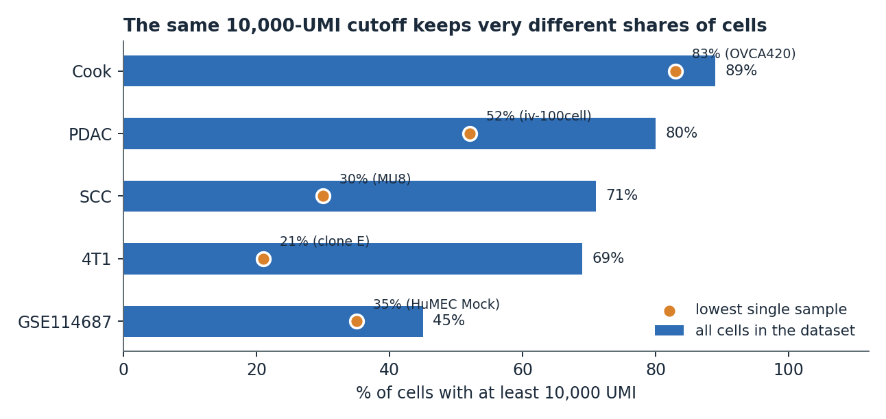

**Figure A1 explained.** Blue bars: the share of all cells in each dataset with at least 10,000 UMI (Cook 89%, PDAC 80%, SCC 71%, 4T1 69%, GSE114687 45%). Orange dots: the lowest single sample (SCC tumour MU8 30%, PDAC library iv-100cell 52%, 4T1 clone E 21%, GSE114687 HuMEC Mock 35%, Cook OVCA420 83%). "Cleaned" therefore means "most cells" in Cook and "under half" in GSE114687, and a whole clone (4T1 E, 142 cells left) can drop out of the analysis. In SCC the multiome assay keeps 50% and the scRNA assay 86%.

**Finding 3: SCC has no cleaning arm, and pooled cleaned fits exist only for 4T1 and PDAC** (as far as the scripts and result folders show). The Cook, SCC and GSE114687 pooled fits appear to use the lighter QC. This limits how directly pooled results compare across datasets (Section 9.8).

**Finding 4: two free choices were never tested.** The 4T1 contamination cutoff (0.3) was set by eye, and the 10,000-UMI cutoff was borrowed from Cook and PDAC (no scan). PDAC cleaned fits on the KS genes were never run.

### 9.4 Code changes (code only; no old result touched)
All new options default to the old behaviour. The old settings were checked to reproduce the old observed t-ratio exactly on one small unit of each dataset (Cook OVCA420 0.4446, PDAC M1-Met 0.4586, 4T1 EM2 0.4721, GSE114687 MCF10A Mock 0.6310) before anything was queued. Non-default settings write to **new** output folders (suffixes below), so old and new can be compared side by side.

| Script | New option | Output suffix |
|---|---|---|
| `Breast Cancer/GSE114687_pseudospace/codes/08_within_unit.py` | `--drop-human-tech` (MALAT1, NEAT1, HBB, HBA1, HBA2) | `_ht` (UMI sweep adds `_t5000`, `_t15000` through the existing `--min-umi` and `--out-suffix`) |
| `Mouse_SCC/Cook/codes/07_within_line_clean.py` | `--drop-human-tech` (same list) | `_ht` |
| `Breast Cancer/Mouse_4T1_GSE303505/codes/08_within_unit.py` | `--min-umi`, `--dc-cut` | `_u<value>`, `_c<value>` when not 10,000 and 0.3 |
| `Mouse_SCC/Mouse_PDAC_GSE173958/codes/08_within_unit.py` | `--min-umi` | `_u<value>` when not 10,000 |

The human list is deliberately short. The mouse list also contains liver ambient-RNA genes (Alb, Apoa1, Saa1, Serpina1...) that are contamination in PDAC but real expression in cultured breast cells; a first version dropped SAA1, SAA2 and SERPINA1 in the human data and was corrected before any fit was run.

### 9.5 Flow of the reruns
1. Edit and check the four scripts (Section 9.4).
2. Write `docs/cleaning_audit/gen_jobs.py`, which lists every fit to run, in priority order, as `jobs.tsv` (id, expected result file, command). 104 fits in five groups:
   - Cook, cleaned per-line fits with the human fix: 18 fits (4 lines, all genes and KS, k = 3 and 4, plus A549 time-balanced).
   - GSE114687, cleaned within-sample fits with the human fix: 24 fits (6 units, all genes and KS, k = 3 and 4).
   - 4T1 contamination cutoff 0.2 and 0.5: 20 fits (5 clones, all genes and KS, k = 3).
   - PDAC cleaned KS fits: 18 fits (9 units, k = 3 and 4).
   - GSE114687 UMI sweep at 5,000 and 15,000: 24 fits (6 units, all genes and KS, k = 3).
3. Run them with `docs/cleaning_audit/run_queue.py`, four fits at a time (the machine has 16 GB; one fit uses about 350 MB and one core). A fit whose result file already exists is skipped, so the queue can be stopped and restarted without losing work. Each fit writes its own log; `logs/queue.log` records start, done and fail lines.
4. Compare old and new with `compare.py` (writes `COMPARE.md`), track with `progress.py` (writes `PROGRESS.md`), draw the figures with `make_figures.py`.
5. Score the Hallmark sets at corners with `hallmark_scc_4t1.py` (SCC and 4T1, the two datasets that never had this check).

All 104 fits finished with no failures (started 01:58, finished 07:00 on 17 October; one fit takes 1.5 to 25 minutes, median 12). The fits themselves are unchanged: 200 shuffles, 15 PCHA starts for the real fit, 5 per shuffle, seed fixed.

### 9.6 Results

#### 9.6.1 The human technical-gene fix changes nothing

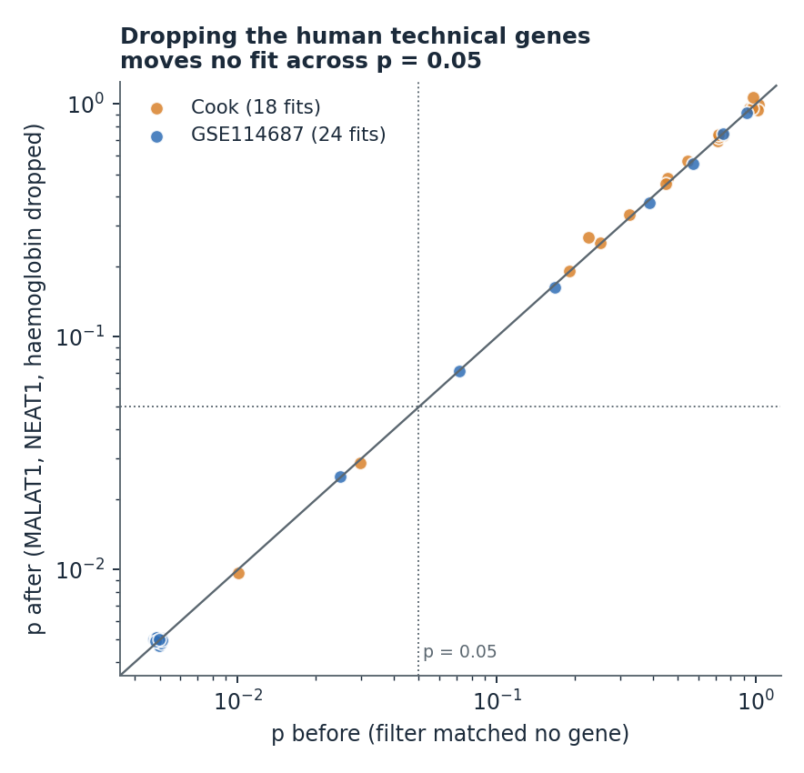

**Figure A2 explained.** Each dot is one fit (orange Cook, 18 fits; blue GSE114687, 24 fits). Horizontal axis: the permutation p with the old filter (which matched no gene); vertical axis: the p after dropping MALAT1, NEAT1 and haemoglobin genes. The diagonal is "no change"; the dotted lines mark p = 0.05. Every dot sits on the diagonal (a few are jittered apart for visibility); none crosses a dotted line.
- **Cook:** all 18 fits keep their pass or fail status. A549 on all genes at k = 3 still passes (p = 0.010 before and after) and still fails when time-balanced (0.224 to 0.269). MCF7 on KS genes at k = 3 still passes (0.030). KS fits are identical to three decimals, as expected, since MALAT1 and NEAT1 are not KS genes.
- **GSE114687:** 18 of 24 cleaned fits pass before and after (all genes 11 of 12, KS genes 7 of 12). The largest change is one fit (HuMEC both arms, all genes, k = 3: 0.925 to 0.886), a fail either way.
- Conclusion: the figure "18 of 24" in Section 7.5 stands. Only the wording "technical genes dropped" needed correcting.

#### 9.6.2 The 4T1 contamination cutoff (0.2, 0.3, 0.5)

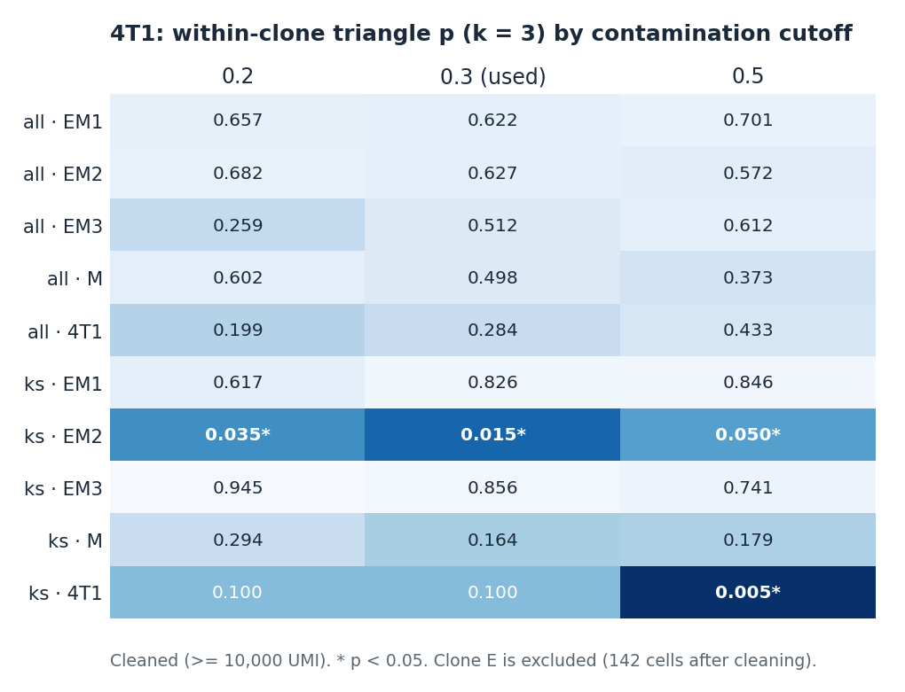

**Figure A4 explained.** Rows are within-clone fits at k = 3 (all genes, then KS genes; the five clones with enough cells after cleaning), columns are the cutoff on the immune and stromal panel score (a stricter 0.2, the 0.3 used in Section 6, a looser 0.5). Numbers are permutation p; darker is smaller; a star marks p below 0.05. Looser cutoffs keep more cells (for example EM3: 1,208, 1,507 and 1,582 cells at 0.2, 0.3 and 0.5).
- **All genes:** no clone passes at any cutoff (0 of 5 at each). "Within a single clone there is almost nothing" does not depend on the 0.3 chosen by eye.
- **KS genes:** clone EM2 passes at all three cutoffs (0.035, 0.015 and 0.050; the last is borderline, p = 0.0498). The parental 4T1 clone passes only at 0.5 (p = 0.005, against 0.100 at 0.3 and 0.2). A looser cutoff leaves more immune and stromal cells, which can form a corner of their own; the corner genes of this fit were not checked, so this one pass is unexplained.

#### 9.6.3 PDAC cleaned KS-gene fits (never run before)

| Unit | KS k = 3 | KS k = 4 | All genes k = 3 (Section 5.4) |
|---|---|---|---|
| M1-SS | 0.333 | **0.005** | **0.005** |
| M1-PT | 0.990 | 0.154 | **0.020** |
| M1-Liver | 0.995 | 0.970 | **0.020** |
| M1-Met | 0.627 | 0.597 | 0.517 |
| M2-PT | 0.622 | 0.910 | **0.005** |
| M2-Liver | 0.856 | 0.746 | **0.005** |
| M2-Met | 0.124 | **0.040** | **0.005** |
| Mouse 1 (all libraries) | 1.000 | 0.985 | 0.124 |
| Mouse 2 (all libraries) | 0.866 | **0.025** | **0.005** |

On the EMT genes alone **no unit passes at k = 3** (0 of 9, against 7 of 9 on all genes). Three of nine pass at k = 4 (M1-SS, M2-Met, mouse 2); k = 4 is beyond the smallest k that passes in the all-genes fits, so these are weaker evidence. The within-library triangles in PDAC therefore come from the other programmes (proliferation, hypoxia, epithelial identity), not from the EMT genes, which agrees with Section 5.5.

#### 9.6.4 GSE114687 UMI cutoff (5,000, 10,000, 15,000)

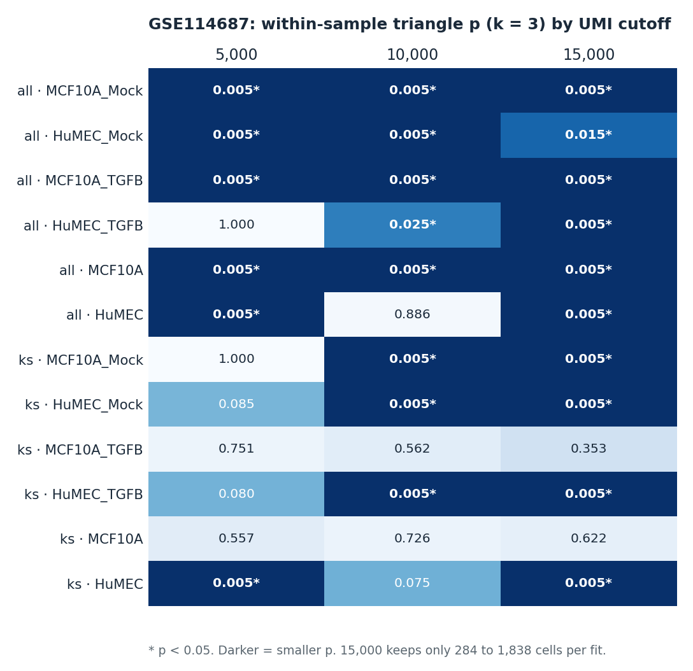

**Figure A3 explained.** Rows are the six within-sample units for all genes and KS genes at k = 3 (human technical genes dropped); columns the UMI cutoff. Numbers are permutation p, a star marks p below 0.05. Cells kept differ a lot by column: at 5,000 every unit is capped at the 4,000-cell fit limit (a random subsample); at 10,000 the units keep 2,536 to 4,000 cells; at 15,000 only 284 to 1,838.

| Passing fits out of 6 | 5,000 | 10,000 | 15,000 |
|---|---|---|---|
| All genes | 5 | 5 | 6 |
| KS genes | 1 | 3 | 4 |

- **All genes:** the three MCF10A units (Mock, TGF-β, both arms) pass at every cutoff with p = 0.005. HuMEC is the fragile cell line: HuMEC TGF-β fails at 5,000 (p = 1.000), only just passes at 10,000 (0.025) and passes at 15,000; HuMEC (both arms) fails at 10,000 (0.886) but passes at 5,000 and 15,000.
- **KS genes:** a KS-only triangle exists in MCF10A Mock, HuMEC Mock and HuMEC TGF-β at 10,000 and 15,000 but **not at 5,000**. So the claim that the EMT genes alone give a triangle needs cells with at least about 10,000 UMI. This agrees with the depth control in Section 7.8, which tested the 10,000-cell version directly, and means the claim is tied to a depth condition.
- At 15,000 so few cells remain that a pass is a smaller sample, not automatically stronger evidence.

#### 9.6.5 Hallmark check of corner names for SCC and 4T1 (the two datasets without one)
Method as in Sections 5 and 7 (code `docs/cleaning_audit/hallmark_scc_4t1.py`): the 10% of cells nearest each corner are scored on MSigDB Hallmark sets (mean z of the set's genes; score = nearest 10% minus the rest; mouse symbols are the capitalised human symbols); the highest set is reported.

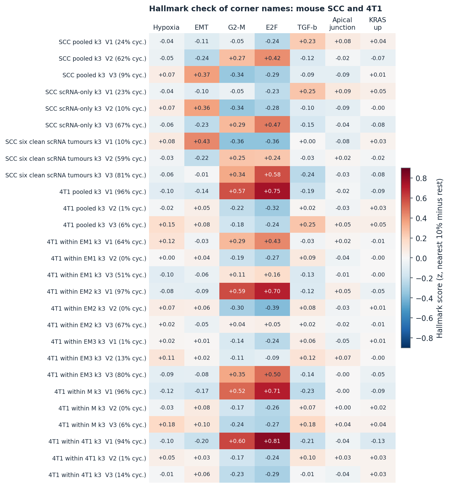

**Figure A5 explained.** Rows are corners (with the share of cycling cells, S or G2M, among the cells nearest the corner); columns the seven Hallmark sets; red means the set is higher near the corner, blue lower.
- **4T1:** in the pooled cleaned fit and every within-clone fit the cycling corner (94 to 97% cycling cells; 64 to 80% in the weaker EM1 and EM3 fits) is top on E2F targets (+0.43 to +0.81) and the G2-M checkpoint. Clone M's corner in the pooled fit scores highest on TGF-β (+0.25) and hypoxia (+0.15). The epithelial-leaning corner has no strong Hallmark set (EMT +0.05). **No 4T1 corner is named by an EMT set.** This confirms the Section 6 reading: the corners are cell division and clone identity.
- **SCC:** the proliferating corner is top on E2F and G2-M (E2F +0.42, +0.47 and +0.58 in the three fits), the late-EMT corner top on EMT (+0.36 to +0.43), as named. The corner called technical has no set above +0.25 (TGF-β +0.23 to +0.25, a weak match), which is consistent with an axis that is not a biological programme.
- The Hallmark check now covers all five datasets (PDAC, Cook and GSE114687 were done earlier).

### 9.7 What holds and what depends on cleaning

| Finding | Holds under the cleaning variants tried? |
|---|---|
| Pooled over samples, EMT genes give no simplex beyond sample identity | Yes (unchanged by every rerun) |
| Corners that appear are programmes, not EMT states | Yes (Hallmark now confirms for all five datasets) |
| Hybrid cells are mostly generalists | Not re-tested here; checked under light QC and cleaned in 4T1 (72 to 85% and 83 to 87%) |
| 4T1: almost nothing within a single clone | Yes (0 of 5 on all genes at every cutoff; one unexplained KS pass at 0.5) |
| PDAC: within-library triangles are not made by EMT genes | Yes (KS k = 3: 0 of 9) |
| GSE114687: a triangle inside a sample after cleaning | Yes for MCF10A on all genes at 5,000 to 15,000; HuMEC depends on the cutoff |
| GSE114687: the EMT genes alone give a triangle | Only at 10,000 UMI or more |
| Cook: A549 triangle | Depends on cleaning and on time balance (unchanged) |

### 9.8 Limits of the audit and what was not done
- The datasets still differ in how they are cleaned (Section 9.2): SCC has no cleaning arm, pooled cleaned fits appear to exist only for 4T1 and PDAC, and the contamination step differs by tissue. These differences are real properties of the datasets and were left as they are; results are compared as patterns that hold in each dataset, not as numbers across datasets.
- The UMI sweep was run for GSE114687 only. The 4T1 and PDAC UMI cutoffs, and the SCC cleaned arm, were not scanned.
- The path-versus-triangle test was not run for SCC, PDAC and the new fits; the planted-triangle power check was not run.
- Shuffle p-values floor at 0.005 (200 shuffles); a "star" on a 15,000-UMI fit uses far fewer cells.
- The one unexplained pass (4T1 parental, KS genes, cutoff 0.5) was not followed up.

### 9.9 Files and reproduction
Everything is in `docs/cleaning_audit/`: `SUMMARY.md` (short results), `COMPARE.md` (old versus new p for every fit), `HANDOFF.md` (how to continue), `PROGRESS.md`, `jobs.tsv`, `gen_jobs.py`, `run_queue.py`, `run_job.sh`, `progress.py`, `compare.py`, `make_figures.py`, `hallmark_scc_4t1.py`, `hallmark_scc_4t1.csv`, `figures/` and `logs/`. To rerun (from `Project_1/`, with `.venv`; do not use `python -I`, which breaks the local `scc_common` import):
```
nohup python3 docs/cleaning_audit/run_queue.py > docs/cleaning_audit/logs/queue_stdout.log 2>&1 &   # resumable, 4 at a time
python3 docs/cleaning_audit/compare.py                 # COMPARE.md
.venv/bin/python docs/cleaning_audit/hallmark_scc_4t1.py
.venv/bin/python docs/cleaning_audit/make_figures.py
```
New result folders sit next to the old ones in each dataset's `results/within_unit/` (or `within_line/`) with the suffixes in Section 9.4.

---

## 10. Gaps in the analysis

| # | Gap | Why it matters | Cheapest fix |
|---|---|---|---|
| 1 | No like-for-like control against breast | The positive Pal triangle in the breast chapter used MAGIC-imputed scRNA with the KS genes; the mouse and cell-line fits are raw. Imputation can sharpen or create shape. | Breast without MAGIC; mouse SCC with MAGIC ("arm C") |
| 2 | Line versus triangle tested in only three of five datasets | A smooth EMT path can mimic a triangle. SCC and PDAC were never tested against one. | Run `08c_path_vs_triangle.py` on both; redo GSE114687 with the authors' pseudospace trajectory |
| 3 | Gene sets | 42 of 218 KS genes are absent in mouse; Hallmark EMT was used only to name corners, never to fit. | Fit on Hallmark EMT and on a mouse-specific EMT list |
| 4 | Circular labels | PDAC, 4T1 and GSE114687 EMT states are cut from the same KS score they are compared with; SCC states come from clustering the same data. | An independent EMT score or protein markers |
| 5 | Power and multiple testing | p floors at 0.005 with 200 shuffles; hundreds of fits; no simulation of a known weak triangle. | Plant a triangle in shuffled data and measure how often the test finds it; correct for multiplicity |
| 6 | Design | One tumour per clone (4T1); two mice (PDAC); no replicates (GSE114687); tumour, assay and state tangled (SCC). | A dataset with several samples per EMT state |
| 7 | Cleaning is a free parameter | It reveals triangles in PDAC and GSE114687 and removes them in 4T1; no threshold scan; the 4T1 contamination cut (0.3) was set by eye. | Repeat cleaned fits over a grid of UMI and contamination thresholds |
| 8 | Corner names not checked independently for 4T1 and SCC | Hallmark check was run for PDAC, Cook and GSE114687 only. | Run `09_hallmark_corners.py` on SCC and 4T1 |
| 9 | No batch-corrected run | The SCC technical axis is unresolved; tumour fingerprints explain 40 to 65% of leading PCs. | A Harmony run, compared with the raw fits |
| 10 | Only k − 1 PCs enter a fit | PC1 and PC2 hold about 14% of variance in SCC; shapes outside that plane are invisible. | Report variance explained by each simplex; try fits in more PCs |
| 11 | Snapshots | Static data cannot show trade-offs; only Cook (time) and GSE114687 (position) have an independent axis. | Time-resolved datasets |

**Status of these gaps after the 17 October audit (Section 9):**
- **Gap 3 (gene sets):** unchanged (not addressed).
- **Gap 7 (cleaning is a free parameter):** partly addressed. GSE114687 UMI cutoff scanned at 5,000, 10,000, 15,000; 4T1 contamination cutoff scanned at 0.2, 0.3, 0.5; PDAC and 4T1 UMI cutoffs and SCC not scanned. A bug (the technical-gene filter did nothing for human data) was found and fixed.
- **Gap 8 (corner names not checked independently for 4T1 and SCC):** closed. Hallmark check run for both (Section 9.6.5).
- **Gap 6 / PDAC cleaned KS fits** (noted in Section 5.4): closed (0 of 9 at k = 3).
- **Gaps 1, 2, 4, 5, 9, 10, 11:** unchanged. Gap 2 (path test on SCC and PDAC) is the most useful one left.

**What a positive result would look like:** p < 0.01 on EMT genes at the same k in several independent samples; a hybrid corner that survives leaving out any one sample; a triangle that beats a one-dimensional EMT path; corners named the same way by an independent gene set; holds with and without imputation and across cleaning thresholds.

## 11. Next steps, in priority order
1. **Like-for-like control against breast** (gap 1): breast without MAGIC and mouse SCC with MAGIC.
2. **Path test on SCC and PDAC** (gap 2), and on the audit's new fits; GSE114687 with the authors' trajectory.
3. **Cross-dataset table of robust versus cleaning-dependent findings** (Section 9.7 has the first version): extend it with a UMI sweep for 4T1 and PDAC and decide how to treat SCC (no cleaning arm).
4. **Follow up the one unexplained pass** (4T1 parental clone, KS genes, contamination cutoff 0.5): look at its corner genes.
5. **Planted-triangle power check** (gap 5), and one fit on Hallmark EMT genes (gap 3).
6. **A better-designed dataset** (gap 6), chosen with the supervisor.

Done since version 1: Hallmark check for SCC and 4T1; contamination and UMI cutoff scans (partial); PDAC cleaned KS fits.

---

## 12. Appendices

### A. The honesty log: what changed after looking
- **SCC.** The scRNA-only fit was added after seeing the technical corner. Removing the technical axis by regression gave p = 0.04 but also removed EMT signal (Krt14 slope 1.04, Col1a1 slope −1.06); it was withdrawn as an artefact and so were the within-tumour fits and cross-projection built on the corrected data. An earlier argument that the Malat1 signal showed V1 was nuclear RNA was wrong and was withdrawn.
- **Cook, PDAC, 4T1, GSE114687.** Cleaned within-sample fits (≥ 10,000 UMI) were added after the first fits.
- **4T1.** The contamination cut (0.3) was set by eye; a first marker panel that included genes tumour cells express (S100a8/9, Cd74, H2-Aa) flagged up to 99% of cells and was replaced.
- **GSE114687.** No predictions file. The path test uses the EMT score, not the authors' pseudospace trajectory. A depth control (regression and depth matching) was added to test the cycling corner; it was run on the 8 fits that passed, and the UMI-threshold scan was not run. A copied `run_fits.sh` initially pointed at the 4T1 folder and re-summarised 4T1 fits: the 4T1 p-values and fit files were untouched, the `sec_per_shuffle` column of two 4T1 `fit_summary.csv` files was restored from values printed earlier, and 4T1's step-3 log files were overwritten (their progress lines are lost).
- **Cleaning audit (17 October).** The audit was started after the report was written, because the cleaning step had changed results in opposite directions. It found that the technical-gene filter matched no gene in the human data and that the 10,000-UMI cutoff keeps 21% to 89% of cells depending on dataset and sample. The rules were not made identical across datasets; the filter was fixed and the free cutoffs tested. A first version of the human gene list also dropped SAA1, SAA2 and SERPINA1; this was corrected before any fit was run because those genes are expressed by cultured breast cells. One unexplained pass (4T1 parental, KS genes, cutoff 0.5) was left as is.
- **Depth control.** The first launch ran 16 jobs at once on a 16 GB machine and swapped; it was stopped and rerun with 4 at a time on the 8 fits that matter.

### B. Where things are (all under `/Users/apple/Desktop/thesis_iisc/Project_1`)

| Dataset | Code | Results | Figures | Write-up |
|---|---|---|---|---|
| SCC | `Mouse_SCC/codes/` | `Mouse_SCC/results/` | `Mouse_SCC/research_report/figures/`, `results/*/` | `Mouse_SCC/WALKTHROUGH.md`, `research_report/Research_Report.md` |
| Cook | `Mouse_SCC/Cook/codes/` | `Mouse_SCC/Cook/results/` | `.../results/mail_figures/` | this report |
| PDAC | `Mouse_SCC/Mouse_PDAC_GSE173958/codes/` | `.../results/` | `.../results/mail_figures/` | this report |
| 4T1 | `Breast Cancer/Mouse_4T1_GSE303505/codes/` | `.../results/` | `.../results/mail_figures/` (7 figures) | `.../RESULTS.md` |
| GSE114687 | `Breast Cancer/GSE114687_pseudospace/codes/` | `.../results/` | `.../results/mail_figures/` (6 figures) | `.../RESULTS.md` |

Audit outputs (17 October): `docs/cleaning_audit/` (summary, old-versus-new tables, queue scripts, figures, Hallmark scores for SCC and 4T1). Shared engine: `src/archetypes.py`. Slide decks: `EMT_archetype_analysis_FINAL_DECK.pptx` (this analysis), `Mouse_EMT_archetype_analysis_four_datasets.pptx` (earlier four-dataset deck).

### C0. Reproducing the cleaning audit
See Section 9.9 (one resumable command, `docs/cleaning_audit/run_queue.py`).

### C. Reproducing a dataset (from `Project_1/`, using `.venv`)
```
.venv/bin/python -u "<dataset>/codes/01_build_anndata.py"
.venv/bin/python -u "<dataset>/codes/02_pca.py" --geneset all     # and --geneset ks
bash "<dataset>/codes/run_fits.sh" all main 200                    # and ks
.venv/bin/python -u "<dataset>/codes/04_describe_simplex.py" --geneset all --k 3
.venv/bin/python -u "<dataset>/codes/08_within_unit.py" --unit <sample> --geneset all --k 3 --clean
```
Cleaned pooled fits use `EXPR_NAME=<cleaned file>.h5ad`. Memory: no more than about 4 within-unit fits at once on a 16 GB machine.

### D. Glossary
- **Archetype / corner / vertex:** a fitted corner of the simplex; a cell type that specialises in one task.
- **Specialist / generalist:** a cell near one corner / a cell in the interior (a mixture).
- **t-ratio:** simplex volume divided by convex-hull volume of the data.
- **ESV:** explained sample variance of a k-corner simplex in the first 10 PCs.
- **p (permutation):** share of 200 shuffled datasets (plus 1) that fit a simplex at least as well; the minimum is 0.005.
- **Gap rule / closest-5% rule / weight > 0.95:** three definitions of specialist (Section 1.3).
- **KS genes:** the Tan 2014 epithelial and mesenchymal signature genes used to score EMT.
- **Cleaning:** removing cells with fewer than 10,000 UMI (and, for 4T1, immune and stromal cells; for PDAC, technical genes).
- **Pseudospace:** distance from the colony edge as an EMT axis (GSE114687).
- **Path-versus-triangle test:** tests whether a triangle is needed beyond a one-dimensional EMT path.

---
*End of report.*
